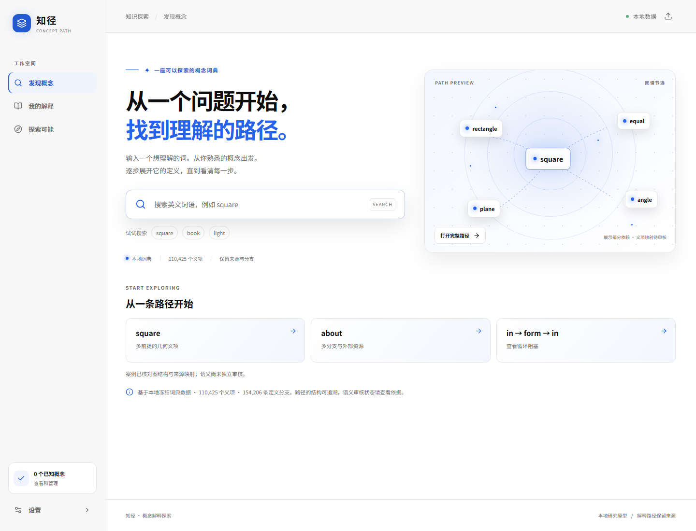

# 知径：交互式概念词典

本地研究原型，使用冻结的 OEWN 定义依赖超图，探索由用户明确标记的已知义项出发的解释路径。操作界面为中文，释义保留英文原文。本项目不调用模型，不上传数据，也不对公网开放。



## 在 Windows 上运行

需要 Python 3.10+ 和 Node.js（20.19+，或 22.12+）及 npm。首次在本项目目录运行：

```powershell
python -m pip install -r requirements.txt
cd frontend
npm install
npm run build
cd ..
python -m backend.index
.\start.ps1
```

打开 http://127.0.0.1:8000 。服务在本机运行，关闭命令窗口即停止。以后直接运行 `.\start.ps1`；首次启动若索引不存在也会自动生成索引。索引记录在 `data/graph.sqlite3`，不修改原始数据。

默认从上一级目录的 `OEWN` 读取冻结包。换位置时在启动前设置：

```powershell
$env:CONCEPT_BUNDLE = 'D:\path\to\frozen-bundle'
python -m backend.index --rebuild
.\start.ps1
```

切换数据版本或出现索引版本不一致时，先停止服务，再运行 `python -m backend.index --rebuild`。每次启动会按数据包清单校验规则、义项表和来源索引的 SHA-256，并与已建索引绑定的输入摘要对比；索引保存数据指纹和节点及分支数量。若原始文件缺失或校验失败，按提示恢复数据包。索引是本项目可重新生成的本地缓存；原数据仍是权威来源。校验文件与随包清单一致，并不证明数据来源、许可或语义正确。

## 如何使用

搜索英文词形并选择义项；点击“我懂”明确标记或撤销已知概念；点击“解释这个概念”展开，使用分支选择器切换完整分支。路径视图与解释卡片对应，依据侧栏列出快照释义、分支来源和原记录状态。首页提供三个结构案例；[核查记录](docs/cases.md)说明它们的边界。

“探索可能”计算从已知集合出发，使用任意可用分支可达的目标；加入一个候选概念可查看新增目标，但不会自动标记它为已知。解释页面的可达状态则会考虑已经手动选择的分支。排序成本是规则展开的启发式，包含重复使用的成本，不能解释为认知难度或最佳学习顺序。

学习状态和主题存于当前浏览器。解释卡片可导出 JSON 并在相同数据版本下导入；分享按钮生成的本机链接也包含状态，其他电脑需先运行相同版本的本地实例。链接和卡片含已知概念列表，请按需分享。

设置中可以切换四种主题、调整释义字体、减少动态效果、设置新解释的路径视图、管理已知概念并查看本地数据状态。最近探索最多保留 20 条，切换目标后可恢复各目标的展开与分支；已知概念在当前浏览器共享。设置中的“清除记录”不会清除当前解释，“重置当前学习状态”不会清除最近探索；两项操作均需在界面中确认。

## 范围与验证

规则中同一分支为联合前提，不同分支为备选；闭包只从用户明确标记的概念开始，不把 85 个 basis 自动视为用户已知。循环不能自行产生可达结论。图路径和来源映射不证明词义、义项消歧或释义语义正确。部分依赖是介词或错误义项，必须经过独立语义审核才能作为经过审定的解释。

可运行 `python -m unittest discover -s tests -v`，以及在 `frontend` 内运行 `npm test`、`npm run format:check` 和 `npm run build`。已提供 GitHub Actions 检查配置；配置存在不代表 CI 已运行。服务只监听 `127.0.0.1`，研究原型尚无多用户身份认证，不能直接部署到公网。无独立人工审核、用户实验或学习效果结论；公开发布前的具体缺口见[发布准备记录](docs/release-readiness.md)。
