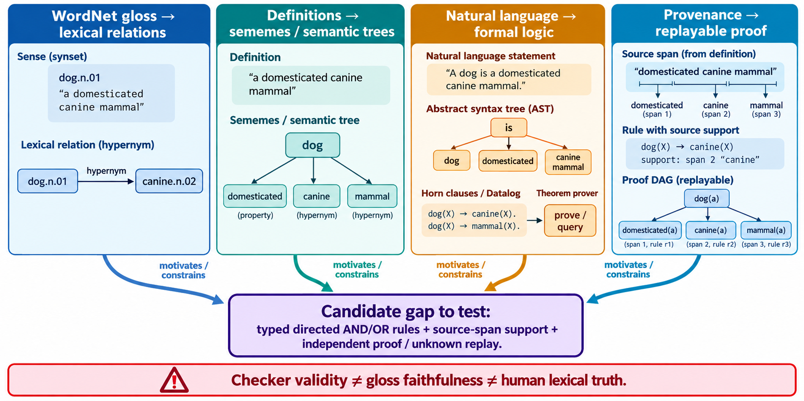

# 相关工作检索与方法学审计（2026-10-03）

## 范围与结论边界

这是对既有相关工作梳理的**快速、定向 scoping 补充**，不是穷尽系统综述或新颖性审计。问题被拆成三段：

1. WordNet/词典定义是否已被转成 sense-aware 表示、语义组件或词汇关系？
2. 一般自然语言/数学定义到形式逻辑、依赖项或可机检证明已经发展到什么程度？
3. 现有 provenance、存在性检查和证明证书分别能验证什么，不能验证什么？

纳入优先级为 2023–2026 正式 ACL/EMNLP/AAAI proceedings；对直接词汇语义先例，即使是 Global WordNet Conference / LREC，也纳入并单独标明 venue。综述论文用于概念框架，不当作实证系统基线；预印本、workshop 与 symposium 不冒充主会技术论文。检索式、来源访问状态和入选记录见[机器可读日志](../sources/literature_screening_log_2026-10-03_cross_database_audit.json)。

检索入口覆盖 ACL Anthology、AAAI OJS、Crossref REST、arXiv API 和补充网页检索。搜索引擎/官方站点没有提供可导出的统一去重候选集；Crossref 查询产生极宽泛总量；OpenAlex 与 Semantic Scholar API 限流，DBLP 返回 bot challenge，arXiv 的严格 AND 查询为零。因此本轮**不报告 PRISMA 流程数、不声称检索穷尽，也不由“未搜到完全同一组合”推出新颖性**。更强的系统检索仍需取得可导出数据库结果、双人筛选并做引用链追踪。

## 新增全文复核

- **Mensfelt et al. (2026), “Towards a Common Framework for Autoformalization,” AAAI 2026 Proceedings, Emerging Trends track**。官方 PDF 将数学形式化、逻辑推理/声明式编程、规划和知识表示中的自然语言形式化统一讨论；作者称综述 81 篇研究，但也明确说综述并不穷尽，且子领域边界交叠。最可迁移的设计是区分语义等价标准 E（输入与形式输出应保持的意义关系）与可计算验证标准 V（对 E 的操作性近似）。这是框架/综述，不是 WordNet 算法或效果基线；出版记录需精确称为 AAAI proceedings 的 Emerging Trends track，不能写成 AAAI technical-track 实证论文。[官方页面](https://ojs.aaai.org/index.php/AAAI/article/view/42132) · [PDF](https://ojs.aaai.org/index.php/AAAI/article/view/42132/46093)。
- **Wang et al. (2026), “Improving Autoformalization Using Direct Dependency Retrieval,” ACL 2026 Long Papers**。全文介绍 DDR 生成候选 Mathlib 依赖、Suffix Array Check (SAC) 核验条目是否存在，并在数学形式化任务上测 retrieval precision/recall、Type Checking 和 BEq。其机制可验证“ID 是否属于此形式库版本”，但作者在局限中指出简称不能精确定位完整条目/元数据，并且形式库跨版本会增删改名。对本项目最重要的边界是：sense/原语 ID 存在且版本吻合，不等于概念同义、规则成立或 gloss 支持该规则；存在性校验必须与语义 faithfulness gold 分开。[官方页面](https://aclanthology.org/2026.acl-long.821/) · [PDF](https://aclanthology.org/2026.acl-long.821.pdf)。
- 与既有全文复核合并看，**SememeLP (EMNLP 2025)** 与 **Structured Sememe Knowledge (ACL 2026)** 已覆盖“定义→语义组件/树→词汇 KG 补全或 lexical relation/graded entailment”；**FormalScience、HBLR、DeepProofLog** 分别覆盖形式忠实度风险、选择性形式化/拒答和 proof search 扩展性。它们压缩了宽泛 novelty claim 的空间，但并未证明一个具体的有类型 AND/OR Horn + source-span support + 可重放 unknown/proof 组合已经新颖。

## 2026-10-03 追加：AST 形式化与模块化逻辑系统

- **Putra et al. (2026), NL2Logic, Findings EACL 2026**。官方全文描述递归 LLM semantic parser 构建 FOLAST，随后确定性两遍生成 solver code；实验使用 3,000 个 FOLIO/LogicNLI/ProofWriter premise–hypothesis 对，语法正确率最高约 0.99，并以 NLI accuracy 间接评估语义正确性。论文摘要称相对 GCD 平均提升约 30%；不同基准/模型的逐项表现有差异，FOLIO 上部分较大模型并非均有提升。作者明确列出翻译前提不一致/不可满足会误导 proof、跨句 coreference/implicit relation 处理不足等限制。此文是 AST-guided parser/compiler 的强邻接方法，不是 WordNet sense/gloss support gold，也不证明逐规则 faithful。[官方页面/PDF](https://aclanthology.org/2026.findings-eacl.317/) · [全文 PDF](https://aclanthology.org/2026.findings-eacl.317.pdf)。
- **Kartac et al. (2026), UFAL-CUNI at SemEval Task 11**。官方全文把 FOL parser、transpiler、Prover9、translation 与 premise relevance 拆成模块；相关 premise 通过移除候选 premise、重跑 prover 判断。扩展验证集部分由前 500 个训练样例合成；这是三段论共享任务系统，不能视为 WordNet definition benchmark。[官方页面/PDF](https://aclanthology.org/2026.semeval-1.418/) · [全文 PDF](https://aclanthology.org/2026.semeval-1.418.pdf)。
- **Cima et al. (AAAI 2026 KRR)** 的 Hybrid Knowledge Base 将 ontology axioms 与 concept/role 的 ML classifiers 组合，研究模型语义、consistency 和 query answering 的复杂度；论文把 ASP encoding 实证验证列作未来方向。它排除“神经与符号结合本身足够新”的说法，但没有做自然语言定义到规则的自动获取。[官方页面](https://ojs.aaai.org/index.php/AAAI/article/view/38971) · [PDF](https://ojs.aaai.org/index.php/AAAI/article/download/38971/42933)。

本补充的精确查询、纳排、全/摘要筛读状态和任务边界见[结构化日志](../sources/literature_screening_log_2026-10-03_logic_pipeline.json)。三篇全文是本次人工定向纳入数，并非总检索命中数；不作 PRISMA 计数或 novelty conclusion。

## 2026-10-03 定向补充：语义 critic 与来源忠实度

另查 ACL Anthology、AAAI OJS、NeurIPS proceedings、OpenReview 与 arXiv，精选核对三项近年工作；逐项查询、venue、全文级别和限制见[机器可读筛读日志](../sources/literature_screening_log_2026-10-03_critic_source_fidelity.json)。

- Peng et al., **CriticLean (ACL 2026 Long Papers)**：把 Lean compiler validity 与形式化语义 critic 分离。其 500-item benchmark 与人工评估结果提示，单测编译会漏掉语义错配；但 critic 基于模型判断，作者也承认小规模评测、基础生成器候选瓶颈及 critic 自我偏差风险。对本项目只能导出“用 NLI/LLM 辅助预筛并与盲标对照”的设计建议，不能拿 Lean benchmark 分数代替 WordNet gloss support gold。
- Li et al., **Harmful Factuality (Findings of EACL 2026)**：指出输出可能更符合外部事实、却更不忠于输入来源，并以受控实体扰动量化。这个区分与项目特别相关：`source_span/gloss supports rule` 和 `WordNet/external evidence supports relation` 必须分别判定；知识冲突应显式记录、abstain 或交人工复核，不可无痕替换原定义内容。其数据为 WikiEntities 和指定模型设置，不能外推成 WordNet 实证结论。
- Wei et al., **Semantic-KG (NeurIPS 2025 Datasets and Benchmarks Track)**：本轮仅筛官方摘要；其多域 KG 派生语义相似 benchmark 报告方法表现取决于领域与差异子类。只据此建议按 AND/OR、方向、sense/source 和属性变化拆分扰动子集，不把通用语义相似度评测当成 lexical entailment/source support gold。

本轮查询未产生可导出的统一候选集合或稳定去重计数；不报告 PRISMA 流程数，也不声称覆盖全部 2026 ACL/NeurIPS/AAAI 论文。定向综述只能收窄研究主张，不能证明剩余组合新颖。

## 新增：ACL 2026 source-grounded KG refinement 近邻

定向搜索另外找到并全文复核 Kim et al., [*LLMs as Knowledge Graph Refiners: Mitigating Factual Inconsistencies in Generative Knowledge Extraction*](https://aclanthology.org/2026.acl-long.1353/)（ACL 2026 Long Papers）。GraphRefine 对生成 KG 三元组执行 KEEP、DELETE、FIX 或 REWRITE，区分事实层错误（不受来源支持、实体/关系误识别）与表示层问题（含糊、冗长），并报告多个数据集上的 KG 质量指标。论文的人审协议抽取 80 个 KG、658 条 triple，三人多数表决的一致性 κ=0.67；对不一致项再协商类型。值得借鉴的是把模型输出错误分解、同时报告修订与信息保留，而不是只报一个事实准确率。其 factualness 指标部分依赖 LLM fact checker，因此本项目仍须把 judge 分数与独立人工标签分开。

边界同样重要：GraphRefine 处理一般文档中的 KG 三元组，不是 WordNet 定义的 sense、必要/充分方向或 AND/OR Horn 公式；人工判断的粒度不能直接替代本项目的 rule-level `E_s` 标注，也没有证明证书。它是评测/错误分类的跨域参照，不是 matched baseline 或本项目性能证据。完整全文筛读和检索限制见[机器可读日志](../sources/literature_screening_log_2026-10-03_graphrefine.json)。

## 后续定向扫描：形式逻辑错配与语义验证

为补足“自然语言定义与形式 axioms 的逻辑运算符错配”这一具体问题，追加检索 ACL Anthology、AAAI OJS 和 arXiv。使用的发现查询、venue 状态与纳排记录见[VSPO 补充日志](../sources/literature_screening_log_2026-10-03_vspo_supplement.json)；没有导出稳定候选全集/去重命中数，故仍不报告 PRISMA 数量。本轮从 AAAI 官方页追到并全文筛读一篇直接相关主会论文：Choi et al., **VSPO: Validating Semantic Pitfalls in Ontology via LLM-Based CQ Generation**, AAAI 2026 KRR technical track。[官方出版页](https://ojs.aaai.org/index.php/AAAI/article/view/38969) · [官方 PDF](https://ojs.aaai.org/index.php/AAAI/article/view/38969/42931)。

VSPO 在六个 ontology 上构造 1,563 个 class/property 样例，报道 1,368 train、195 test，并以删除/省略 axiom 或替换 union/intersection 等受控错配构造 semantic-pitfall 场景；另报告 leave-one-ontology-out。对错配 CQsp，表 3 报告 VSPO P/R/F1 为 75.0/62.2/68.0，GPT-4.1 为 49.0/34.0/40.1；判定基于 Sentence-BERT 与参考 CQ 的 cosine 相似度阈值 0.7。这个结果是论文报告的 CQ-generation benchmark 结果，不是 WordNet 语义支持准确率或定理证明 soundness。作者限制包括 ontology 数少且 axiom 类型失衡、每个 term 只注入一次 axiom 错误、实际 ontology annotation 稀疏/歧义，以及仍需人工核验。

对本项目的增量是把“逻辑扰动”加入后续 challenge-set 设计：定向替换 AND/OR、反转必要/充分方向、删除一个定义约束、错配 sense/source，再由独立标注者判定原 span 是否支持规则、扰动后是否失真。编译器是否接受只测语法/片段合法性，不能证明它检出了语义错配；参考文本相似度也不能代替此 gold。已把该限制加入研究定位，尚未声称上述 challenge set 已构建或结果已测。

下图是主题关系示意，不是检索流程/命中数统计，也不表示候选 gap 已经证实新颖。

## 对项目方法与评测的直接修订

借鉴 E/V 区分，项目应在方法冻结前声明：

- **输入对象**：有固定资源版本、sense ID/POS、原始 gloss、来源记录与字符 span 的定义。不能把裸 lemma 或冻结图节点当成同一个义项。
- **目标形式**：有类型/论元的有向定义 claim，明示目标逻辑片段与编译器版本；保留 AND/OR、必要/充分方向、变量/作用域。超片段部分显式记 `unsupported/unknown`，不靠删掉难例制造高精度。
- **语义标准 E**：每条输出 claim 必须在标注的方向与粒度上被 gloss 支持，不能引入无根据的属性；若系统声称完整 formalization，还需覆盖所有与目标任务相关的定义内容，未覆盖部分显式记录。必要条件 `Target→Φ`、充分条件 `Φ→Target` 和 biconditional 应分别 adjudicate，不能互换。
- **可计算验证 V**：分层报告字符 span 是否在源记录中、predicate/sense/版本 ID 是否存在、AST/schema 是否良构、编译器是否保持声明的 Horn 片段、proof certificate 是否能由独立 checker 重放、人工双标对 E 的裁决及一致性。前四项及 proof replay 都只是局部 V；不能单独代替 E。

这要求保留至少三项不同结果，不设一个“已验证”布尔值：

| 结果 | 可回答的问题 | 不可推出 |
|---|---|---|
| Source/ID validation | 引用 span、sense、谓词和版本记录是否存在且可定位？ | 这些内容是否表达同一意义、是否支持规则 |
| Formal/proof validation | AST/程序是否在声明片段内良构，目标是否由输入规则推出？ | 输入规则是否忠实于 gloss 或符合人类词义判断 |
| Semantic validation | 双人/裁决标签是否支持该方向、范围与定义解读？ | 对未标注义项、其他版本或开放世界事实自动泛化 |

因此，当前 Datalog checker 与 witness/Datalog bridge 应被定位为 V 中的程序/证书层；源文件哈希与 span 定位属于 source integrity；`source_clause_alignment` 仍只是结构映射候选，不能写成语义支持验证。真正检验 E 的关键仍是未完成的 sense-disjoint 双人 gold slice、裁决和分层误差分析。

## 当前可辩护的研究假设

宽泛命题“从 WordNet 释义自动抽取语义组件、扩展知识图谱或预测上下位”已有直接近邻，不能宣称新。值得继续验证的窄问题是：在明确的义项/版本对象和 E/V 评价契约下，系统能否从 gloss 生成可审计、保留 AND/OR 和方向的 typed Horn claim；针对每条 claim 定位来源证据并由独立语义标注验证；再将结构闭包/形式证明证书与 unsupported/unknown 区分开。只有在 matched gold、matched splits、直接 sememe/hypernym 和 LLM+prover 基线下证明了质量/成本收益，才可讨论论文贡献或顶会有效性。

## 参考文献（本轮新增）

1. Mensfelt, A., Tena Cucala, D., Franco, S., Koutsoukou-Argyraki, A., Trencsenyi, V., & Stathis, K. (2026). Towards a Common Framework for Autoformalization. *Proceedings of the AAAI Conference on Artificial Intelligence*, 40(48), 40971–40980. DOI: [10.1609/aaai.v40i48.42132](https://doi.org/10.1609/aaai.v40i48.42132). (Emerging Trends track.)
2. Wang, S., Yu, L., Lou, S., Yan, F., Yang, C., Cui, Q., & Zhou, J. (2026). Improving Autoformalization Using Direct Dependency Retrieval. *Proceedings of the 64th Annual Meeting of the Association for Computational Linguistics (Volume 1: Long Papers)*, 18023–18040. DOI: [10.18653/v1/2026.acl-long.821](https://doi.org/10.18653/v1/2026.acl-long.821).
3. Putra, R. R., Basuki, R. S. P., Cheng, Y., & Gao, P. (2026). NL2Logic: AST-Guided Translation of Natural Language into First-Order Logic with Large Language Models. *Findings of the Association for Computational Linguistics: EACL 2026*, 6035–6051. DOI: [10.18653/v1/2026.findings-eacl.317](https://doi.org/10.18653/v1/2026.findings-eacl.317).
4. Kartac, I., Onderkova, K., Bronec, J., Kasner, Z., Lango, M., & Dusek, O. (2026). UFAL-CUNI at SemEval-2026 Task 11: An Efficient Modular Neuro-symbolic Method for Syllogistic Reasoning. *Proceedings of the 20th International Workshop on Semantic Evaluation*, 3363–3376. DOI: [10.18653/v1/2026.semeval-1.418](https://doi.org/10.18653/v1/2026.semeval-1.418).
5. Cima, G., Console, M., & Papi, L. (2026). Foundations of Formal Reasoning over Knowledge Bases Combining Symbolic and Sub-Symbolic Knowledge. *Proceedings of the AAAI Conference on Artificial Intelligence*, 40(23), 18994–19002. DOI: [10.1609/aaai.v40i23.38971](https://doi.org/10.1609/aaai.v40i23.38971).
