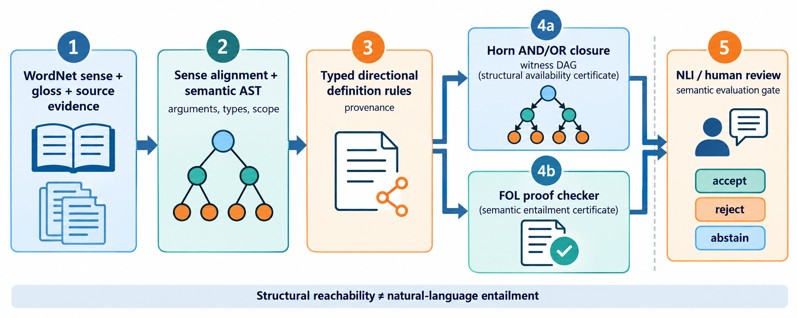

## 2026-10-08：证明可用性不能由正确性或 replay 替代（Phase270）

Petrov et al., [*Not All Proofs Are Equal: Evaluating LLM Proof Quality Beyond Correctness*](https://arxiv.org/abs/2605.10379) 以 382 道竞赛题上的 ProofRank 提出五类可扩展证明质量 proxy；论文将质量比较限制在正确且论证完整的解上，并用人工判断校验若干指标。作者也报告 correctness verifier 存在遗漏关键步骤的 false positives。NeurIPS 2026 官方 Downloads/Poster 页面列出该标题，但 arXiv v2 评论称论文被 ICML 2026 AI for Math workshop 接收；现有记录不能解释两项 venue 记录关系，也不能确认具体 NeurIPS track。作者实验未复现。该文排除“可验证/正确就足以评价证明质量”的宽泛主张，但其数学竞赛任务不是 WordNet gloss-span→typed Horn support 或 source-bound witness replay baseline。对项目而言，当前 witness 应表述为结构可检查/可重放的证据链；结构量与 source support、exact-condition NLI、人工可用性判断分开报告，不把 replay 当作解释清楚或下游有用的证据。筛读限制见Phase270报告和[结构化日志](../sources/literature_screening_log_2026-10-08_proofrank_phase270.json)。

## 2026-10-08：逻辑有效性与现实 plausibility 混淆的全文复核（Phase269）

Bertolazzi, Pezzelle & Bernardi 的 [Findings ACL 2026 论文](https://aclanthology.org/2026.findings-acl.454/)（*How Language Models Conflate Logical Validity with Plausibility*）先前在 Phase217 仅核对摘要；Phase269 完成官方全文筛读。论文构造 1,280 个 syllogism，涵盖 64 种逻辑形式、十组 taxonomic term triples，按逻辑形式做 70/30 split；hypernym/hyponym 控制也复用这十组 triples（60 个有向词对、180 个 prompt）。作者报告 validity/plausibility activation 方向相似度 .48–.64，hypernymy control 为 .10–.13；CoT 降低所报告的 syllogistic content-effect，Qwen3 steering 亦改善其数据上的 accuracy/CE。均未由本项目复现。该工作只研究 syllogism 的逻辑有效性与现实世界 plausibility，不提供 WordNet gloss span 对 typed Horn literal 的支持 gold；仅十组词汇 triples 且未报告词汇 triple-disjoint split，不能支撑 held-out lexical generalization。对项目的作用是强化 plausibility/content-effect 必须独立诊断、不能替代 raw-gloss source-support 标签；本项目尚无实测内容偏差。细节见Phase269 报告及[全文筛读日志](../sources/literature_screening_log_2026-10-08_validity_plausibility_fulltext_phase269.json)。

## 2026-10-08：WN30-lfs 生成工具链与 status 语义边界（Phase260）

[LFToolkit 项目页](https://www.isi.edu/people-hobbs/projects/lftoolkit/)公开一个 generic compiled JAR，描述它以 parse-tree XML 和另行定义的 transformation rules 产生 LF；页面还记载 processing status、rule-ID trace 与未覆盖节点的 partial output。它特别指出 partial output 可能有未正确链接的变量。[WN30-lfs 论文](https://ragerri.github.io/files/ilf.pdf)另外描述 Charniak parsing 与 WordNet GlossTag sense assignment。当前公开 WN30-lfs ZIP 只含 final XML；没有从这三项来源拼出完整 producer bundle。因此历史工具页面不能被算作可重复的 WN30-lfs pipeline，也不能将 `partial/complete` 当语义质量标签。工具本身和 WN30-lfs 的单独许可均未从这些材料清权。

当前取得的 JAR 只作二进制容器盘点，SHA-256 和缺失组件详见Phase260 深度报告与[结构化机器记录](../sources/wn30_lfs_producer_reproducibility_2026-10-08_phase260.json)。此为 prior-work/reproducibility 边界，不是新方法效果证据。

## 2026-10-08：WN30-lfs 来源与 identity key 的原始资料核对（Phase259）

Agerri & Peñas 的 CICLing 2010 论文将 ISI/Boeing WN30-lfs 描述为 WordNet 3.0 gloss 的 LF 资源（排除 parsing failures），称 XML entry 含不带例句的 gloss 和 LF，并展示 `bigheaded#a#1` 一类键。对 [Princeton 官方 ZIP](https://wordnetcode.princeton.edu/standoff-files/wn30-lfs.zip) 的结构重放发现内部 XML 只有 container `version="1.0"`，entry 无 WordNet release 或 synset offset 字段。Princeton [senseidx(5WN)](https://wordnet.princeton.edu/documentation/senseidx5wn) 说明 WordNet sense numbers 和 offsets 随版本变化，而 `sense_key` 可作为版本间 sense lookup；WN30-lfs 的 `lemma#pos#sense_number` 不是该 `sense_key`。因此 Phase257 仍应严格依声明的 WordNet 3.0 发行版映射；不能把 2.1/3.0 之间的数字或容器版本混为一谈。原文“解析失败排除”不构成每个 absent offset 的逐条标签，174 个未匹配 key 也未确定根因。

复算和本地结构详情见Phase259 报告、[机器输出](../outputs/phase259/wn30_lfs_source_schema.json)和[source record](../sources/wn30_lfs_source_schema_2026-10-08_phase259.json)。此项资源 lineage 确认不是新颖性证据；语义支持、独立证明与资源许可仍单独待证。

## 2026-10-08：WN30-lfs 未映射 key 的诊断边界（Phase258）

Phase258 对 Phase257 严格 ID join 中 174 个未映射 XML keys 作了非模糊释义字符串诊断：23 条具有唯一同 lemma/POS gloss 候选、1 条候选歧义、38 条只有异 lemma 同 POS 候选，另 112 条无精确 gloss 候选。例子显示 key-sense-number discrepancy、词形变体和异 lemma gloss collision 均可能存在；例如 `repaint#v#3` 匹配两个 gloss 相同的 3.0 sense，`Twentieth_Amendment#n#1` 的字符串候选却是 `nineteenth_amendment`。因此，“WordNet 3.0 key mismatch”不能一概解释为版本差异；也不能按 gloss-only 自动修复。当前诊断不具备人工 sense identity adjudication，也未确认 XML key 字段生成来源。严格 coverage 继续为 88.4599%；候选均只作手动追查线索。细节、归一化规则和不复制 gloss 的审计输出见Phase258报告、[CLI](../src/analysis/audit_wn30_lfs_unmapped_entries.py)与[机器结果](../outputs/phase258/wn30_lfs_unmapped_diagnostic.json)。

## 2026-10-08：WN30-lfs 与 Princeton WordNet 3.0 的身份对账（Phase257）

Phase257 将 Phase256 的 entry 数量比较替换为固定发行版 ID 对账。根据 Princeton [WordNet 3.0 数据包说明](https://wordnet.princeton.edu/documentation/wnpkgs7wn)下载完整数据库，并按 [index.sense 文件格式](https://wordnet.princeton.edu/documentation/senseidx5wn)将 WN30-lfs 的 `lemma#pos#sense_number` 严格映射到 `(POS, synset_offset)`。`index.sense` 的 206,941 行含 117,659 个唯一 synset ID，与四个 release `data.*` 文件 offset 集完全一致。WN30-lfs 104,357 个 XML entries 中，104,081 个唯一 ID 可严格对齐，13,578 个 3.0 IDs 未出现，0 个匹配到 3.0 库外；严格 ID coverage 为 88.4599%。174 个 entry keys 未严格映射，不以 lemma/POS-only 猜测补齐；其中 66 个在 release index 有同 lemma/POS 但 sense number 不合，108 个连同 lemma/POS 也不匹配。

entry 数大于唯一 synset ID 数：100 个 offset 有多个 XML entries，其中 65 个对应多个不同 entry keys；另有 36 个相同 XML key 的额外重复出现。45 个 synset IDs 的多个 entries 之间 `partial/complete` 状态冲突。故 `complete` 不是一个可无条件聚合到 synset 的语义质量标签。此交叉表只支持固定 WordNet release 的身份可比性与覆盖盘点，不验证 LF fidelity、解析成功原因或 source-span 支持；WordNet 3.0 包自带许可证也不能自动确定 WN30-lfs 独立资源的授权。详见Phase257报告、[机器输出](../outputs/phase257/wn30_lfs_synset_crosswalk.json)及[来源审计记录](../sources/wn30_lfs_synset_crosswalk_2026-10-08_phase257.json)。

## 2026-10-08：WordNet gloss→逻辑形式资源与一致性审计（Phase256）

Phase256 更正并扩展了 Phase255 的沿革复核。XWN 的 [NAACL 2001 progress report](https://digital.library.unt.edu/ark:/67531/metadc83309/) 六页作者全文可取得，本轮定向筛读阶段、格式、置信与标注流程部分：它把预处理/解析、WSD、logical-form transformation、topical relation extraction 列为项目阶段，但报告实证重点在前两阶段和 1,000 条 noun.artifact / verb.social gloss pilot，并非端到端 LF 忠实度评测。此前“摘要/元数据级”的状态已更正。agreement-based tagger confidence 与人工复核是标注流程先例，不是 gloss-span→rule 语义金标准。

本轮还直接取得 [Princeton WN30-lfs archive](https://wordnetcode.princeton.edu/standoff-files/wn30-lfs.zip) 并解析其 XML：104,357 entries 全有 gloss 和 LF，其中 52,743 条标为 `partial`、51,614 条为 `complete`；13,565 条含 sub-LF。与 ILF-WN 引述的 117,659 个 WordNet 3.0 synsets 相除所得 88.69% 只是计数比，没有完成 offset crosswalk，不能称为 recall/coverage。压缩包未含 README/license 文件，因此数据下载和结构解析不代表许可已清权或可再分发。

相关工作还必须包括 Delmonte & Rotondi 的 [2012 LF consistency audit](https://iris.unive.it/handle/10278/35936) 与 [2015 LF parser/correction paper](https://iris.unive.it/handle/10278/3660559)。前者用其 parser 报告 71,658/132,587 XWN LF 存在 disconnected variables（54.05%）；后者报告自动修正后为 31,583/132,587（23.82%），人工干预后作者称总错误低于 15%。这些是 parser 定义的结构一致性/同一 parser 的修正评估，不能解释为 gloss 语义精确率，也没有独立裁决逐 span 对关系方向或 Horn literal 的支持。它们排除了“LF 资源一致性检查/自动结构修正尚无先例”的宽泛主张。

Phase254 确认 Moldovan & Rus (FLAIRS 2001) 已将 WordNet gloss 转成义项化逻辑形式、保留动词论元槽位和 AND/OR，并展示 QA 用途。Phase255 筛读 Agerri & Peñas 的 [ILF-WN](https://doi.org/10.1007/978-3-642-12116-6_3)：扁平 neo-Davidsonian 中间逻辑形式，`conj_or` 是协调结构标签；该版未应用 WSD，未报告定量 gold fidelity。Rus 2004 的双标/moderation 与 predicate/argument/exact LF 指标是通用评测先例，不是 gloss-span support gold。

因此剩余可检验假设须非常窄：固定 sense/release 与同一 gold 时，方向化 typed literal 的 gloss-span 支持是否经独立人工裁决成立；来源绑定 witness 能否由独立 checker 重放。当前 `compile_annotations` 输入是人审结构化 claims，不是 raw-gloss parser。需要在同一 gold 上适配/重建历史 LFT、ILF-WN、WN30-lfs 等并分开测 parse coverage、结构一致性、语义支持与 proof validity。详见Phase256 报告、[结构化日志](../sources/literature_screening_log_2026-10-08_phase256_xwn_wn30_resource_reaudit.json)与[最近工作矩阵](closest_work_comparison.md)。本轮是定向复核，不是系统综述、新颖性证明、许可意见或资源重放。

## 2026-10-08：WordNet gloss→逻辑形式 lineage 与评测先例（Phase255）

Phase254 确认 Moldovan & Rus (FLAIRS 2001) 已将 WordNet gloss 转成义项化逻辑形式、保留动词论元槽位和 AND/OR，并展示 QA 用途。Phase255 沿引文链全文筛读 Agerri & Peñas 的 [ILF-WN](https://doi.org/10.1007/978-3-642-12116-6_3)（CICLing 2010）：其 WordNet 3.0 流水线自动做预处理、POS/依存解析并产出 XML 中间逻辑形式；表示为扁平 neo-Davidsonian entity/relation 结构，作者明确不称其为标准 FOL。`conj_or` 是协调结构标签，不能直接视作逻辑析取 Horn clause。该版仅给单义词添加 sense offset，未应用 WSD；作者主要作定性对比，未报告定量 gold 语义忠实度。论文把 XWN 2 和 ISI/Boeing WN30-lfs 作为既有资源比较。WN30-lfs 因本轮证据来自 ILF-WN 的讨论而记作资源节点，不另计独立系统论文。

XWN 状态在 Phase256 更正；该历史快照只读 UNT 馆藏元数据/摘要。当前全文定向复核见上节。Rus 的 [LFi evaluation](https://aclanthology.org/W04-0810/)（SENSEVAL-3 2004）全文报告 300 句通用英语逻辑形式识别 benchmark，双 annotator 检查并由 moderator 处理分歧，评 argument/predicate 与句级 exact；它是评测设计先例，不是 WordNet gloss→literal span semantic support gold。

因此应从创新表述中排除“首次 WordNet gloss 自动转逻辑/形式结构”、一般双人 LF gold 或 argument/predicate/exact 指标。可继续验证的窄假设是 sense/release 绑定的方向化 typed rule/literal 是否获得逐 span 人工裁决支持，以及来源绑定 witness 能否独立重放；这仍需同 gold、同义项、同输入下重建/适配 2001 LFT、ILF-WN/WN30-lfs 和其他 gloss parser，并分开报告 parse coverage、语义支持和 proof validity。详见Phase255 深度报告、[筛读日志](../sources/literature_screening_log_2026-10-08_phase255_wordnet_logic_lineage.json)和[最近工作矩阵](closest_work_comparison.md)。这是定向补查，不是系统综述或新颖性证明。

## 2026-10-08：ICLR 2026 WordNet 层级与逻辑表示定向筛查（Phase239）

新增全文筛读 Hill et al., [HiCEM](https://proceedings.iclr.cc/paper_files/paper/2026/hash/1395b425d06a50e42fafe91cf04f3a98-Abstract-Conference.html)：在六个视觉/合成数据集研究 concept splitting、两层 hierarchical concept embedding 与分层概念干预；ImageNet 的初始高层标签由 WordNet synset hypernym ancestors 构造。它进一步压缩“WordNet taxonomy 驱动层次概念建模/干预尚无顶会先例”的宽泛说法，但不解析 gloss、不抽取词汇关系或 typed Horn rule、不做 source-span support/proof replay，因此不是 lexical gloss baseline。全文 29 页官方 PDF 定向筛读；SAE 语义不保证、只处理子概念关系、ImageNet validation-as-test 等边界见Phase239报告与[机器日志](../sources/literature_screening_log_2026-10-08_iclr2026_hierarchical_concepts_wordnet_phase239.json)。

另将 Zhou et al., [*The Geometry of Reasoning*](https://proceedings.iclr.cc/paper_files/paper/2026/hash/7644353d580a9e027e0069d6480d971b-Abstract-Conference.html)作为 ICLR 2026 跨域逻辑表示背景候选登记；官方 PDF 本轮抓取失败，故仅摘要级，不计入全文筛读或 closest-work 直接近邻。该定向筛查不是 ICLR proceedings census、系统综述或新颖性证明。

## 2026-10-08：可靠性工程中的联合重要度与结构交互（Phase228）

pairwise/multi-component interaction 不是新出现的分析思想。coherent-system 文献定义两组件及多组件的 Joint Reliability/Failure Importance（JRI/JFI），将其用于系统可靠性或失效响应；故障树工作直接分析 gate-event 联合重要度及 minimal cut set；另有以逻辑微分演算定义 joint structural importance 的近期研究。代表来源包括 [Gao et al. (2007)](https://www.sciencedirect.com/science/article/abs/pii/S0377221706008010)、[Hong, Koo & Lie (2000)](https://www.sciencedirect.com/science/article/abs/pii/S0951832099000794)、[Borgonovo (2010)](https://www.sciencedirect.com/science/article/pii/S0377221709007899)、[Barlow & Proschan (1975)](https://www.sciencedirect.com/science/article/pii/0304414975900137)及[2026 joint structural importance](https://www.sciencedirect.com/science/article/abs/pii/S0377042725005710)。

Phase227 的固定图统计对每个 head 计算联合删除的额外闭包损失；在完整 basis closure 下，它精确对应 head-level 二元素 inclusion-minimal deletion cut sets。可靠性工程中 cut-set importance/JRI/JFI 是明确先例，但通常在 coherent-system/fault-tree 的顶事件上进一步结合可靠度/概率；Phase227 没有该概率解释或 matched comparison。应撤回 pairwise interaction 本身的方法新颖性或“来源冗余比例”主张。当前结果只支持冻结图上的描述性结构结论；词汇任务中的效用和 sense/source 语义解释仍是待验证假设。此轮仅做出版方摘要/元数据级定向筛读（直接 ScienceDirect 页面打开受限），不构成系统综述或公式级比较。详见Phase228 深度报告与[结构化日志](../sources/literature_screening_log_2026-10-08_reliability_interactions_phase228.json)。

## 2026-10-08：形式正确性、verifier 监督与内容效应（Phase159）

Kim et al. 的 [T²](https://aclanthology.org/2026.acl-industry.150/)（ACL 2026 Industry Track）以 Lean 下游定理重编译测试生成 theorem 的依赖行为，并明确成功编译是语义正确性的证据而非逻辑保证；其自然语言 theorem annotation 仅随机人工检查 10 条。Kamoi et al. 的 [FoVer](https://aclanthology.org/2026.findings-acl.403/)（Findings ACL 2026）用 Z3/Isabelle 标记形式推理轨迹中的步骤，再训练 PRM，并在含 ANLI/HANS 的 12 个基准上评估；这不是给 NLI 样本做 source-support 标注。Valentino et al. 的 [SemEval-2026 Task 11](https://aclanthology.org/2026.semeval-1.450/) 将 syllogism 有效性与内容 plausibility 分开，并设无关前提、多语言切片。

三者分别提示 dependency-behavior 检查、形式 verifier 监督与 content-effect 控制的已有先例。它们均不标注 WordNet sense-linked raw-gloss span 对方向性 typed Horn literal 的支持；不能作为本项目 matched baseline 或 gold。项目必须把形式证明/回放、下游稳健性、来源语义忠实度分别计量。Venue 分属 ACL Industry、ACL Findings 与 SemEval workshop；单审阅者定向筛读，不是系统综述。范围与机器记录见Phase159和[结构化筛读日志](../sources/literature_screening_log_2026-10-08_formal_correctness_nli_addendum.json)。

## 2026-10-08：分层 selective risk control 与 NLI abstention

Salem et al. 的 [HG-CRC](https://arxiv.org/abs/2607.24562) 提出对用户指定层级 group 同时做 conformal risk control，并以 leaf-first threshold 与分层 residual calibration 处理不同 group 风险。它是近年的 LLM selective abstention/risk-control 方法先例，但目前 arXiv v1 未列接收会议。定理的 split 版本假设 IID calibration examples 与独立测试点；因此论文里的 group membership 不能替代对项目多 surface/condition 重复观察的 cluster-dependence 处理。其 ARC/MMLU-Pro 结果不移植到本项目，也不直接作为 lexical baseline。实现假设和项目 calibration contract 对照见Phase154报告及[结构化日志](../sources/literature_screening_log_2026-10-08_hierarchical_group_risk_control.json)。

## 2026-10-08 COLM 2026：human-grounded judge 与受控逻辑 benchmark

官方目录/论文全文核对 No Free Labels、LogicIF；GraphWalker 与 GDP-RAG 仅筛题名摘要。No Free Labels 显示 correctness judge 的人类一致性依赖 judge 自身能力和正确参考，错误参考可能伤害判断；LogicIF 用可执行代码产生 logic-rich 指令标签，并由两名专家核查自然语言忠实度。它们约束本项目：LLM judge 必须对照独立人工 gold；形式 replay/程序 oracle 不能替代 WordNet gloss 的 sense-linked source-span semantic gold。GraphWalker/GDP-RAG 是图遍历或 gap-aware RAG 邻接工作，不是 lexical proof baseline。见Phase 151和[日志](../sources/literature_screening_log_2026-10-08_colm2026_grounded_logic_addendum.json)。

## 2026-10-08 COLM 2026：Q-CARE claim verifiability 邻接工作

Choi et al., [Q-CARE](https://arxiv.org/abs/2608.11238)（COLM 2026 接收）将 query/answer 拆成 sub-queries 与 atomic claims，并以 LLM checker 判断 sub-query–chunk、sub-query–claim、claim–chunk 配对关系。其人标 benchmark 的相关性样本为 320 queries、567 sub-queries、7,907 claims；三名标注者独立标记后多数裁决，alignment κ=.801–.891。重复运行同一 Qwen3 checker 得到的 alpha 是模型 run stability，不能计作 human IAA。官方接收状态见[COLM 2026 接收论文页](https://colm.eventhosts.cc/Conferences/2026/AcceptedPapers)，方法与数字见[论文全文](https://arxiv.org/pdf/2608.11238)。

Q-CARE 使一般 atomic claim decomposition、claim-to-evidence support 与人标 verifiability 评价不再适合作为宽泛创新点。它可作为 Track A pairwise-support 设计先例或未来适配 baseline，但它验证的是 RAG answer claims 对 retrieved chunks 的支持，不是 WordNet sense-linked raw-gloss spans 对方向性 Horn literals 的支持；不处理 AND/OR rule fidelity 或独立 proof replay。不能跨任务移植论文分数。项目差异仍是假设，需冻结 Track A 合同后用同一输入、裁决 gold、split 和预算实测。详见Phase 150 深度报告及[机器日志](../sources/literature_screening_log_2026-10-08_colm2026_qcare_fulltext.json)。

## 2026-10-07 ACL 2026 官方检索去重与候选框边界

按 `gloss + WordNet` 与 `hypernym + WordNet` 在 ACL Anthology 2026 进行定向官方页面检索，命中 ACL 2026 的 SememeLRM，以及 LREC 2026 的 OEWN adjective hypernym gold；两项已经纳入本综述与逐项矩阵，本次只登记为重复命中，没有新增全文筛读。Open English NameNet 已在 2026-10-03 官方全文日志中登记；此处再次命中不重复计数。官方 ACL 2026 活动目录列出 2,223 篇 long papers，因此本项目跨 2016–2026 的 1,747 条 ACL v3 是检索得到的候选框，不是 ACL 2026 或完整 ACL 论文全集；精确 URL 日志匹配率只能解释为该候选框内 reconciliation，不能转写为全 ACL 覆盖率或召回率。OpenReview 精确词查询未返回可用的完整 ICLR 2026 候选集，故不据此作缺席判断。详见[官方来源去重与范围日志](../sources/literature_screening_log_2026-10-07_acl2026_lexical_relation_dedup.json)。官方来源：[ACL 2026 event/proceedings listing](https://aclanthology.org/events/acl-2026/)、[ACL 2026 long-paper volume](https://aclanthology.org/volumes/2026.acl-long/)、[SememeLRM](https://aclanthology.org/2026.acl-long.224/)、[OEWN adjective hypernym gold](https://aclanthology.org/2026.lrec-1.293/)和[Open English NameNet](https://aclanthology.org/2026.ldl-1.7/)。

## 2026-10-07：结构化 lexical explanation + LangPro 近邻（AKBC 2026）

de Jong et al., [*Explaining Textual Entailment with Lexical Entailments: Using LLMs to Supply Lexical Relations for Formal Proofs*](https://arxiv.org/abs/2609.32491) 已被 AKBC 2026 接收；截至本次筛读（2026-10-07），workshop 尚未举行，官方日程列出该论文。全文提出 lex-NLI：为 SNLI/SICK entailment 句对标注多参考的有向词/多词单位蕴含关系，再测 LLM 预测及将关系作为 KB 补入 LangPro 的效果。最终集 362 项、1,108 个 lex reference；223 项只有一个裁决 lex，139 项保留多解，29% reference 为空。三名独立标注者与裁决后的平均 exact match / micro-F1 为 80.9 / 84.9。最佳 LLM 的 micro-F1 为 73.1；在 1,000 个 SNLI entailment 项上，LangPro+WordNet 证明 157 项，加入 LLM 关系的最佳配置证明 212 项。

这是一条很强的邻近线：结构化词汇解释、人工多参考 gold、LLM 词汇知识生成和可检查的自然逻辑证明均已有结合。作者错误分析同时显示，增加 proof coverage 并不保证词汇关系语义正确：许多新关系不可靠，或在修补 parser/prover 错误；所以 proof outcome 必须与 lexical/source support 分开计量。该文的单位是给定 NLI 句对所需的 context-specific lex set，并不从单条 WordNet gloss 编译 typed AND/OR Horn，也不标注每条 literal 对应的定义原文 span。项目只能把 sense/release-bound gloss span→typed rule support→独立 replay 作为待测的任务差异假设，不能称为已证新颖性，不能直接横比论文分数。若做 baseline，应在同一 gloss 输入、盲化裁决 gold、数据切分和推理预算下适配 lex-NLI 思路，并分别报告 claim、方向/类型、span support 与 proof coverage/correctness。详见Phase 103 全文筛读及[结构化日志](../sources/literature_screening_log_2026-10-07_lex_nli_formal_proofs_akbc2026.json)。

## 2026-10-06 ACL/TACL 官方检索增量：近期词义与逻辑论文去重

补做一轮针对 2026 ACL/TACL 的官方页面检索，覆盖 WordNet/gloss lexical entailment、definition modeling、sense relations 与 FOL verification。检索找到的五个正式页面中，四项已经在本综述出现：ACL 2026 的 [SenseRel](https://aclanthology.org/2026.acl-long.20/)、LREC 2026 的 [OEWN adjective hypernym gold](https://aclanthology.org/2026.lrec-1.293/)、ACL 2026 的 [FOLX-KG](https://aclanthology.org/2026.acl-long.1230/) 和 [SememeLRM](https://aclanthology.org/2026.acl-long.224/)，本次只作重复命中核对，不重复累计全文筛读数。

新增边界项是 Maudslay & Teufel 的 TACL 2026 [Simulating Sense Extension](https://aclanthology.org/2026.tacl-1.82/)。官方元数据/摘要表明，该任务让模型依据未见概念的多模态表征创造性地扩展已有词义，覆盖七类 sense-extension 现象；它不是给定 WordNet 义项 gloss 的形式化或关系验证，因此不进入直接 baseline 集。本轮只筛了元数据和摘要，未阅读全文或复现。结构化检索与去重决定见[官方检索增量日志](../sources/literature_screening_log_2026-10-06_acl_lexical_logic_delta.json)。

这轮检索没有发现未记录的直接方法邻居，但检索结果并非结构化数据库的全量导出，不能据此证明研究新颖或文献已穷尽；整体综述仍是单人定向筛查。

## 2026-10-06 EMNLP：可声明式生成的逻辑压力测试

Sileo, [Scaling Synthetic Logical Reasoning Datasets with Context-Sensitive Declarative Grammars](https://aclanthology.org/2024.emnlp-main.301/) 提出 Unigram，将简化英语和 TPTP FOF 公式绑定在上下文敏感声明式语法中，以 FOL solver 生成 entailment/contradiction/neutral 标签并附 Vampire 证明。Unigram-FOL 覆盖等号、显式有限/开放域、更多量词、多段谓词链、否定及条件句限制；论文给出 100K 数据、80/10/10 切分，实验中使用 40K 训练样本与 FLD 对齐，并用 LogicNLI 基础语法消融分离语法框架与逻辑建模。详细筛读见[日志](../sources/literature_screening_log_2026-10-06_unigram_fol.json)。

这是可复算合成推理压力集的直接方法邻居；可借鉴它将声明式生成器、TPTP/FOL 表示、solver 标签、证明记录和逻辑现象切片分开。但它是 grammar-authored synthetic English，不抽取 WordNet gloss；solver/Vampire 只认证形式输入上的状态，不证明生成自然语言与公式忠实，也不建立 source-span gold。作者明确称没有新增人工标注，神经分类器无形式保证。因此它能测形式化引擎和受控接口，不能作为 gloss 语义准确率或研究有效性的证据。


Thayaparan et al., [Diff-Comb Explainer](https://aclanthology.org/2024.lrec-main.40/) 在 WorldTree 多选科学问答中，以加权事实—假设图和 ILP 约束选取连通解释子图，并用 differentiable black-box combinatorial solver 联训表示。论文分开报告答案准确率、解释 Precision@K，以及解释一致性和答案—解释 faithfulness；解释选择只在 dev 评估，因为 test 的 gold explanations 不公开。背景库含 WorldTree 抽象事实和超过 100,000 条 ConceptNet `is-a` grounding facts。定向全文筛读见[机器日志](../sources/literature_screening_log_2026-10-06_diff_comb_explainer.json)。

该主会工作是约束式证据图选择和解释质量评测的重要邻居，但其事实—假设相关性图不是 WordNet 义项定义的 OR-of-AND Horn 图，ConceptNet 背景也不满足 source-only。它的 faithfulness 只检查答案对错是否与是否选到正确解释事实相符，不验证形式规则是否由来源文本蕴含、span 是否支持关系或证书能否独立重放。可借鉴的是把答案质量、解释覆盖/一致性分轴报告；项目还须另测 gloss-span support 与 proof replay，不可借其指标名声称来源忠实。


## 2026-10-06 ACL：NL→FOL 翻译与人工对齐评估近邻

Yang et al., [Harnessing the Power of Large Language Models for Natural Language to First-Order Logic Translation](https://aclanthology.org/2024.acl-long.375/)（ACL 2024）提出 MALLS：28K 由 GPT-4 生成的句子级 NL–FOL 对，经 CFG 语法检查；作者对均匀抽样的 1K 子集逐项由三名标注者评为 correct/partial/incorrect，并报告 Krippendorff α=.714。基于观察到的自由变量、连接词/嵌套作用域、过度使用 XOR、遗漏原文信息等错误设计过滤器；论文报告过滤前后 correct 比例 84.5%→92.8%。详见[定向全文筛读日志](../sources/literature_screening_log_2026-10-06_malls_nl_fol.json)。

这是 NL→FOL 质量控制与人工一致性设计的重要主会邻居，也提示本项目把变量绑定、AND/OR/方向、作用域和定义信息遗漏列为独立错误类型。它不是 gloss 解析基线：样本彼此独立、不共享谓词/实体命名空间，且作者明确不检验生成语句的事实性；其公式 BLEU/逻辑等价分数不能替代 WordNet 义项识别、方向性词汇关系或逐条 gloss-span 支持。若要比较，必须在本项目自己的双人裁决 gold 上适配，并把语法/形式等价与来源语义支持分开报告。MALLS 数据声明为 CC BY-NC 4.0，未进行下载、复用或许可审查。


## 2026-10-06 ACL Anthology：WordNet/gloss 候选 2021–2022 筛查

对冻结 ACL Anthology v2 候选池中 `wordnet_gloss_lexical_relations` 词族、2021–2022 年仍待筛的 33 条记录完成单人题名/摘要筛查：4 条直接近邻、10 条相邻、3 条背景、16 条范围排除；其中 7 条标为优先全文核查。最重要的近邻包括 WordNet taxonomy 建构中使用 gloss 的方法（Chen et al., NAACL 2021）、基于传递性和 WordNet 的 hypernym 数据增广（Kober et al., EACL 2021）、WordNet IS-A 传递性探测（Lin & Ng, ACL 2022）及多语 gloss 交集驱动的 Abui sense 候选生成（Kratochvil et al., FieldMatters 2022）。逐条决定、理由和哈希锁定来源见[结构化日志](../sources/literature_screening_log_2026-10-06_acl_wordnet_direct_2021_2022.json)。其中 7 条优先候选均已完成官方 PDF 定向核读；逐篇证据见同一日志。其余保留项仍是待考察邻居，而非最终综述纳入；本轮不含代码/数据复现，也不构成新颖性证明。

## 2026-10-06 EACL：WordNet 定义建模与本项目形式化任务的边界

Liu et al., [LM-Lexicon: Improving Definition Modeling via Harmonizing Semantic Experts](https://aclanthology.org/2026.eacl-long.1/) 是 EACL 2026 长文，在 WordNet、Oxford、Wikipedia、Urban 和 3D-EX 五个数据集上研究 definition modeling。模型从 Llama-3-8B 出发，以 3D-EX 的四个语义簇训练专家并合并为稀疏 MoE；作者报告跨五集平均约 7% BLEU 改善，并对 300 个 3D-EX 样例由三名语言学/词典学研究生按五项维度做人评。官方全文还报告三种随机种子，并指出英语范围、训练成本和更强定义 verifier 的需求。详细证据见[2026-10-06 定向全文筛读日志](../sources/literature_screening_log_2026-10-06_definition_modeling.json)。

这是 WordNet definition modeling 的近期主会先例，不能把“WordNet 定义建模”或“对生成定义做自动/人工质量评估”作为新颖点。但该任务是 term/context→definition generation；它没有把给定 gloss 转成义项绑定、有方向的 AND/OR Horn 规则，也没有评 gloss-span 支持、规则蕴含 soundness 或独立 proof/countermodel replay。因此它是重要的定义生成邻居，而不是本项目形式逻辑目标的 matched baseline。即便如此，文本流畅/与参考释义相似不能替代来源忠实度；本项目仍需分别测 sense identity、候选 relation、gloss-span support 和形式证明。

## 2026-10-05 ICLR 2026：WordNet 层级与 embedding lattice 逻辑组合

定向全文筛读 Xiong, [*The Lattice Representation Hypothesis of Large Language Models*](https://proceedings.iclr.cc/paper_files/paper/2026/hash/208853db0e806d03f6be769a3fae1ecd-Abstract-Conference.html)，核对了 16 页官方 ICLR 2026 proceedings PDF 中的形式框架、WordNet 数据构造、定量评测和复现说明。机器记录及筛读边界见[日志](../sources/literature_screening_log_2026-10-05_iclr_lattice_and_kdd_subspaces.json)。

该工作将属性方向/阈值化半空间与 Formal Concept Analysis 联系起来，并在 Animal、Plant、Food、Event、Cognition 五个 WordNet 子层级上评估表示中的概念偏序及 meet/join。对象-属性标注由 GPT-4o 生成，WordNet `is-a` 层级提供偏序目标；属性恢复 F1 约为 70–83%，偏序推断最高 F1 报告为 77.1。作者另在每域 200 个满足共同上位/下位条件的概念对上测 meet/join MRR。以上度量对应 embedding geometry 和该论文构造的属性标注/WordNet 层级，不是对定义解析或原始 gloss 的语义忠实度评价。

这是一项 ICLR 主会层级的重要概念组合先例，故“首次在 WordNet 上建模逻辑合取/析取或层级组合”不可作为宽泛贡献。它的输入是概念/属性表示而非 gloss 中的具体 claim；也没有从原文抽取带 sense、方向、类型和证据 span 的 Horn 规则，或独立重放证明。项目仍可检验的差异是来源锚定的显式规则与证书，但这只是方法学差别，是否新颖、有用须经 matched baselines 和真实人审 gold 验证。不要把论文分数迁移到本项目指标。

## 2026-10-05 KDD 2026：子空间层级与零样本逻辑组合

全文及附录筛读 Moreira et al., [*Native Hierarchical and Compositional Representations with Subspace Embeddings*](https://arxiv.org/abs/2508.16687)，arXiv v2 页眉列明 KDD ’26 Proceedings Volume 2 和 ACM DOI 10.1145/3770855.3817808。早期 OpenReview ICLR 投稿题名是同一 arXiv 记录的旧版本，不重复计算。逐项筛读、会场和版本对账见[机器日志](../sources/literature_screening_log_2026-10-05_iclr_lattice_and_kdd_subspaces.json)。

该工作以可学习 soft subspace projectors 表示 WordNet synset 与句子，几何包含分数表示 entailment，子空间交/线性和/正交补对应 conjunction/disjunction/negation。WordNet 重建/链路预测用已有层级与 transitive closure；另在 HyperLex 2,163 个 noun pairs 上报告人类 graded-entailment Spearman ρ=.683。SNLI 上 SE-128 与强 bi-encoder 大体相当（mpnet-base-v2 下 3-way accuracy 85.80%）。v2 新增 600 对 LLM elicited 的零样本 compositional entailment（150 premises，每例构造两条组合蕴含、两条组合矛盾）；约 200 个 Gemini 3.1 Pro 候选经人工过滤，并进一步去掉基础假设已被 baseline 判错的样本。SE-128 在其 conjunction / negated-conjunction 切片报告 AUC 96.55 / 95.76。作者明确指出该合成集不代表自然语言组合推理的广泛分布。

此工作关闭了“WordNet hierarchy、几何化 entailment 与 AND/OR/NOT 组合缺乏顶会先例”的宽泛主张。其关键限度也与项目问题直接相关：作者说明 soft projector 导致的是 approximate logic，而非 executable Boolean logic；WordNet 输入是 synset taxonomy links，不是原始 gloss；NLI/组合任务训练和分类不检验一条定义规则是否有原文 span 支持，也不产生 source-only Horn proof certificate。项目可检验的差别因此收敛到 sense/version-bound gloss compilation、逐条 directional rule support 和独立重放来源证明；目前这些差别只是待验证假设，不能据表示方式不同推断新颖或更有效。该论文公开了[代码](https://github.com/gabmoreira/subembed)，本项目未运行或复现。

## 2026-10-05 形式证明与分解式 NLI 的邻近先例

从固定 ACL v2 候选框中补筛两篇此前待筛的主会论文，逐篇事实与证据边界见[结构化全文筛读日志](../sources/literature_screening_log_2026-10-05_logic_proof_and_decompositional_nli.json)。

- Sun et al., [Towards Generalizable and Faithful Logic Reasoning over Natural Language via Resolution Refutation (LREC-COLING 2024)](https://aclanthology.org/2024.lrec-main.1436/) 的 GFaiR 在有平行 FOL 表示的 RuleTaker 规则/事实文本上做 resolution-refutation 风格逐步推理，用 learned selector/composer/verifier 产生和筛选步骤；Full Accuracy 要求答案和每步都能由对应 FOL 表示推出。Hard RuleTaker** 上报告 EA/FA 92.2/92.2，RuleTaker-E 上 83.2/82.7。它进一步排除“NL logic + proof trace checking”作为宽泛空白，但不验证从 WordNet 原 gloss 到公式/规则的语义忠实度，也未给出 source-span 锚定证书。推理有最大步数上限，触顶被当作无矛盾处理；项目必须把资源/搜索截断与语义 Unknown 分开。
- Weir et al., [Enhancing Systematic Decompositional Natural Language Inference Using Informal Logic (EMNLP 2024)](https://aclanthology.org/2024.emnlp-main.531/) 提出 RDTE，对 QA 分解中的 premise relevance、acceptability/factuality（部分域）、redundancy 和整体 sufficiency 作五级序数标注；四位作者对 1,000 项作双重标注，报告 raw agreement .79、Krippendorff α .53，并以 RDTE 训练的 entailment verifier 改进 entailment-tree QA 与 GPT-4 judge 的树完整性分数。论文一处称 1,000 项，另一处 ARC 267 + HotpotQA 775 合计 1,042，日志保留此计数差异。它启发把“每步论证质量”拆成可裁决子维度，但其依赖问题语境/通常背景知识的 sufficiency 不等于 gloss-span 的 source support；RDTE 标签不能替代本项目的 NLI relation、directional semantic-support 与 evidence-span 三类标注。

因此，证明步骤可由形式表示检查与自然语言论证质量人审是已有路线。尚待验证的区别假设更窄：对固定 sense/release 的 gloss 逐条标出来源 span 和方向规则，隔离 `source_only` 前提，区分搜索超限与 Unknown，并让独立 verifier 重放 AND/OR Horn 证书。当前项目尚无 gold 或 matched benchmark 证明这些设计有效或新颖。

## 2026-10-05 近期 WordNet/gloss 候选筛读

在固定 ACL 第一组词面候选中筛查 2024–2026 年的 24 条记录，本轮新做题名/摘要筛查 18 条，保留 9 条作后续核验、排除 9 条；逐条决定见[结构化日志](../sources/literature_screening_log_2026-10-05_recent_acl_wordnet_slice.json)。其中五篇经过相关 PDF 章节的定向核验，证据范围和会场类别分别记录：

- Kutuzov et al., [Enriching Word Usage Graphs with Cluster Definitions](https://aclanthology.org/2024.lrec-main.546/) 从 usage examples 生成词簇定义，并与 Lesk/GlossReader 的 WordNet/Wiktionary 定义选择基线比较。其人工任务是让评审依据定义辨认 cluster；作者明确将 cluster correctness 留在范围之外。因此它是定义生成与任务操作化的邻居，可提示分别测 cluster fit 与语义正确性，但不能提供 gloss entailment 或 source-span gold。论文报告英文本任务上 DefGen cluster identification accuracy 69.17%，Lesk 21.67%、GlossReader 50.00%；这是原任务内结果，不应移作本项目基线。
- Almiman et al., [WordNet under Scrutiny: Dictionary Examples in the Era of Large Language Models](https://aclanthology.org/2024.lrec-main.1538/) 比较 WordNet 与其他词典/模型生成的用例自然度、信息量和自包含性。作者报告标注者间一致性偏低或有限（定义清晰度 κ=0.32；用例自然度/信息量/自包含性 κ=0.20/0.23/0.24），提醒人工判断需要明确任务定义并报告分歧；不过研究对象是 dictionary examples，不是释义内部命题或词汇规则。

同一短名单中的 Ku et al., [When Structure Matters: Cross-Lingual Hyperbolic Embeddings for Chinese and English Wordnets](https://lrec.elra.info/lrec2026-main-944) 是 LREC 2026 主会工作，也是 WordNet hierarchy evaluation 的较新邻居。现已取回并核读 18 页全文。该工作从 OEWN 名词 hypernym 边训练 20 维 Poincare embedding，用 GPT-5-mini 将 CWN 义项自动对齐到 PWN synsets，再以映射得到的英语 synsets 做词汇约束迁移评测。所谓 zero-shot CWN 设置把 CWN 测试涉及的 synset 保护在 OEWN 训练图内以避免 OOV；作者在局限中明确承认这不是严格 unseen-synset zero-shot。数据切分还报告 OEWN 88,200 条名词边、保护 12,348 条、其余 75,852 条候选中筛得 499 条测试边；文中另报 CWN pairwise 测试集 1,182 对，Table 3 则报告 CWN 测试诱导图 1,473 对，二者属于不同描述口径，引用时需带上下文。作者报告末 10 个 checkpoint（单次训练）上的 CWN MRR 0.030±0.001，对照 Euclidean 0.012±0.000（paired t(9)=95.81，p<.001，d=34.48），径向层级过滤后为 0.052±0.002；OEWN 和其它指标见原文 Tables 1–2。作者承认中英测试规模/分支/深度不平衡使 transfer 比较混杂、CWN 优势只能按上界理解；GPT-5-mini 对齐未经人工验证；未来工作应提供结构匹配评测与人审对齐。统计推断基于同一次运行的 10 个 checkpoint，而非独立训练种子。方法部分称代码/预处理/模型将在接收后公开，结论称将提供数据和评测脚本；但官方页面只列 PDF/海报/视频，PDF 的可点击链接中也未见项目仓库或数据链接，发布工件尚未定位。全文没有检查或复现数据/代码。它仍是词汇层级嵌入迁移工作，不是 gloss 语义标注或 Horn 编译基线。

本轮新核验的三篇为：

- Xu et al., [Annotating Chinese Word Senses with English WordNet](https://aclanthology.org/2024.lrec-main.106/) 是 LREC-COLING 2024 主会资源标注工作。以 OntoNotes 中文用例选择 PWN 3.1 synset；2,240 个用例有 867 个完全同 synset（38.7% 原始一致率，非 κ），分歧由第三人从两候选中裁决。多用例义项在裁决后也不一定形成一对一映射。它提示严格义项/类别判断可能出现邻近 sense 分歧；但评审看的是上下文用例，未见原始定义，不能把其一致率外推为项目 claim/span 标注的可靠性。
- Augello & McCrae, [Inferring Adjective Hypernyms with Language Models](https://aclanthology.org/2025.ontolex-1.1/) 是 OntoLex Workshop 2025。作者以词义包含/可替代性作为形容词上下位的操作判据，对 ODWN/plWN 候选逐轮双标并拒收含糊项，建立单一精确上位词与同 synset 可接受别名两个评测版本；样本仅 301 对且作者明示规模、主观性和语言范围局限。模型表明定义输入可能改变关系预测，但其 workshop 结果和封闭小数据不能直接作为本项目基线。
- Freihat et al., [Advancing the Arabic WordNet](https://aclanthology.org/2024.osact-1.9/) 是 OSACT workshop 论文。其阿拉伯词汇资源修订由两名母语翻译者互审、再由阿拉伯语专家核验，并报告对 9,576 个输入 synsets 更新 5,554 项；过程中依靠 PWN 对齐 gloss 和例句补充/纠正词汇资源。它提供多阶段来源质量控制的先例，但不是自动抽取规则或证明有效性评估。

- Hristov, [Large Language Models for Lexical Resource Enhancement: Multiple Hypernymy Resolution in WordNet](https://aclanthology.org/2025.ranlp-stud.3/) 是 RANLP 2025 Student Research Workshop 论文。它在 PWN 3.0 的多重 hypernym 义项上，让四个 4-bit 本地模型从既有候选关系中选一个，并比较 0/1/5-shot 输出与 Koeva & Hristov (2023) 的手工整理结果。全文报告 1,339 个评测义项；LLM 与手工结果 exact agreement 为 45.4%–55.0%，模型间一致更高（0-shot 52.7%–71.5%，1-shot 63.9%–77.6%，5-shot 62.0%–75.8%）。作者把共识用于人工整理优先级，但没有报告标注者间一致率，并将对人工/模型结果做进一步人审列为 future work。它直接限制“用 LLM 解决 WordNet 冗余 hypernym”这一宽泛新颖性说法，也警示模型共识不可代替 gold；但仍只是已有关系候选的选择任务，不解析释义为规则，也不测 source-span 支持或证明。论文链接的 GitHub 仓库顶层列 Manual-2023 / Automatic-2025，未见许可证文件；本项目未下载或复用其数据/代码。

本切片另全文核读 Roussopoulou & Markantonatou, [From Form to Meaning: Interlingua Sense-Alignment of Offensive Language with LLMs](https://aclanthology.org/2026.ltedi-1.6/)，一篇 LT-EDI 2026 workshop 论文。作者以五种语言的 lemma–definition–example 为义项单元，用 Mistral Small 在 temperature 0 下做 2,872,327 次跨语言两两判断，再用十对全 merge 的 strict tuple 和 4/5 重合分组得到 31 个 global-sense 类别。四组语言各由一位双语者审 20 对，结果为 75%–100%；这是每组 n=20 的单审阅者判断准确率，不是标注者间一致率，也未覆盖十组语言对中的其余六组。希腊词汇定义与例句由 GPT-o3 生成；作者报告英语模式干扰、过时词形和例句语义漂移，并指出不同语言资源质量/粒度不齐。其公开仓库提供代码、提示词及材料：代码 MIT，作者自制数据/材料 CC BY-NC-SA 4.0，第三方资源继续受原许可约束；大型对齐输出另放 Google Drive。它是 sense identity、来源三元组保留和小规模人工核验的邻接先例，不是 WordNet gloss→Horn 编译、claim/span 支持或证明评测；数据权利仍需逐来源处理。

这三篇及前述两篇均仅做相关方法/结果章节的定向阅读，不计为完整全文逐项审查。短名单其余工作仍待核验；LREC 2026 跨语 WordNet 层级论文仍只有官方元数据与摘要证据，且其公开数据集尚未检查。不可据此宣称整个 178 篇 WordNet 家族已筛完。


## 2026-10-05 OpenAlex 固定候选框标题/摘要筛查

对截至 2026-10-04 的 OpenAlex 候选导出逐条筛查 43 项的既有决定做规范化对账：原日志记录 4 项新补入、9 项已在矩阵、30 项标题/摘要排除；完整逐项理由、9 条缺 OpenAlex 摘要记录、两个源文件哈希和跨库匹配见[筛查表](../sources/openalex_title_abstract_screen_2026-10-05.json)。与 ACL 固定候选框按规范化 DOI 去重后，两个候选框共有 1,305 个候选记录，OpenAlex/ACL 重合 8 项；该并集的绝大部分尚未完成人工相关性筛查。此文件整理已有单 reviewer 决定，不是一次新的独立筛查；OpenAlex venue/type 元数据仍需逐篇核验，保留不等同最终综述纳入，也不构成 PRISMA 流程。

其原日志新增的直接资源工作包括乌克兰 WordNet 上下位关系抽取；方法邻居包括 ACL 主会的 SymbCoT、FLINS-ISKE/Springer 收录的 prover-guided 公式修正，以及 ASONAM/Springer 收录的 FOL fact-checking 章节。矩阵已收录的 NL2Logic、AAAI NL-FOL 评测与选择性符号翻译，则分别可约束编译器语义保真评估、避免记忆/模式匹配混淆，以及设计低置信 `unknown` 路由；它们不提供 WordNet gloss 的 sense/span gold。直接词汇资源候选中含 GWC/LREC 类资源建设工作，须与主会方法论文分层陈述，不能统称顶会结果。

## 2026-10-05 补充：定义到语义表示、词汇关系与方向性推理规则的早期先例

对 ACL 固定候选框中的 Wordnet Bahasa 定义抽取工作及其引用链邻近工作做了三篇定向全文复核，详见[结构化日志](../sources/literature_screening_log_2026-10-05_definition_to_rules.json)。其中 COLING 2004 是主会论文，另外两项是 GWC/RANLP 直接相关会议先例；三者对应定义到结构化语义、本体关系或方向规则的不同环节，必须纳入最近工作比较。

- Bond et al., [Acquiring an Ontology for a Fundamental Vocabulary (COLING 2004)](https://aclanthology.org/C04-1193/) 用日语 HPSG 解析 Lexeed 定义并从 MRS 中抽取超类等词汇关系。Lexeed 报告含 46,300 个义项和 81,000 条定义；当时系统可解析略多于 80% 的定义句。作者将抽取的名词关系与 Goi-Taikei 语义类层级比较，报告 15,888/27,146（58.5%）关系获确认；加上名称和缩写关系后报告 60.7% coverage。该指标依赖外部本体类别包含关系，不是逐条释义 span 的独立语义支持裁决。MRS 是包含谓词、论元和作用域约束的语义表示，但论文目标与评测是本体关系获取；不应将其改述成已编译完整 typed AND/OR Horn 程序或可重放证明证书。论文还将 sense-tagging 与把 hypernym 连到具体义项列为后续工作。

- Moeljadi & Bond, [Identifying and Exploiting Definitions in Wordnet Bahasa (GWC 2016)](https://aclanthology.org/2016.gwc-1.33/) 对清理后的印尼语 Wordnet Bahasa 定义取首个词汇 head，以正则规则抽取并与 WordNet 关系核对。作者报告 10,958 条名词/动词定义中 6,257 条（57.10%）得到四类关系；这只是资源内抽取覆盖，不能解释为 gold precision。论文直接指出 head-word heuristic 会漏掉首词之外的真实上位词。
- Almiman & Ramsay, [Using English Dictionaries to Generate Commonsense Knowledge in Natural Language (RANLP 2017)](https://acl-bg.org/proceedings/2017/RANLP%202017/pdf/RANLP009.pdf) 将 Macmillan 与 WordNet 的词条定义按 POS-tagged pattern 和正则改写为有方向的自然语言推理规则，例子为 “X is a human if X is a person”，动词通用宾语可映射为变量。论文称 WordNet 侧改写了 3,630 条定义，并对每个来源抽 100 条规则进行人工 meaning/grammar 判断；WordNet 样本的 precision 报告为 73%。召回率存在内部差异：摘要为 0.09，正文结果为 0.126；本项目不择一引用或跨任务比较。

这些先例共同收窄宽泛的新颖性说法：**从定义句法/语义表示中构建词汇本体，以及从字典/WordNet 定义生成方向性推理规则并做人审，均已有先例。** 目前可能继续研究的差异只能写成待验证假设：对固定义项和版本给出 source-span 级语义支持标注，保留有类型变量及 AND/OR 定义结构，并用独立 checker 重放证明或返回精确 `unknown`。这些属性不能只从既有图结构、MRS 表示或 solver 可执行性推出，也尚无本项目 gold/匹配基线证明其效果或组合新颖性。

## 2026-10-05 补充：近期 WordNet gloss 关系分类与 theorem-prover 公式评测

继续从未筛 ACL 固定候选中，全文复核一篇 ACL 主会 gloss/层级分类工作和一篇近期 theorem-prover 语义解析评测工作；各自范围与任务边界记录在[机器日志](../sources/literature_screening_log_2026-10-05_recent_acl_methods.json)。两篇不能合并成同一种“定义逻辑化”基线。

- Cassotti et al., [Using Synchronic Definitions and Semantic Relations to Classify Semantic Change Types (ACL 2024)](https://aclanthology.org/2024.acl-long.249/) 从 WordNet 的直接 taxonomy/antonym links 构造 synset-gloss pair 及标签，训练 RoBERTa-large 做 hyperonymy/hyponymy、co-hyponymy、antonymy 等分类，并迁移到语义变化任务。WordNet 测试集 hyperonymy/hyponymy normalized recall 报告为 .91/.90，反向混淆占主要错误。它是较新的 sense-gloss+taxonomic-relation 分类参照；标签来自 WordNet 关系，不是独立人审 gloss-support gold，也不生成逻辑规则或证明。
- Funakura et al., [A Theorem-Proving-Based Evaluation of Neural Semantic Parsing (BlackboxNLP 2025)](https://aclanthology.org/2025.blackboxnlp-1.18/) 在 SICK 衍生集合上并报 DRS/Counter 图匹配与 Vampire 对预测公式和参考公式的双向蕴含；SICK 中仅保留参考解析的 prover 判断与 entailment/contradiction 标签一致的项目，排除 neutral。作者指出 coordination、PP 和变量绑定等困难，并明确不评端到端 NLI。它是 workshop 级的公式层评测方法邻居，证明器结果只表示与给定参考公式等价，不能判定参考或生成公式是否忠实支持某个 WordNet 原释义。

因此后续报告应把 relation label、逻辑形式相对 gold 的双向等价、gold 对原 gloss 的逐 claim/span 支持，以及独立 proof replay/端到端 NLI 分层。图/AST closeness 不能替代逻辑等价，逻辑等价也不能替代 source fidelity；目前的项目没有适用于这些比较的双标 WordNet gloss gold 或复现结果。

## 2026-10-05 定向补充：自然语言定义形式化与可靠评测

在 ACL Anthology 固定候选框的 definition-to-formal-logic 词族中，补充筛读两篇 EMNLP 2025 工作；候选全集、查询哈希与未筛条目状态见[机器候选库](../sources/acl_anthology_candidates_2026-10-05.json)及[结构化全文筛读日志](../sources/literature_screening_log_2026-10-05_autoformalization_evaluation.json)。本轮只筛选标题/摘要直接命中定义形式化与评测的两篇，不是对 1,270 条候选的系统筛查。

- Zhang et al., [Autoformalization in the Wild (EMNLP 2025)](https://aclanthology.org/2025.emnlp-main.90/) 构建 Def_Wiki/Def_ArXiv 数学定义资源，并评估 LLM→Isabelle/HOL，含 proof-assistant feedback 与 formal-definition grounding。它排除了“首次将自然语言定义转成形式语言并用证明器评估”的宽泛主张；但任务是数学形式化，不是 WordNet sense-linked gloss→AND/OR Horn、source-span support 或 lexical provenance。
- Jana et al., [ProofBridge: Auto-Formalization of Natural Language Proofs in Lean via Joint Embeddings (ICLR 2026)](https://proceedings.iclr.cc/paper_files/paper/2026/hash/16f5b8d916f13534d11c50adf60914e4-Abstract-Conference.html) 将 NL 数学定理+证明映射到 Lean，结合 theorem-proof DAG-aware 跨模态检索、检索增强微调、Lean type-check 和迭代修复。其 semantic correctness 检验要求 LLM 生成的 Lean 双向等价证明通过 Lean kernel，形式上强于仅用 LLM judge；但比较对象是参考 Lean theorem，作者明确将 reference NL→FL fidelity 当作假设，故 checker 不能独立证明输入自然语言与参考公式等价。训练 38,951 theorem-proof 对中约 30% FL proofs 为人工编写、其余由 KiminaProver 生成；NL proof 由 Gemini-2.5-Pro 生成。244 项 MINIF2F-TEST-PF 上相对随机 few-shot Kimina-Prover-RL-1.7B 的 pass@32 SC/TC 为 62.70/95.49 对 31.56/93.85。它是 verifier-grounded autoformalization 的重要跨域先例，但非词典释义、sense-linked rule 或 source-span gold 的直接基线；相关工作启示是分开报告 formal proof validity 与 source→formalization faithfulness。[23 页官方全文筛读](../sources/literature_screening_log_2026-10-06_proofbridge.json)。
- Poiroux et al., [Reliable Evaluation and Benchmarks for Statement Autoformalization (EMNLP 2025)](https://aclanthology.org/2025.emnlp-main.907/) 提出 Lean 4 的 BEq+，并构建 ProofNetVerif（3,752 对带人工二元语义等价标注）、ProofNet# 与 RLM25（619 对研究级陈述/形式化）。BEq+ 在 ProofNetVerif 上 precision/recall/F1 为 98.0/48.3/64.7，长陈述 recall 更低。对本项目的关键启示是分开统计 parser/type-check/prover success、语义等价与 source-span 支持；需以独立人审 gold 检验自动指标，不能把 checker pass 当作语言语义证据。
- Lalwani et al., [Autoformalizing Natural Language to First-Order Logic (Findings IJCNLP-AACL 2025)](https://aclanthology.org/2025.findings-ijcnlp.8/) 用逐步 LLM formalizer、pairwise NLI 背景关系、FOL→SMT/CVC4 及反模型解释做 fallacy detection，因而“NL→FOL→solver/countermodel”本身也不是空白。论文明确报告 pairwise NLI 会漏掉 `(a ∧ b) → c` 这类多前提关系，且 solver 对生成公式的结果不能证明公式忠实于输入。该工作不是 WordNet/sense/gloss 任务，也没有 gloss-span 支持或 lexical provenance；相关边界与全文筛读见[专项日志](../sources/literature_screening_log_2026-10-05_nl2fol.json)。
- Lee et al., [Entailment-Preserving FOL Representations (ACL 2025)](https://aclanthology.org/2025.acl-long.286/) 将输出公式是否保持原自然语言蕴含标签定义为 EPF，并用 Vampire 计算 EPR/EPR@K；另设新谓词/常量检查和“证明必须使用所有前提”过滤，避免矛盾爆炸造成的伪蕴含。它是直接的 NL-entailment/FOL/prover 评测近邻，必须纳入基线与 novelty audit。但 EPR 是标签保持率，不是逐句语义等价或 gloss-span 支持；论文也指出 benchmark 缺少语言学控制的最小对。全文筛读见[专项日志](../sources/literature_screening_log_2026-10-05_epf.json)。

上述数学领域与 NLI 领域的结果不能直接移植到 WordNet gloss；本项目尚无 matched baseline，也没有可用的人审语义 gold。更窄、可证伪的研究问题应落在 sense identity、gloss-span 支持、typed AND/OR Horn 表达与可独立重放的词汇证明来源，并报告 abstention 与复杂度分层。若采用 EPR 类下游指标，须固定候选预算并把 top-1、top-K、oracle 分开报告；任何 prover 结果仍需与公式语义/来源支持人工标注分开。

## 2026-10-05 定向补充：自然语言约束形式化与逻辑等价鲁棒性

本轮从 ACL Anthology 官方论文页及 PDF 定向筛读四篇 2026 ACL/EACL Long Papers 与 ACL Findings 工作，查询、筛选状态与边界见[机器日志](../sources/literature_screening_log_2026-10-05_formalization_robustness.json)。检索没有稳定可导出的全量候选集或每条查询命中数，故只报告四篇精选论文的局部方法/任务筛读，不称系统综述或穷尽覆盖。

- Huang et al., [Language Model as Planner and Formalizer under Constraints (ACL 2026)](https://aclanthology.org/2026.acl-long.624/) 提出 CoPE：为规划基准补入四类人工标注自然语言约束，比较 4 个推理模型、4 种形式语言和 4 个数据集；作者报告一句话约束会显著拉低规划器与形式化器表现。它不是 WordNet/定义形式化任务，但提示本项目应单独压力测试释义中的限定、例外和关系结构有没有在 AST/Horn 化时丢失。其指标不能外推为本项目的误差率。
- Borah et al., [Don’t Judge a Book by its Cover (EACL 2026)](https://aclanthology.org/2026.eacl-long.95/) 提出 Logifus/LogiQAte；全套 1,108 题中含 272 题的 FOL entailment 等价改写任务，Obfus FOL 另有 Prover9 与双人核查。该工作可启发为释义构造逻辑等价改写，并分别检查形式结论保持和模型形式化鲁棒性；但它从已有 FOL/推理题出发，不提供义项链接、gloss-span 支持或定义规则 gold。
- Kagitha et al., [Unifying Inference-Time Planning Language Generation (Findings ACL 2026)](https://aclanthology.org/2026.findings-acl.415/) 将规划 formalizer pipeline 按中间表示分层，比较十余条 pipeline、4 个开源模型和 4 个规划环境，并分别报告生成语法正确性与经符号规划器/VAL 验证的 plan accuracy；在 8 个模型×领域组合中，加入一层中间表示的最佳路线均高于 Level 0/1，但更深流程的成本和复杂度稳健性需要另看。它不是 gloss 编译工作；对本项目的启发是匹配 LLM 调用预算、显式分阶段消融，并将可解析/可证明与源语义正确分开。
- Qi et al., [CARL (Findings ACL 2026)](https://aclanthology.org/2026.findings-acl.1069/) 以有约束/删去约束两种输入下的输出分布差异定义 constraint-aware reward，并和任务 reward 共同训练规划模型；在其 Qwen3-8B TravelPlanner 设置中报告 final pass rate 从 RFT 的 2.2% 到 CARL 的 56.1%。这是规划约束关注度的训练邻居，不是 WordNet gloss formalization 或证明方法；约束注意力/满足率不能代替逐条 source-span 对规则的语义支持。

因此可检验的新实验切片是：对同一 sense 制作经人工核对的词面释义变体与逻辑等价公式改写，比较其是否保持必要/充分方向、来源 span 对齐和 prover 结果，同时记录 abstention；管线对照需固定或报告 LLM 调用预算。此项仍是待检验的设计假设；当前项目没有这些样本或结果，不能据此声称方法鲁棒或提出已验证的新颖点。

## 2026-10-05 定向补充：标注指南驱动的关系抽取与外部 adjective gold

本轮在 ACL Anthology 官方记录及全文中筛读 Dai et al., [R1-RE (ACL 2026)](https://aclanthology.org/2026.acl-long.1587/)，并复核 Augello et al., [LREC 2026 adjective-hypernym resource](https://aclanthology.org/2026.lrec-1.293/) 的公开数据仓库说明；检索和筛选范围见[结构化筛读日志](../sources/literature_screening_log_2026-10-05_annotation_guideline_rlvr.json)。R1-RE 将带实体标记的关系分类描述为依据关系指南逐步判定，并用格式正确性和 gold 标签正确性构造奖励，在 SemEval-2010 与私有医学 KG 数据上报告 OOD 改善。它可作为“指南输入”和格式/标签分开核查的关系抽取邻居，但它的分类奖励不验证 gloss-span 支持、Horn 规则蕴含或证明证书；论文对“类人标注过程”的解释也不是认知等价证据。

LREC 2026 仓库 README 说明其公开词表包含带 OEWN 定义的形容词 hyponym–hypernym pairs 及 train/test 划分，可能用于受限的方向性与 sense-linking 外部核验；但该数据不能充当任意释义逻辑化或证据 span 的 gold。仓库根目录没有可见 license 文件，当前项目未下载或复制数据；使用前需核清授权并冻结匹配协议。

## 2026-10-03 后续补充：faithfulness audit 与 formalization uncertainty

对 ACL Anthology、AAAI OJS、NeurIPS proceedings 的官方论文页/PDF 做新一轮定向发现，重点复核 Yuan et al., [SAVeR (ACL 2026)](https://aclanthology.org/2026.acl-long.1440/) 和 Ganguly et al., [Grammars of Formal Uncertainty (NeurIPS 2025)](https://proceedings.neurips.cc/paper_files/paper/2025/hash/30ff6279fb18304d3eac481970157430-Abstract-Conference.html)。完整查询、筛选范围、venue 元数据和字段抽取见[机器可读日志](../sources/literature_screening_log_2026-10-03_selective_faithfulness.json)。本轮再次发现的 Direct Dependency Retrieval 与 Structured Sememe Knowledge 已在旧日志/矩阵中，不重复计为新增。此次新增两篇精选全文，不存在稳定、可导出的去重候选全集；不报告 PRISMA 数，也不称系统综述或 novelty audit。

SAVeR 把推理链 faithfulness 拆成局部步骤，结构化标记 missing assumption、invalid precondition、unjustified inference、循环、矛盾和 overgeneralization，并通过显式 acceptance criteria 引导最小修复；论文同时报告多轮 audit-repair 的 token、时延与调用成本。可借鉴失败切片、typed error labels、局部修复以及覆盖/成本并报。它的目标是 agent belief trajectory，不是 WordNet sense 的定义解析或方向性 Horn claim；“可检查”标准不等于 gloss 语义被独立验证，LLM auditor 也不能替代人工 source-support adjudication。

NeurIPS 2025 形式不确定性工作用多份 SMT-LIB 样本诱导 task-specific PCFG，发现结构信号对形式错误的预测力依赖任务和模型；部分配置虽有较高 AUROC，校准仍可能较差，而且每个选定 task/model 使用大量采样。对本项目，这带来一个待验证实验：测量同一 gloss 的 AST/Horn 候选分歧、AND/OR 分支复杂度和 witness/proof cost，检验这些特征能否补充 NLI 分数以改进 abstention。须在 sense-disjoint 人工 gold 上校准并报告风险—覆盖曲线；原论文的 SMT 分数不能迁移为项目预期结果，规则结构不确定也不等于语义错误。

更新后的评测仍应分开报告：sense/source 身份，source-span→规则语义支持，候选逻辑结构不确定性，相对于输入规则的 proof replay，以及 NLI/人工语义裁决。对协调定义还应专门保留多前提 AND stress cases，不能用成对关系预测代替规则级 conjunction gold。下一步是在 gold slice 上比较 NLI-only、结构-only 和融合 gate，而不是把静态中心性解释为语义或证明质量。

检索更新至 2026-10-05。以下优先列正式会议论文集/论文页面；它是项目方向的定向综述，不是已完成的系统综述，也不能单独证明研究新颖性。涉及与自然语言定义建库最接近的 LREC 资源论文也列入，避免只按“顶会”筛选而漏掉直接先例。2026-10-03 新增摘要级筛读与精选全文复核，分别见[初筛日志](../sources/literature_screening_log_2026-10-03.json)、[全文筛读日志](../sources/literature_screening_log_2026-10-03_fulltext.json)、[sememe 方向碰撞检索](../sources/literature_screening_log_2026-10-03_sememe_supplement.json)、[VSPO 逻辑错配补充日志](../sources/literature_screening_log_2026-10-03_vspo_supplement.json)、[NL-FOL/逻辑幻觉补充日志](../sources/literature_screening_log_2026-10-03_logic_hallucination_supplement.json)、[来源忠实度与语义 critic 补充](../sources/literature_screening_log_2026-10-03_critic_source_fidelity.json)、[GraphRefine 跨域来源忠实度补充](../sources/literature_screening_log_2026-10-03_graphrefine.json)、[本轮 ACL/AAAI 定向扩展](../sources/literature_screening_log_2026-10-03_targeted_extension.json)、[WordNet source/gold 补充全文日志](../sources/literature_screening_log_2026-10-03_wordnet_source_gold.json)、[2026-10-04 OpenAlex 候选筛选日志](../sources/literature_screening_log_2026-10-04_openalex.json)和[2026-10-05 formalization robustness 筛读日志](../sources/literature_screening_log_2026-10-05_formalization_robustness.json)。

EMNLP 2026 的官方论文集范围截至 2026-10-04 尚待更新：主会排期在 2026-10-24 至 10-29，官方 CFP 规定论文须经现场/会议报告才进入 proceedings。针对定义、WordNet/词汇关系和逻辑/NLI 的 ACL Anthology 定向查询尚未返回该届论文记录，故本文件中的“截至 2026 年”不能解释为覆盖 EMNLP 2026。发布后复查要求与查询边界见[可用性筛读日志](../sources/literature_screening_log_2026-10-04_emnlp2026_status.json)；无命中不构成相关工作不存在或新颖性证据。


## 1. 最接近的定义到词汇知识资源工作

Greco et al., [Talking the Talk Does Not Entail Walking the Walk: On the Limits of Large Language Models in Lexical Entailment Recognition](https://aclanthology.org/2024.findings-emnlp.881/)（Findings of EMNLP 2024）是一个应加入 matched-baseline 清单的任务级近邻：作者向八种 LLM 提供 WordNet 动词 synset gloss，并评估其对 WordNet/HyperLex 动词对的方向性词汇蕴含判断；任务包含零样本/少样本及三种提示形式。WordNet 零样本中，最佳 accuracy/F1 随提示而变，Direct 提示下报告最高各为 0.62；少样本示例有时提升、也可能损害表现。全文核对显示，论文没有设置同提示有/无 gloss 的受控消融，故不能据此声称 gloss 带来因果增益；其标签是对资源关系的符合度，也不是释义蕴含人工 gold。该工作排除了“把 WordNet 释义交给 LLM 判断方向性 lexical entailment”作为新点，但没有将定义编译为显式规则、标出支持规则的来源 span，或验证/重放从规则到结论的证明。详见[定向补查日志](../sources/literature_screening_log_2026-10-06_definition_entailment_supplement.json)。

Jiang et al., [Domain Adaptation for Large-Vocabulary Object Detectors](https://proceedings.neurips.cc/paper_files/paper/2024/hash/89d0d5c2f720921df93bbb8fef514571-Abstract-Conference.html)（NeurIPS 2024）是另一项相邻先例：其 KGD-L 从 WordNet 取 category synset definition 与 hyponym set，将定义/下位描述用 CLIP 编码为文本节点，再组成加权无向语言知识图，用于大词表检测器的无监督领域适配。Cityscapes 消融报告 definition-only AP50=52.0、definition+hyponyms=52.8、source-only=46.5。该结果说明 gloss 与 taxonomy 已被联合用于显式知识图和下游分类，但其边是 embedding-distance 关系，视觉检测 AP 不是词汇蕴含、规则支持或证明指标；本项目不能把它当匹配基线。方法与消融章节定向核读记录在同一[补查日志](../sources/literature_screening_log_2026-10-06_definition_entailment_supplement.json)。

| 工作 | 方法与已报告范围 | 与本项目的关系 | 尚需区分 |
|---|---|---|---|
| Silva et al., 2018, [Building a Knowledge Graph from Natural Language Definitions](https://aclanthology.org/L18-1542/) | 从 WordNet gloss 中识别语义角色并形成 RDF 定义图；用于文本蕴含时沿图导航，并输出人可读路径解释。 | 直接说明“从 WordNet 定义自动建图并支持 entailment”已有先例。 | 其图路径和分布式导航不是保留原始 AND/OR 的正 Horn 程序，也未等同于有形式证明证书的 FOL 蕴含。具体差异必须通过复现实验和方法比较证明。 |
| Agerri & Peñas, 2010, [On the Automatic Generation of Intermediate Logic Forms for WordNet Glosses](https://doi.org/10.1007/978-3-642-12116-6_3) | POS/依存解析流水线将 WordNet 3.0 gloss 转成 ILF-WN；采用平坦、neo-Davidsonian entity/relation 中间表示，逐 synset 保存解析和逻辑形式；`conj_or` 表示协调标签。 | 是直接且不可忽略的定义→形式表示先例，也明确与 eXtended WordNet、WN30-lfs 比较。 | 全文显示该版仅给单义词加 sense offset、未运行普遍 WSD，评估是定性而非定量 gold fidelity；ILF 非标准 FOL，`conj_or` 不等价于显式析取规则。它表明贡献不能写成“首次自动把 WordNet gloss 形式化”。 |
| Silva et al., 2016, [Categorization of Semantic Roles for Dictionary Definitions](https://aclanthology.org/W16-5323/) | 对 100 条 WordNet 名词/动词 gloss 手工分析实体中心的语义角色，并关联句法模式；区分 supertype、essential differentiae 与 optional/incidental roles。 | **重要 gloss 结构先例**：WordNet 定义的语义角色与模式分类已有系统性小样本人审分析。 | 自动分类器和规模化标注在文中是未来工作；没有方向蕴含规则、规则级 source-support gold 或 proof replay。与本项目差异应从规则/关系标注及其证据链验证，而非“第一次理解 gloss 结构”出发。全文边界见[定向 ACL 筛读日志](../sources/literature_screening_log_2026-10-06_acl_wordnet_direct_2016_2019.json)。 |
| Rademaker et al., 2023, [Semantic Parsing and Sense Tagging the Princeton WordNet Gloss Corpus](https://aclanthology.org/2023.gwc-1.30/) | 将 GlossTag 中释义/例句词形连至上下文义项，并用 English Resource Grammar (ERG) 解析、把 sense 标注投射至 ERG predicates；报告向 WordNet 3.1 升级。 | 直接覆盖 gloss 内部 WSD 和深层语义解析，是构造 sense-aware source layer 的重要资源/工程先例。 | 目标主要是经人工建设/修订的标注语料与 ERG 语义表示，不等同于从 11 万释义自动诱导带版本来源的 Horn 依赖证明。论文也讨论 WordNet 3.0/3.1 定义、sense 变动和 gloss 对齐不一致，支持本项目严格做版本/来源审计。 |
| Rademaker et al., 2019, [Completing the Princeton Annotated Gloss Corpus Project](https://aclanthology.org/2019.gwc-1.48/) | 报告 Princeton WordNet Gloss Corpus 的人工词形→上下文 WordNet 义项标注，以及继续覆盖开放类词的初步工作和标注工具。 | sense-linked gloss 是来源和义项身份设计的先行资源；不应把 sense alignment 本身包装成新贡献。 | 不是 gloss→逻辑规则系统，也未评价方向性 entailment/source-span support。需比较其具体 release 与本项目义项对齐覆盖，而非推断全覆盖。 |
| Nishida et al., 2018, [Natural Language Inference with Definition Embedding Considering Context On the Fly](https://aclanthology.org/W18-3007/) | 将 WordNet 定义通过上下文注意力嵌入 SNLI/MNLI 句子表示；polysemous words 可使用最多五条按 synset 频率排序的定义。 | **定义增强 NLI 方法先例**；其输入输出任务与 gloss→方向 claim 评测不同，但必须纳入定义资源/NLI 路线的比较图。 | 输出是句对分类，不判定某条 gloss 对某个方向 claim 的支持；没有显式规则、source span 或证书。100d GloVe 下报告一定增益，300d 下无显著改善，论文主要指出对低质量/稀有词向量的帮助。见[全文核读日志](../sources/literature_screening_log_2026-10-06_acl_wordnet_direct_2016_2019.json)。 |
| Hsu & Hsieh, 2013, [Back to the Basic: Exploring Base Concepts from the WordNet Glosses](https://aclanthology.org/O13-3004/) | 从中文 WordNet gloss 的高频词探索候选 base concepts，报告 130 个，并与 EuroWordNet Base Concepts 比较；两组只有 44.6% 有对应项。 | 是“从 gloss 选基础概念/基元”的直接早期先例，且提示语言与资源变化会改变候选基集。 | 该研究是候选基础词集合的探索，不证明语义原语的普适性、最小性或 Horn 闭包完整性；与项目的 85 个结构 basis 不能仅按数量类比。 |
| Allen et al., 2020, [A Broad-Coverage Deep Semantic Lexicon for Verbs](https://aclanthology.org/2020.lrec-1.396/) | 从 WordNet gloss（以 Princeton WordNet Gloss Corpus 辅助词义消歧）经 TRIPS semantic parser 导出词汇、角色、ontology 与蕴含公理；流程使用 hand-built lexicon/ontology 及 WN–TRIPS mappings。报告 12,007/13,782 WordNet synsets incorporated、5,536 新 ontology types、9,654 verb entries（7,087 自动生成）。两名评审的人审 axiom 样本中 45.1% 完全正确、17.3% 为有效蕴含、16.7% 错误被拒、20.9% 错误但被接受；role F1=.85、template recall=.96。 | **重大直接 prior-art collision**：已覆盖 WordNet gloss→sense-aware semantic structures→AND/OR entailment axioms→人类语义评估。 | 该系统从手工 TRIPS/ontology 与预先映射启动，范围聚焦动词；本项目不得声称首次从 WordNet gloss 自动导出 compositional axioms。候选差异须转为与它直接对照的 sense/release alignment、逐条来源 span、整体 AND/OR 分支保真，以及可独立重放证明/反例；这些差异目前未验证。详见[2020 全文核读日志](../sources/literature_screening_log_2026-10-06_acl_wordnet_direct_2020.json)。
| Kovács et al., 2020, [BMEAUT at SemEval-2020 Task 2: Lexical Entailment with Semantic Graphs](https://aclanthology.org/2020.semeval-1.15/) | Wiktionary definitions→UD parse→4lang semantic graph; boundedly expands the premise graph, then predicts lexical entailment if a directed 0-edge path reaches the hypothesis; combines with WordNet hypernym closure. Graph-only development results show high precision/low recall (EN P/R/F1=95.74/25.28/40.00); WordNet+graph reports 94.70/90.44/92.52. | **重大直接 prior-art collision**：definition-to-graph lexical entailment already exists, and it is a natural matched graph baseline. | It uses Wiktionary rather than WordNet glosses and a graph-path criterion, not the project’s proof-certificate output. Polysemy remains a known problem despite first-definition heuristics; no claim-span source labels or independently replayed proofs were reported. Task is monolingual binary lexical entailment. See [2020 targeted PDF log](../sources/literature_screening_log_2026-10-06_acl_wordnet_direct_2020.json).
| Qi et al., 2021, [Automatic Construction of Sememe Knowledge Bases via Dictionaries](https://aclanthology.org/2021.findings-acl.411/) | 使用受控释义词汇从词典释义抽取 sememe，构建英语/法语资源并做内在一致性与下游任务评估。 | 挑战“传统知识库只能人工标注、难扩展”的宽泛问题表述：已有自动词典建库路线。 | sememe 标签资源不等于变量、论元、量词和作用域完整的形式逻辑程序。需要把本项目问题限定为形式语义、证明可复核与来源追踪。 |
| Wang et al., 2025, [How Sememic Components Can Benefit Link Prediction for Lexico-Semantic Knowledge Graphs?](https://aclanthology.org/2025.emnlp-main.740/) | 从定义预测既定 sememe 库中的 all/main sememe；构建 SememeDef（70,645 英文、43,163 中文定义–sememe 样本），并把 sememe 表征用于 WN18RR/HN7/CWN5 link prediction。 | 已直接覆盖“定义自动映射到有限语义组件，并用于词汇知识图谱补全”；其 WN18RR MRR 报告为 75.1%。 | 目标是基于既有 sememe inventory 的向量表示和 missing-triple ranking；不产生可读的有类型 Horn 定义规则、规则级 gloss-span 支持或可重放证明。项目的 85 个 frozen basis 不能未经验证就等同 sememe。 |
| Wang et al., 2026, [Enhancing Lexical Relation Mining with Structured Sememe Knowledge](https://aclanthology.org/2026.acl-long.224/) | 将定义结构化为完整 sememe tree：预测 all sememes、main sememe、树结构及父子关系类别；论文称据此自动构造 WordNet sememe trees，并在词汇关系分类和 HyperLex graded lexical entailment 上评测。 | 是“定义→结构化义项语义→上下位/词汇关系”最直接的近邻之一，显著收窄项目可主张的创新范围。 | 学习式 pair classification/regression 不等于声明式 AND/OR Horn 规则或 soundness proof。论文比较中的 sememe parent–relation–child gold 平均覆盖率为 65.9%；没有验证单条来源 gloss 对候选规则的充分支持，也未在已审材料中证实发布完整 110k-sense 树库。 |
| Moskvoretskii et al., 2024, [TaxoLLaMA: WordNet-based Model for Solving Multiple Lexical Semantic Tasks](https://aclanthology.org/2024.acl-long.127/) | 以 WordNet 3.0 的 hypernym links 构造 instruction-tuning 数据，微调 4-bit LoRA LLaMA-2-7B；在 Hypernym Discovery、Taxonomy Enrichment、Taxonomy Construction 和 Lexical Entailment 四类任务中报告 11/16 个设置第一、4/16 个第二。部分目标数据没有定义时另用 Wikidata 或 ChatGPT 定义。 | **直接 baseline 与 novelty collision**：WordNet taxonomy 对 LLM lexical hypernym / entailment 的训练和评测已有 ACL 主会先例。 | 模型从线性化的既有层级关系学习/预测关系；不把任意 gloss 编译为保留 AND/OR 的 Horn 规则，也不验证 source span→规则支持或输出独立 proof/countermodel 证书。不同训练资源与 benchmark 分数不能代替本项目的 matched gold 评测。 |
| Sun & Wang, 2025, [Expanding WordNet Based on Glosses: Methodology and Applications](https://aclanthology.org/2025.gwc-1.5/) | GWC 2025 AI-WordNet 用 PWN 3.0 名词训练小型 PLM，从 lemma+gloss 预测 lexname、synset 归属及 hypernym；结果表报告 lexname F1 94.6%、hypernym exact hit 64.8%、平均 taxonomy distance 1.374。作者正文后段另写 64.5%，与摘要/表格 64.8% 有轻微不一致。 | 与“从 WordNet 自然语言释义自举词汇知识并预测上位关系”高度直接，必须作为匹配基线候选。 | 其外部应用对 8,000 条 Wiktionary 新名词不逐项核对 taxonomy 正确性，而对 300 道 cloze distractors 做三人效用评估；论文明确展示即使预测关系方向错误，仍可能对 distractor 有用。故 downstream usefulness 不等于 hypernym truth 或 gloss entailment。系统限定名词/PWN 3.0，不产出有类型 AND/OR Horn、source-span rule support 或证明证书。 |
| Gulbe et al., 2025, [Extracting WordNet links from dictionary glosses](https://aclanthology.org/2025.gwc-1.25/) | GWC 2025：从 Tezaurs.lv gloss 生成词义对级同义/上下位候选。3 名语言学家人工评估；自动验证集 hypernym precision 0.87、人工评估平均约 0.67，论文讨论义项错配、协调结构和派生定义引入误报。 | 极接近“释义→WordNet 关系”的直接先例，且显示 sense 对齐与 gold-set 预处理会显著影响评测。 | 研究对象为拉脱维亚 WordNet 的候选链接，不等于大规模带论元/量词的 Horn/FOL 定义编译或证明证书。差异需全文比较。 |
| Cao et al., 2025, [Misalignment of Semantic Relation Knowledge between WordNet and Human Intuition](https://aclanthology.org/2025.gwc-1.4/) | GWC 2025 用人类模板判断考察 WordNet 关系与语言使用者直觉的一致性；发现 taxonomy/hypernym 判断存在系统性偏差，且 WordNet path length 不是可靠的人类 hypernym 直觉代理。 | 提醒 WordNet taxonomy 是可审计词汇资源而非所有语境中无争议的语义真值；评估须保留独立人类判定。 | 研究词汇关系与直觉的对齐，不检验定义自动逻辑化或 prover soundness；不能据此推断所有 WordNet relation 都不可靠。 |
| Cassotti et al., 2026, [SenseRel: A Sense-Level Benchmark for Denotational and Connotational Meaning Relations](https://aclanthology.org/2026.acl-long.20/) | ACL 2026 长文提出 sense-level 关系基准，覆盖 generalization、metaphor 等指称关系及 valence/arousal 两个内涵维度；比较 LLM 与微调 RoBERTa。 | 支持将关系判断放在词义层而非 lemma 层，并把 denotational 与 connotational 判断分开。 | 它不从 gloss 自动抽取关系/规则，且其标签集不是 WordNet hypernymy 或 proof validity 的直接 gold；与项目关系仅属评测邻接。 |
| Puccetti et al., 2025, [WordNet and Word Ladders: Climbing the Abstraction Taxonomy with LLMs](https://aclanthology.org/2025.gwc-1.18/) | GWC 2025 比较 LLM 生成的词汇抽象阶梯与 WordNet IS-A 层级，并测试角色提示因素；报告抽象概念更困难且提示特征影响结果。 | 与 LLM 上下位/概念层级验证相关，支持将人类/词义级校验和分层错误分析纳入基准。 | 生成 word ladder 与 taxonomy 对照不等于 gloss 转规则、完整逻辑推导或证据链验证。 |
| Augello et al., 2025, [Inferring Adjective Hypernyms with Language Models to Increase the Connectivity of Open English Wordnet](https://aclanthology.org/2025.ontolex-1.1/) | OntoLex 2025：讨论形容词 hypernymy 理论并用语言模型预测 OEWN 形容词层级，以提升资源连通度。 | 是 LREC 2026 gold-standard 工作的前置直接脉络，也明确形容词关系需单独建模。 | 关系补全并非释义到全逻辑；需全文核验训练/评测划分和数据关系后再确定其能否作为量化基线。 |
| Ku et al., 2026, [When Structure Matters: Cross-Lingual Hyperbolic Embeddings for Chinese and English Wordnets](https://lrec.elra.info/lrec2026-main-944) | LREC 2026 主会：从 OEWN 名词 hypernymy 训练 20-D Poincare embeddings，经 GPT-5-mini 自动 sense alignment 向 CWN 迁移；将测试所涉英语 synset 保留在训练图以避免 OOV。 | 全文核读：末 10 个 checkpoint（单次训练）的 CWN MRR .030±.001 对 Euclidean .012±.000（paired t(9)=95.81,p<.001,d=34.48）；径向过滤后 .052±.002。作者承认非严格 zero-shot、测试图结构不平衡且自动对齐无人审；其结果只能作论文自身设置的报告值。 | 是资源内 hierarchy-transfer/embedding baseline，不判定 gloss 语义正确，不编译方向 Horn 规则，也不提供 source-span support/proof certificate；论文称将发布数据/代码，但官方页面及 PDF 链接中未定位发布物，数据许可/适配性未核。 |
| Augello et al., 2026, [Towards a Gold Standard for Adjectival Hypernymy](https://aclanthology.org/2026.lrec-1.293/) | LREC 2026 用三种 LLM、每模型四折、理论准则与人工核验构建 3,836 对 OEWN 形容词 hyponym–hypernym。Consensus 候选最终保留 2,367/2,711（87%）；majority 的 100 对双专家样本 κ=.89，再据频次/排名阈值报告该样本 P=.84/R=.72；singleton 子集另用反向生成与人审。 | 直接针对 OEWN 与 lexical hypernymy；为项目提供近年的外部关系集及人工阈值校准/方向性错误设计先例。 | 不是所有 3,836 对都由人逐项独立双标；覆盖 1,148 个经 sense 对齐的高频形容词输入，作者承认总体规模/population 与人类判断主观性限制。它不校验任意 gloss→Horn rule、source span 或多步 proof；不得外推为全 POS source-faithfulness gold。 |
| Choi et al., 2026, [VSPO: Validating Semantic Pitfalls in Ontology via LLM-Based CQ Generation](https://ojs.aaai.org/index.php/AAAI/article/view/38969) | AAAI 2026 KRR technical track。以六个 ontology 的 class/property 定义和 axioms 构造 1,563 个样例，注入缺失公理、定义不充分或逻辑构造错用（如 union/intersection 替换），训练 LLaMA-3.1-8B 生成用于发现 semantic pitfalls 的 competency questions。论文表 3 在错配 CQsp 上报告 VSPO P/R/F1=75.0/62.2/68.0，GPT-4.1 为 49.0/34.0/40.1。 | 是“自然语言定义与形式逻辑结构错配”直接邻接先例，否定“逻辑符号错用尚未被研究”的宽泛主张。评测按 Sentence-BERT 与参考问题 cosine similarity、阈值 0.7 判定；定义/参考问题有 GPT-4.1 生成成分，不等于对原始 source→axiom 忠实度的人类 gold。作者还指出 ontology 数量少、错配每次只改一个 axiom、真实 annotation 常稀疏/歧义、输出仍需人工核验且非端到端。项目可借鉴受控 mutation challenge set，但必须用独立 gloss-span/方向标注评估，不能把编译成功或 CQ 相似度当 semantic support。 |
| Brunello et al., 2026, [Do LLMs Really Struggle at NL-FOL Translation?](https://ojs.aaai.org/index.php/AAAI/article/view/40258) | AAAI 2026 technical proceedings。明确拆分 Ontology Extraction（OE：符号及其语义）和 Logical Translation（LT：在给定签名下翻译句子）；实验给定 gold ontology，以 Z3 检逻辑等价，并另测联结词/量词/否定扰动选择与排序。 | 是本项目“词义/词汇 grounding 与逻辑组合要分开评估”的直接方法先例；作者未评 OE，将其留作未来工作。其模型 LT 分数不是端到端 gloss 编译能力。 | 本项目应报 oracle-sense/signature 与端到端两种设置，并显式给出差距；另外分别测 source-span 支持、sense 错误、逻辑错误和 proof replay。数据、ontology 条件与评价协议不同前，不与该文准确率直接比较。 |
| Zhang et al., 2025, [Neural Semantic Parsing with Extremely Rich Symbolic Meaning Representations](https://aclanthology.org/2025.cl-1.7/) | 用 WordNet taxonomy 路径构造 compositional predicate encoding，训练 neural semantic parser；提供 OOD 概念 challenge set 与 taxonomy-aware evaluation。 | 是“神经语义解析 + WordNet taxonomy + 可解释符号表示”的近邻；论文报告普通指标略低于传统表示，但 OOV 概念解释表现更好。 | 任务是句子语义表示解析/概念编码，不是 WordNet gloss→definition rule 编译或 rule proof。作者构建并人工修订 500 句 challenge set；适合启发 sense/OOD 分层评测，但其结果不可直接代表本项目的蕴含 soundness。 |

两篇 2026 年新核对的研究进一步限定了方向。Forer & Hope 的 [Definition-Augmented Relational Reasoning](https://aclanthology.org/2026.tacl-1.36/) 从科学论文上下文生成单概念及概念关系定义，用于跨文档共指和层级推断；在 SCICO 全测试集上 relational definitions 的 hierarchy F1 为 58.03，相比 Mistral-7B 的 56.84 有提升，在较难子集也有显著结果。它是“定义增强层级推断”的重要跨域近邻，但输入是科学文献提及与上下文，不是 WordNet sense 的词典释义到形式规则，也没有本项目拟研究的规则级证明证书。dos Santos & Leal 的 [Can a Large Language Model Replace Humans at Rating Lexical Semantic Relations Strength?](https://aclanthology.org/2026.cl-2.7/) 在英语、葡萄牙语的 45 个数据集分区上比较 LLM 连续词汇关系强度评分和人类评分，抽样评估平均 Pearson 相关约为 0.701，最佳模型约 0.839。该结果可启发 NLI/LLM 作为候选打分器或人工标注辅助，但相似/相关强度拟合不能替代有方向的 sense-level entailment、hypernym 校验或 gloss-source faithfulness 标注。故后续评测须分别问“强度是否像人类评分”“关系方向/义项是否正确”“输入定义是否支持规则”“证明是否可重放”，不可合并为一个分数。

## 2. 自然语言形式化、证明与 NLI

### 2026-10-04 OpenAlex 定向候选筛选补充

新增一轮可导出的 OpenAlex `title_and_abstract` 候选检索（2024–2026，8 条词组查询，去重 43 条），完整逐条筛选见[检索日志](../sources/literature_screening_log_2026-10-04_openalex.json)，机器原始记录见[候选导出](../sources/openalex_related_work_2026-10-04.json)。该轮补入四条邻接工作：ACL 2024 的 [SymbCoT](https://aclanthology.org/2024.acl-long.720/) 展示 NL→symbolic→rule reasoning→verification 的通用流程；UNLP @ LREC-COLING 2024 的[乌克兰 WordNet 上下位关系抽取](https://aclanthology.org/2024.unlp-1.7/)展示跨语言资源扩展和专家参与；FLINS-ISKE 2026 的[Prover-Guided Correction](https://link.springer.com/chapter/10.1007/978-981-92-2480-7_17)通过 E prover 反馈循环修正 TPTP 公式，出版社摘要仍将语义等价列为困难；ASONAM 2025 的 [FOLDCoVe](https://link.springer.com/chapter/10.1007/978-3-032-14107-1_6)把 claim 转成 FOL，并用较低成本模型对长来源逐 predicate 核验。四者任务、venue 和证据层级不同；两篇 Springer 章节本轮仅查出版社摘要，均不当作匹配性能结果。

另对 ACL Findings 2026 的 [NSF-CoT](https://aclanthology.org/2026.findings-acl.516/) 做了官方全文定向检查。它把上下文问答推理步骤映射为 ground atoms，再结合 fact-ablation attribution、Z3 与 LLM fallback 评价步骤 groundedness、validity、utility；文中指出 FOL 抽象难表示模糊量词、情态和习语。它加强了本项目对“来源支持、形式有效、对答案有用”分层报告的动机，但对象为 QA 中间推理步骤而非词典义项/释义规则，不含本项目所需 gloss-span 人工支持 gold。OpenAlex 搜索没有检出 NSF-CoT，说明该候选导出仅覆盖指定词组，不能当作完整系统检索或新颖性证据。

对近年的 source-support/NLI 单元设计再作两篇全文筛读，证据见[机器日志](../sources/literature_screening_log_2026-10-05_fine_grained_support.json)。ACL 2026 的 [PrefixNLI](https://aclanthology.org/2026.acl-long.63/) 将 entailment 推广到不完整文本前缀，并在 SummEditsPrefixes 与 RAGTruthPrefixes 上训练/评测 MiniTruePrefixes；相对 MiniCheck 在 unfaithful-class F1 上分别提升 5.2 和 14.3 点，controlled decoding 则报告摘要事实一致性提升，但引入每步额外推理成本。其前缀标签依赖“是否存在可信续写”的定义，训练数据包括 GPT-4 定位的 hallucination span，模型限英语且论文任务集中在新闻摘要。TACL 2026 的 [QASemConsistency](https://aclanthology.org/2026.tacl-1.6/) 把生成语句拆为 predicate–argument QA，构建 3,098 个三人标注 QA，Fleiss κ 在三个任务上为 .67–.79，并报告 NLI 与 LLM 的自动支持判断。其最接近本项目“原子 claim 是否由来源支持”的评测动机，但对象仍是生成文本 QA，不是 sense-linked gloss span、定义方向规则或 Horn proof。两者共同支持把文本/语义分解和来源支持分类分别测量；不能把其数据、标签、性能或“首创”范围直接外推到释义逻辑化。

对 ACL v2 新增的 `source_grounded_entailment` 候选族再抽查六篇图式事实核验/来源归因工作，筛读深度各异，细节见[逐篇日志](../sources/literature_screening_log_2026-10-05_graph_factuality_nli.json)。NAACL 2025 的 [FactCG](https://aclanthology.org/2025.naacl-long.258/) 从文档构建 context graph 并合成多跳 claim 训练事实核查器；Findings EMNLP 2025 的 [FactReasoner](https://aclanthology.org/2025.findings-emnlp.785/) 用概率图聚合原子 claim 与检索上下文的 entailment/contradiction 关系。Findings ACL 2026 的 [NSF-CoT](https://aclanthology.org/2026.findings-acl.516/) 则把 QA 推理步骤和上下文转为受限 ground atoms，结合 Z3 与 LLM judge 做 groundedness、validity、utility 审核。三者分别是文档图式样本构造、概率支持评估和形式验证邻居，但均未处理 WordNet sense-linked gloss 的方向性 AND/OR Horn 获取、精确 gloss-span 支持标注及可独立重放的 lexical proof。ACL 2025 的 [CiteEval](https://aclanthology.org/2025.acl-long.1574/) 还提醒，二元 NLI source support 不等同于完整 citation quality；[Self-Correcting RAG](https://aclanthology.org/2026.findings-acl.1052/) 与 [Transform Retrieval](https://aclanthology.org/2025.naacl-short.50/) 分别把 NLI 用于搜索期校验和 entailment-aware retrieval。以上均为方法/评测近邻而非匹配基线；候选框和单人筛查范围有限，不能据此作新颖性结论。

对优先候选再定向核读四篇 Findings 论文的官方 PDF 相关章节，记录见[筛读日志](../sources/literature_screening_log_2026-10-05_acl_source_grounded_followup.json)。ACL 2025 的 [QC-NLI](https://aclanthology.org/2025.findings-acl.765/) 把文档蕴含条件化于 query/aspect，作者明确说长文 source-span attribution 不在本文主任务中；[HaluMap](https://aclanthology.org/2025.findings-acl.96/) 用 source/output 片段 NLI 矩阵和 self-NLI 背景校准做 faithfulness 检测。NAACL 2025 的 [RefNLI](https://aclanthology.org/2025.findings-naacl.450/) 显示 reference mismatch 会影响标签与人类分歧；ACL 2026 的 [Comprehensiveness Metrics](https://aclanthology.org/2026.findings-acl.1744/) 将原子事实组织为 NLI entailment graph 评估遗漏。它们共同支持将方面选择、sense/reference identity、文本分解及支持判断分别测量；但即使图边来自 NLI，也不等于逻辑证明边或 Horn proof DAG。Dejl et al. 的 50 样本人审中，NLI 路线完全正确率为 48%，QA 为 66%、端到端 LLM 为 88%；该小样本不能外推为项目指标。四项都不是 WordNet 定义编译的匹配基线，也不能证明本项目新颖性。

Mensfelt et al. 的 [Towards a Common Framework for Autoformalization](https://ojs.aaai.org/index.php/AAAI/article/view/42132)（AAAI 2026 Proceedings, Emerging Trends track）全文综述数学定理证明、逻辑推理/声明式编程、规划和知识表示中的 formalization，并区分语义等价标准与其可计算验证标准。它是领域框架/综述而不是 WordNet 方法基线；对本项目的关键启示是必须先定义方向敏感的 source→rule 支持标准，再把 source/ID integrity、类型检查和 proof replay 列为不同验证指标。官方 PDF 声称综述 81 项研究且类别边界可能重叠，本项目不把该论文用作检索总量或 PRISMA 分母。详细适用边界见[本轮检索审计](literature_review_audit_2026-10-03.md)。

本轮新增全文复核的 [NL2Logic (Findings EACL 2026)](https://aclanthology.org/2026.findings-eacl.317/) 用递归语义解析先构建 FOL AST，再经确定性两遍生成器输出求解器代码；它把 AST 分解/语法有效率与下游 NLI 准确率分开，但所谓语义正确度是对 3,000 个 FOLIO、LogicNLI、ProofWriter premise–hypothesis 样例的间接准确率，而非逐公式人工源文本支持标注。作者还警告，翻译后前提若不一致或不可满足，求解器可能给出误导性后果，并指出跨句指代/隐含关系仍有限。[UFAL-CUNI SemEval 2026 Task 11 系统](https://aclanthology.org/2026.semeval-1.418/) 则把 FOL parser、transpiler、Prover9 与相关前提选择模块化，提供了 parser/prover 分离和组件消融的近期任务系统参考；但其目标是三段论有效性/前提筛选，不是词典释义规则学习。两者共同支持“解析、编译、证明、语义源支持分层测量”，并不提供本项目 gloss-support gold 或直接性能基线。筛读细节见[本轮逻辑管线补充日志](../sources/literature_screening_log_2026-10-03_logic_pipeline.json)。

2026-10-04 定向全文补读了 LREC 2026 的 [Assessing Logical Coherence of LLMs via Fine-Grained NLI](https://aclanthology.org/2026.lrec-1.423/)。该研究在 PhrasIS 上考察推理方向反转后的预测一致性，以 soft/hard causal coherence 区分“自洽”与“自洽且符合标签”；它适合作为本项目 NLI stress-test 的方法参照。它使用七类 phrase-pair 标签，不是 WordNet gloss、规则级 source support 或 Horn 证明基线；其一致性指标也不能代替正确率与人工语义 gold。对本项目的具体迁移方案和 14 页全文范围见[定向筛读日志](../sources/literature_screening_log_2026-10-04_directional_nli.json)。

| 工作 | 主要贡献 | 对项目设计的启示 |
|---|---|---|
| Han et al., 2024, [FOLIO](https://aclanthology.org/2024.emnlp-main.1229/)；Han et al., 2024, [P-FOLIO](https://aclanthology.org/2024.findings-emnlp.966/) | FOLIO 含 1,430 个结论、487 组前提，公式由推理引擎检查；P-FOLIO 加入 0–20 步的人写自然语言证明链与细粒度推理评估。 | 不能只测最终 entailment 标签；应分别评价 sense/公式正确性、步骤证明有效性与最终答案。专家标注虽能提高质量，规模化成本是明确限制；两者都不是词典释义支持 gold。 |
| Quan et al., 2024, [Explanation-Refiner](https://aclanthology.org/2024.emnlp-main.172/) | 将 LLM 形式化的 NLI 解释交给 Isabelle/HOL 检查，再用失败反馈修订；覆盖 e-SNLI、QASC、WorldTree。 | “NLI + LLM + theorem prover”已有直接先例；solver 验证的是形式化后的前提/解释和证明步骤，不独立证明它们忠实于原始文本。项目差异需落在 sense/gloss 来源绑定、规则支持与可重放证据，而非仅把 NLI 接到求解器。 |
| Zhang et al., 2024, [Consistent Autoformalization](https://aclanthology.org/2024.emnlp-main.233/) | MathLibForm 从 IsarMathLib 文本说明抽取 2,744 项，按 90/10 随机切分；以 Isabelle 语法通过率和公式相似度代理评价检索增强、去噪与错误反馈。 | 数学定义库上的检索增强 autoformalization 已有先例；语法通过率与相似度不是 WordNet gloss-span 支持 gold，故需把翻译忠实度另行人审。 |
| Aly & Vlachos, 2024, [TabVer](https://aclanthology.org/2024.tacl-1.89/) | 将表格证据与 claim spans 对齐、分解 claim，再执行含算术扩展的自然逻辑 proof。 | 是 span 对齐和 proof 输出的相邻证据核验先例；来源是表格而非词典释义。论文还指出自然逻辑表达力与多跳 claim-span proof 粒度的限制，不能将其证明直接等同 Horn 证书。 |
| Liu et al., 2024, [Formal Languages for KBQA](https://aclanthology.org/2024.findings-acl.45/) | 比较 LLM 对不同逻辑形式的理解与生成，发现生成正确逻辑形式仍有困难，并对形式化程度敏感。 | 提醒报告生成形式本身的错误及目标语言选择；其 KBQA 不含词义对齐或 gloss-span 支持。 |
| Pei et al., 2025, [FoVer](https://aclanthology.org/2025.tacl-1.61/) | TACL 2025：LLM 把自然语言推理转为可执行逻辑，再用 Z3 验证；在 ProofWriter、FOLIO 和真实模型输出上评估。 | 通用“NL→FOL→solver”流水线已有发表工作，须复用其 verifier/错误处理思路并作为基线。 |
| Liu, 2025, [Code4Logic](https://aclanthology.org/2025.naacl-long.547/) | NAACL 2025 Long Papers：以 Python 代码作为渐进式桥接做 NL→FOL；在 FOLIO/MALLS 报告作者定义的 Logic Equivalence，另以 Prover9/Pyke 用于 LogicNLI、RuleTaker、VitaminC 下游任务。全文筛读记录见[日志](../sources/literature_screening_log_2026-10-06_code4logic.json)。 | 已有 code-mediated NL→FOL + prover/downstream logic 先例，不可作为宽泛 novelty。其 LE 分数不能与本项目拟议 source-support 指标横比；不测 WordNet sense、gloss span 支持或独立可重放证明。需作 matched gloss adaptation，形式化翻译、来源语义支持和 proof replay 分开评价。 |
| Saparina & Lapata, 2025, [Disambiguate First, Parse Later](https://aclanthology.org/2025.findings-acl.863/) | Findings ACL 2025：生成自然语言解释、补全未覆盖的歧义读法，再将每个读法单独解析为 SQL；在 AmbiQT/Ambrosia 报告单项与完整解释覆盖率。全文筛读记录见[日志](../sources/literature_screening_log_2026-10-06_saparina_parse_later.json)。 | 先显式处理多种解释、再做形式解析已有直接语义解析先例；coverage、parsing correctness 和来源支持必须分开评估。其 ambiguity 来自 text-to-SQL 问句/数据库 schema，不是 WordNet WSD 或 gloss→规则支持 gold。 |
| Quan et al., 2025, [Faithful and Robust LLM-Driven Theorem Proving for NLI Explanations](https://aclanthology.org/2025.acl-long.867/) | 围绕 autoformalization 的语义损失、公式错误检查、证明草图和 prover 反馈改进 NLI 解释验证。 | 需区分解析/形式化错误与规则知识不足，并保留公式 AST、源文本片段和证明失败日志。 |
| Lalwani et al., 2025, [Autoformalizing Natural Language to First-Order Logic](https://aclanthology.org/2025.findings-ijcnlp.8/) | 以 NL→FOL 和 SMT 做逻辑谬误检测，并在多个数据集上评估。 | 证明“从 NL 形式化后运行 solver”的一般架构已相当成熟；需要更强的定义级规模、来源证据及 sense 对齐贡献。 |
| Zhang et al., 2025, [Autoformalization in the Wild: Assessing LLMs on Real-World Mathematical Definitions](https://aclanthology.org/2025.emnlp-main.90/) | EMNLP 2025 Best Resource Paper，发布 Def_Wiki/Def_ArXiv（56/30 条真实数学定义），评测 Isabelle/HOL 形式化，并研究 proof-assistant 结构化反馈与 formal-library grounding；论文报告数学定义比 miniF2F 更难。 | “自然语言定义→machine-checkable formalization”已在数学定义域被直接研究；资源、错误类别和结构化反馈值得参考。 | 数学对象、HOL 类型和形式库与 WordNet lexical senses/关系不同；是跨域近邻，不等于词汇知识库构建。 |
| Poiroux et al., 2025, [Reliable Evaluation and Benchmarks for Statement Autoformalization](https://aclanthology.org/2025.emnlp-main.907/) | EMNLP 2025 提出 BEq+、ProofNetVerif（3,752 条人工标注例）及 ProofNet#/RLM25；分析 prover/type-check-based autoformalization 指标的 precision/recall trade-off 与失败模式。 | 不能把“公式能通过 checker”当成与 gloss 语义等价；要校准自动指标并保留专家对照、false-positive 分析。 | 数学形式化资源不可直接当作 WordNet 公式评分器或性能基线。 |
| de Souza et al., 2025, [Inductive Learning of Logical Theories with LLMs: An Expressivity-graded Analysis](https://ojs.aaai.org/index.php/AAAI/article/view/34546) | AAAI 2025 将 LLM 诱导逻辑理论按规则依赖表达力分层，并用 Prolog 推理引擎反馈；作者报告长谓词关系链比理论复杂度更难。 | 是 LLM 学习/追踪规则依赖的邻近先例，不做 WordNet 定义解析或 sense 级规则生产。 | 本项目可把 witness 深度、OR 备选分支、证明展开规模作为压力测试维度；这些维度与该文合成逻辑理论分层并不等价，必须单独控制并报告，不能预设性能结论。 |
| Wang et al., 2026, [Improving Autoformalization Using Direct Dependency Retrieval](https://aclanthology.org/2026.acl-long.821/) | ACL 2026 从自然语言数学描述检索形式库依赖；用 Suffix Array Check 验证库对象存在性，构造超过 500,000 条依赖样本。 | 对“基础谓词/概念如何锚定、避免幻造标识符”有启发：候选生成与词库存在性校验应拆开。 | Mathlib 名称存在性不等于语义依赖正确；本项目对象是 lexical senses/definition rules，不能直接移植其数据或性能数字。 |
| Thatikonda et al., 2025, [Assessing the Sensitivity and Alignment of FOL Closeness Metrics](https://aclanthology.org/2025.findings-emnlp.910/) | Findings EMNLP 2025：在 FOLIO/MALLS 上评估 NL/FOL/图指标，并以量词、否定、AND/OR、操作符、谓词和变量改写测试敏感性；全文筛读见[日志](../sources/literature_screening_log_2026-10-06_fol_closeness_metrics.json)。 | 指标对操作符与词面改动的敏感性不同，不能只用单一字符串或逻辑等价分数。论文主要排名对齐依据 o3-mini judge，而非大样本人类标签；项目应先以受控 AST mutation 评估公式层指标，并另做人审 gloss-span support。 |
| Lee et al., 2026, [FOL-Traces](https://aclanthology.org/2026.findings-eacl.115/) | Findings EACL 2026：大规模程序化验证的一阶逻辑推理 traces，设计 masked-operation prediction 和 step-completion 任务；5 个 LLM 在步骤任务上仍较弱。 | 强调仅看最终 NLI/蕴含标签不足，项目需设置步骤/证明证书级任务。 | 它评估 FOL 推理过程，不研究 WordNet gloss 解析或定义规则的语义忠实性。 |
| Hao & Wu, 2026, [Extending First-Order Logic for Factual Reasoning over Knowledge Graphs](https://aclanthology.org/2026.acl-long.1230/) | ACL 2026 全文核查：FOLX-KG 扩展 KG 上 FOL 的比较谓词/计数量词；Fact-FOLX-KG 含 43,821 对 claim–formula。论文报告公式解释器与标签 100% 一致；两批各 5,000 条 claim 的人工一致性为 96%/94%，重叠 200 条 Cohen’s κ=0.86；错误预测按 syntactic / logical / execution 三类分析。 | 逻辑表达力、KG 上可执行推理、人工一致性抽检和多层错误分析已有直接先例；但其 DBpedia factual claim 流程不从 WordNet gloss 学习 lexicon/sense 规则，人工检查不评价源释义 span 对方向性 Horn 规则的支持，也没有报告本项目所需的独立重放 proof certificate。项目要迁移的是分层质控/错误归因设计，而非跨任务比较其准确率。 |
| Putra et al., 2026, [NL2Logic](https://aclanthology.org/2026.findings-eacl.317/) | Findings EACL 2026：递归 LLM 语义解析→FOL AST→确定性 solver code；在 3 个 NLI/FOL 基准共 3,000 个 premise–hypothesis 对上评测。 | AST/确定性代码生成是紧邻的编译器架构先例，但不做 WordNet sense linking 或 definition-to-Horn acquisition。 | 报告接近 99% syntax correctness 及约 30% 对 GCD 的下游语义准确率改善；semantic score 是 NLI accuracy proxy，不是逐公式人工 gloss-support。作者明确讨论矛盾/不一致前提可能造成 misleading proof，以及跨句共指限制。 | 应把 AST 与确定性后端作为强基线；项目额外标注必要/充分方向及 gloss span，并审计不一致规则集、拒答和证书是否对应正确 sense。论文指标不可直接迁移。 |
| Kartac et al., 2026, [UFAL-CUNI at SemEval Task 11](https://aclanthology.org/2026.semeval-1.418/) | SemEval 2026 workshop 系统：LLM FOL parser→transpiler→Prover9，另有翻译和相关前提筛选；提供消融与官方 leaderboard 结果。 | 三段论推理而非词典定义/lexical relation；venue 是 SemEval task proceedings，不列作 ACL/AAAI 主会结果。 | 以 parser/prover 分模块，逐条移除前提后重跑 prover 判断相关性；部分验证集从前 500 个训练样本合成扩展。 | 设计模块消融与 premise ablation 可参考；项目还要对 source-span→rule 的人工支持单独评测，不能将 benchmark correctness 或 premise minimality当作 gloss-faithfulness。 |

## 3. 图证据、provenance 与超图方法

| 工作 | 主要贡献 | 与本项目的边界 |
|---|---|---|
| Calautti et al., 2024, [Computing the Why-Provenance for Datalog Queries via SAT Solvers](https://ojs.aaai.org/index.php/AAAI/article/view/28914) | AAAI 2024：定义标准 why-provenance 为某 query answer 的证明树叶子事实集合；论文的 SAT 构造针对 unambiguous proof trees，增量枚举其支持集（whyUN），并有 whyUN ⊆ 标准 why-provenance。 | 证明“逻辑答案的证据来源”不是空白方向；其目标是查询 provenance，而非 gloss 到规则的语义支持。项目当前 witness 是结构性定义可用性的一条 DAG 记录，不等于完整的替代输入事实集合；须区分单条可复算 witness、替代子句证明集合和源 gloss span 对规则的语义支持。其 whyUN 的证明树约束也不可误述为对任意 Datalog proof trees 的穷尽枚举。 |
| Zhu et al., 2025, [TROVE: A Challenge for Fine-Grained Text Provenance](https://aclanthology.org/2025.acl-long.577/) | ACL 2025 建立句级来源追踪数据，并对来源关系区分 quotation/compression/inference 等；采用检索、人机来源标注的分阶段流程。 | 说明“定位 source”与“source 如何支持结论”是不同标注目标；gloss AST→rule 应标 evidence span 及其支持关系/充分性。 | 文本生成 provenance 不是形式规则证明，也不验证 dictionary gloss 的逻辑后果。 |
| Ni et al., 2025, [Towards Trustworthy Knowledge Graph Reasoning](https://ojs.aaai.org/index.php/AAAI/article/view/33353) | AAAI 2025：KG-LLM 多步推理中引入 conformal prediction 和错误率控制。 | 仅有单点准确率不够；如 NLI/候选规则带不确定性，应报告校准、覆盖率和拒答/待审策略。 |
| Cima et al., 2026, [Foundations of Formal Reasoning over Knowledge Bases Combining Symbolic and Sub-Symbolic Knowledge](https://ojs.aaai.org/index.php/AAAI/article/view/38971) | AAAI 2026：Hybrid Knowledge Base 将逻辑 ontology 与 ML 二元分类器结合，并研究查询回答及复杂度。 | “神经符号形式推理”已经是独立研究方向；本项目不能以结合 NLI 和逻辑作为唯一新颖性，而要证明定义/义项级可追溯知识获取及其验证的具体增量。 |
| Calò et al., 2026, [A Logic-Based Approach to Hallucinations in Data-to-Text NLG](https://aclanthology.org/2026.starsem-conference.3/) | *SEM 2026：用输入与输出之间的逻辑后果关系细分七类 data-to-text 幻觉；以 25 个 hotel 和 75 个 logic 输入-输出样例比较人类与 LLM 标注。专家参考标注 Krippendorff α 分别为 0.73 与 0.85；歧义样例允许多标签/分歧处理。 | 将幻觉具化为来源与陈述间的逻辑后果，而非单一 NLI 标签；支持区分支持、过强、过弱、矛盾、独立及 unknown/歧义。该工作不验证 WordNet gloss→Horn 规则或 proof certificate，样本小且限两个领域。可借鉴显式记录方向与歧义，但不可把其准确率移植为本项目 gold。 |
| Long et al., 2025, [EPERM: An Evidence Path Enhanced Reasoning Model for KGQA](https://ojs.aaai.org/index.php/AAAI/article/view/33338) | AAAI 2025：检索子图、筛选支持答案的证据路径，再按重要性推理。 | 支持将可审查证据路径交给 LLM 的设计，但其普通图路径不能替代本项目的 AND/OR 子句证书。 |
| Huang et al., 2026, [Relink: Constructing Query-Driven Evidence Graph On-the-Fly for GraphRAG](https://ojs.aaai.org/index.php/AAAI/article/view/40382) | AAAI 2026：面向查询动态构建证据图，尝试修复 KG 缺失路径并排除干扰事实。 | 支持将“知识缺项/噪声”视为独立问题。该工作优化 QA 证据路径，非定义规则上的逻辑推导证书。 |
| Zhou et al., 2026, [What Breaks Knowledge Graph based RAG? / BRINK](https://aclanthology.org/2026.eacl-long.114/) | EACL 2026：针对知识图谱不完整构建评测，指出许多 KG-RAG 测试可被直接检索回答，且方法在缺事实时常依赖模型记忆。 | 需专门设计规则缺失/OOD 测试，不能将“未证明”与“命题为假”混为一谈；应加 no-proof/unknown 和反例语义标注。 |
| Wei et al., 2026, [GenProve: Learning to Generate Text with Fine-Grained Provenance](https://aclanthology.org/2026.acl-long.228/) | ACL 2026：要求生成句级 provenance triples，区分 quotation、compression、inference，并以专家标注资源训练/评测来源支持。 | 强化“有引用路径不等于来源真正支持推理结论”的警示；本项目需核验规则语义支持，而非只附 source path。 |
| Li et al., 2025, [When Hypergraph Meets Heterophily](https://ojs.aaai.org/index.php/AAAI/article/view/34022) | AAAI 2025：指出超图学习有异配性问题，提出测量与数据集基线。 | 通用 HNN/HGNN 分析需要检查 homophily 等假设；它不能直接验证 Horn 规则的逻辑语义。本项目应先把 clause 当逻辑对象，而不是先做 embedding。 |

## 4. 可辩护的研究空白与新颖性边界

截至本轮检索，以下说法**不能直接作为新颖性主张**：

- “首次从 WordNet gloss 自动生成语义/逻辑表示，或从定义建图、推导蕴含”：Moldovan–Rus LFT、eXtended WordNet、WN30-lfs、ILF-WN、WordNetGraph 和 COLLIE-V 等更早工作已覆盖；Phase256 已对 XWN 作者报告作定向全文筛读、解析 WN30-lfs 归档，并纳入 2012/2015 LF 连通性检查与修正先例。GWC 2025 的 AI-WordNet 与 Latvian gloss-link work 进一步覆盖 gloss 驱动的词义关系扩充。新工作必须比较逻辑表示、WSD、AND/OR 语义、scope、来源和 proof artifact，而不能仅强调自动化、结构一致性或规模。
- “首次自动构建词典知识库”：受控释义词汇的自动 sememe KB 已发表。
- “首次从词义定义自动生成结构化语义组件/树并用于上下位或词汇蕴含”：EMNLP 2025 SememeLP 已从定义预测固定 sememe 并用于词汇 KG link prediction；ACL 2026 SememeLRM 又提出从定义自动构造 WordNet sememe trees，并评测 lexical relation classification 与 graded lexical entailment。其 SSP Strict 52.3 来自提供 gold sememe set 的 BabelSememe restricted setting；benchmark 的 sememe-tree coverage 和下游增益不能解释为全部 WordNet sense 上的 end-to-end 树正确率。不得把这条宽泛管线作为新颖性主张，也不得把其任务分数当作 source-supported Horn rule 或证明证书的验证。
- “首次从 gloss 寻找基础概念”：早期中文 WordNet gloss base-concept 探索已报告过候选集；项目 85 basis 的闭包充分性、单删敏感性、全局最小性、语言学语义原语身份必须分别定义和验证，不能互相替代。
- “只要让自动定理证明器接受定义就说明形式化正确”：EMNLP 2025 的数学定义 autoformalization 与 statement-autoformalization 评测工作已展示定义形式化困难、校验指标有误差；checker 成功只能核验特定形式系统中的语法/证明条件，不能单独保证源文本语义忠实。
- “首次把 LLM、FOL 和 prover 用在 NLI/自然语言验证”：Explanation-Refiner、FoVer、Code4Logic、ACL 2025 feedback 工作和其他形式化验证研究已覆盖。VeriCoT 的检索条目本轮未能确认正式发表状态，不作为证据。
- “首次输出图路径解释/证据链”：WordNetGraph、AAAI 的 KG 证据路径和 Datalog why-provenance 都是相关先例。
- “只要带来源路径就足以解决可验证性”：ACL 2026 的细粒度 provenance 工作专门区分直接摘录与推理支持；source path 仍需做语义支持审核。
- “首次从 gloss 自动预测义项级上下位或构建 OEWN hypernymy gold set”：GWC 2025 与 LREC 2026 已覆盖相邻任务。
- “85 个原语、11 万义项 Horn 闭包是本轮图分析的结果”：匿名既有 AAAI 2027 投稿稿已报告这些成果，但不是用户成果；当前交付的同名冻结包与稿件报告的若干统计不一致，需先解决版本差异，且不得将稿件结果归入用户新研究。

归属与使用边界已单独记录于[既有 AAAI2027 稿件与新研究定位](research_positioning_and_prior_work.md)：用户明确表示该匿名稿件不是其成果；稿件封面另禁止分发、引用和公开分享。故此项目将其仅作为内部 prior-work comparator，不把稿件实验归于用户或列为可公开引用的发表文献。新的独立贡献必须落在可核实的新问题、人工语义 gold 和 matched evaluation 上；现有结构复算/Phase 21 压平消融均不足以单独证明新颖性或语义有效性。

更值得验证的窄问题是：**能否从有版本、有义项身份和来源 span 的词典定义，自动或半自动生成经人审校的多元/有类型、保留 AND/OR 与逻辑方向的定义规则；再为词义上下位/蕴含判断输出可重放的结构证书或 unknown，并按错误类别区分 WSD、解析/逻辑化、知识缺项、证明器和来源语义支持失败？** 这是研究假设而非新颖性结论。检索到的 WordNet gloss→形式表示已有 eXtended WordNet、WN30-lfs、ILF-WN 和 GlossTag/ERG 语义解析等直接先例；AI-WordNet/GWC 关系抽取覆盖 gloss→WordNet 扩展/链接；数学定义 autoformalization 覆盖 definitions→proof-assistant 表示；ACL/EMNLP 工作也覆盖 taxonomy-aware symbolic parsing、依赖检索、公式质量指标与细粒 provenance。因而潜在增量只能是可逐项验证的组合差异：sense 与版本控制、来源 span 支持、保真地处理 AND/OR/变量/作用域、可重放证明或精确 unknown、错误分型与 matched baselines。需逐一核对全文/代码/数据后再评估是否构成新颖贡献。

2026-10-03 sememe 碰撞检索对上段的边界作了进一步收窄：**“从释义自动分解语义组件/树并预测上下位”已不能作为宽泛创新主张。** ACL 2026 工作已将义项定义解析为结构化 sememe tree，并在 WordNet 相关 lexical-relation / graded lexical-entailment benchmark 评测；EMNLP 2025 也将定义预测的 sememe 用于 lexical-KG completion。潜在差异应限定到可独立核验的形式对象：带 sense/version 和来源 span 的有类型、有方向定义规则，明确保留 AND/OR/变量/作用域，以及相对于明示规则可重放的 proof certificate 或 sound `unknown/unsupported`。这仍是待通过更广检索和同数据基线验证的研究假设。具体全文筛读范围见[sememe 补充日志](../sources/literature_screening_log_2026-10-03_sememe_supplement.json)。

2026-10-03 定向补充还全文复核了 ACL 2026 Long Papers 的 [GraphRefine](https://aclanthology.org/2026.acl-long.1353/)（机器可读筛读记录见[日志](../sources/literature_screening_log_2026-10-03_graphrefine.json)）。它把生成式 KG 错误分为事实正确性与表示质量问题，并用人工审核的错误样本训练 KEEP/DELETE/FIX/REWRITE 后处理；其人工一致性标签与错误分类可启发本项目报告多层错误和覆盖损失，但没有 WordNet 义项、规则方向、AND/OR 或证明对象。其 LLM factualness judge 也不能替代独立 source-support gold。故它是 source-grounding 评测的跨域近邻，不是直接方法基线，也不证明本项目新颖性。

当前 compiler 只支持人工审阅 AST 的单变量一元正原子及 AND/OR 特定方向投影，属于接口验证，不等于“11 万释义自动逻辑化”目标的实现。下一阶段需扩展到 sense/type/arity、关系谓词、量词/否定/限定词和从 gloss 到 AST 的自动生成，并由 gold slice 逐层评测；暂不把当前子片段的测试通过写成端到端进展或效果证据。

建议形成“形式对象分层”，不把定义可达性写成逻辑蕴含：

```text
原始 gloss + sense/WSD + 来源
        ↓ 证据对齐、人工可审查的语义 AST
带参数/类型/量词/作用域的定义规则 R_s: H_s(x̄) ⇐def Φ_s(x̄)
        ↓ 经声明的逻辑片段投影与独立 well-formedness 检查
AND/OR 依赖超图 Π⁺ + 命名版本与 clause provenance
        ↓ 前向 Horn 闭包 / 带来源的 proof DAG
结构性“可用性”结论 + 完整规则/输入的证明证书
        ↓ 未形式化语义、常识或含糊案例进入 NLI/人工审查
语义判断、置信/拒答、错误归因
```

其中 `⇐def` 表示“有来源支持的定义构造方式”，不默认为双向定义等价，也不自动推出所有对象层面的实质蕴含。NLI 可以参与语义判别/排序，不能回写成无来源的确定公理。

## 5. 发表前还必须完成的调研

1. 在 [逐项对照矩阵](closest_work_comparison.md) 标注每篇工作全文/摘要核对状态；继续取得 WordNetGraph、COLLIE-V、GWC 2025、LREC 2026、FoVer、FOL-Traces 的实现、附录和数据，优先核查还未读全文的条目。FOLX-KG ACL 2026 PDF 与附录已完成全文核对；如拟选作复现实验基线，仍需另行审计其代码、数据与许可。
2. 已取得 XWN 作者全文与 Princeton WN30-lfs 归档并完成定向章节/结构筛查（Phase256）；下一步应先做 WordNet 3.0 synset offset crosswalk，核实 104,357 个资源 entry 的身份、缺项和 `partial/complete` 状态，再决定是否能安全比较或重放。许可、LFToolkit/runtime 与 gloss-span 语义评测仍未完成。之后继续 Dictionary MinSet、Princeton Gloss Corpus/GlossTag、COLLIE 系列及较新 definition-modeling/hypernymy work。当前仍是定向筛查，不应表述为系统综述。
3. 对 NL→FOL、autoformalization、theorem-prover feedback、NLI explanation verification、Datalog provenance 分别导出 ACL Anthology、OpenReview、AAAI 及至少一个综合索引的结构化候选结果，记录检索式、命中数、去重数、纳排理由和时间范围；当前只有定向检索，不声称穷尽。
4. 对比逻辑表示的方向、sense identity、definition alternatives、argument/scope、proof artifact、provenance granularity、人工审核协议、基准及错误分析；仅标题相似不算方法比较。
5. 对内部 AAAI 2027 投稿稿 claims 逐一映射到公开实验/数据/代码，并核对交付 bundle 的 graph semantic fingerprint。尚未确认稿件状态和许可前，不公开投稿稿正文或将其列作正式发表文献。

逐项维度、证据等级与后续实验基线见 [最接近工作的对照矩阵](closest_work_comparison.md)。矩阵现包含部分官方全文方法/结果核对；标为未知/待全文核查的字段不能作为定量优势或 novelty 证据。

补充检索说明：本轮找到一个 VeriCoT 的 OpenReview 旧 ID，但正式页无法读取，检索到的 PDF 标为 “under review”。因此它从“已发表核心先例”中移出；状态核实前只作待查线索。完整数据库范围、查询式和综述限制见 [literature_search_protocol.md](literature_search_protocol.md)。

## 6. 概念框架（研究目标，不代表系统已实现）



图中把结构性 Horn 闭包与 FOL 语义证明画成两个独立分支；当前项目只复算了前者。图片为生成式概念草图，作为讨论框架使用，不能替代精确算法图或作为已实现系统架构陈述。生成提示及复核说明见 [figures/research_framework_notes.md](figures/research_framework_notes.md)。

## 7. 2026-10-03 新增：选择性形式化与证明扩展性

- [FormalScience (ACL 2026)](https://aclanthology.org/2026.acl-long.1057/) 是科学领域的人机协作 Lean autoformalization 工作；本轮已筛读正式 PDF。其 FormalPhysics 资源经人工参与构建的代码达到 100% formal validity，但在 statement-autoformalisation 模型比较中最佳 agent 的 formal validity 仅 31%；资源评估的 Logical Preservation / Mathematical Consistency 分别为 72.0% / 72.5%（LLM-judge）。这是“形式通过”不保证“忠实源义”的强例证。对 gloss 编译应分开报告 schema/type/proof pass rate 与 sense/公式/source-span fidelity，且校验后者需要盲标 gold/人审，而不能只靠 prover 或单一 LLM judge。
- [From Hypothesis to Premises (AAAI 2026)](https://ojs.aaai.org/index.php/AAAI/article/view/40434) 全文描述选择性形式化：高置信 span 转 FOL，低置信内容保留 NL，以 LLM reflection 回退有损翻译，并在五个推理 benchmark 比较 All-NL / All-FOL 消融。作者报告的选择性策略相对两个消融分别平均提升 7.2% / 4.7%。选择性翻译和 abstention 已有 AAAI 主会先例，应作为项目设计约束而非独立 novelty claim；其 LLM semantic verifier 不是独立人工金标准。
- [DeepProofLog (AAAI 2026)](https://ojs.aaai.org/index.php/AAAI/article/view/39396) 全文将 stochastic logic program 的 SLD resolution 映射到 MDP，并用 dynamic programming 或 policy-gradient/RL 指导证明搜索；任务含 WN18RR 等知识图谱基准。它提示区分 proof-certificate replay correctness 与 proof search cost，但不做 WordNet gloss 解析或来源语义支持，也不替代确定性独立 soundness verifier。
- [Ancient Greek synset selection (Brigada Villa et al., LT4HALA @ LREC 2026)](https://aclanthology.org/2026.lt4hala-1.38/) 是 lexical alignment 邻接工作：从 LSJ 定义和近义词组选择 WordNet synset，比较受限 hypernym-tree coverage 与 LLM gloss pairwise reranking；双人对候选按 0–3 等级标注、第三人盲选代表 synset。全文报告仅 16 组并称结果为趋势；该配置中 taxonomy-structured baseline 更稳，LLM reranking 在多义组并不稳定。它直接提示 Phase 9/11 的首名词-any-sense heuristic 必须和 sense-disjoint 的结构候选排序、gloss matching、人类 gold 对照。
- [Open English NameNet (McCrae, LDL @ LREC 2026)](https://aclanthology.org/2026.ldl-1.7/) 通过 Wikidata/Wikipedia 映射和 instance-hypernym 将命名实体接入 OEWN 层级。它不是释义解析/规则生成，但属于新近 OEWN 资源扩展先例；不能把层级扩展或新增 hypernym link 本身作为项目的贡献 claim。
- [LLMs as Knowledge Workers (Nirenburg et al., AAAI Spring Symposium Series 2026)](https://ojs.aaai.org/index.php/AAAI-SS/article/view/42583) 的全文显示：OntoAgentic 在语义分析遇到词汇/组合缺口时，让 LLM 基于 OntoAgent 本体、词典和部分 meaning representation 提议条目，再检查概念存在性、推理所需属性及继承约束；无法自动解决的矛盾交由人工复核。实验仅用一篇短船舶维护流程文本，新增 9 个词典条目和 2 个本体概念，作者明确称其为初步可行性测试，尚无规模化准确率或效率评估，并提出后续需要跨域 gold benchmark 与人工成本比较。该文是 AAAI Spring Symposium Series（不是 AAAI technical-track main-conference paper），且使用其自有世界模型资源，不解析 WordNet gloss、不生成有类型 AND/OR Horn 超边或独立可重放证明；因此是知识获取动机/约束验证架构的近邻，不是同任务方法基线，也不能证明人工审核已消除。全文还将部分算法描述称为对 LLM 决策的 rational reconstruction，而非模型内部过程的忠实记录。
- [From Argumentation to Labeled Logic Program for LLM Verification (Galitsky, AAAI Spring Symposium Series 2026)](https://ojs.aaai.org/index.php/AAAI-SS/article/view/42572) 将主张/知识转为带来源、时间、可靠性、模态和不确定性标签的逻辑程序，用于检测支持/反驳并生成解释。它提醒项目的 proof node 需要区分来源身份与证据可信度；但该工作是 LLM 输出验证框架，且主要使用合成 hallucination 数据，不是 WordNet 知识获取，也不验证 gloss-span 对规则的语义支持。仅作为 AAAI symposium 邻接工作，不与主会结果混列。

本节前述三篇均为已出版的 ACL/AAAI technical-track 主会论文，官方页和摘要核对状态及筛查边界见 [2026-10-03 JSON 筛读日志](../sources/literature_screening_log_2026-10-03.json)。新增工作收窄了方法设计，不证明项目有性能优势或首创性。下一步需先完成人工 gold slice，再比较语义保真、拒答覆盖与证明复算成本。

## 8. 2026-10-03 后续补充：来源核验、逻辑管线与 verifier

这次是针对性补充检索，不是穷尽检索。全文核查六项：五篇已出版 proceedings（其中两篇为 ACL Findings track，另三篇为 NeurIPS 2025）以及一篇 2026-09-21 版本的 arXiv autoformalization 预印本；逐篇状态、PDF、查询式和纳入边界见[补充筛读日志](../sources/literature_screening_log_2026-10-03_late_supplement.json)。

- [GAVEL (Findings ACL 2026)](https://aclanthology.org/2026.findings-acl.1789/) 将事实核验中间主张绑定到句子/表格单元标识和引文片段，并机械核对标识及原文匹配。它提示证据定位与证据校验可拆成明确字段；但 quote exact-match 不等同于 entailment，更不证明词典释义支持某条规则。
- [ORACLE (Findings ACL 2026)](https://aclanthology.org/2026.findings-acl.687/) 展示 query-specific ontology→FOL→子问题规划的流程，是“本体到逻辑”的近邻先例；但执行依赖检索/LLM，不是 theorem prover，也不从 gloss 编译有来源的 Horn 规则。
- [Faithful Autoformalization via Roundtrip Verification and Repair (arXiv:2604.25031)](https://arxiv.org/abs/2604.25031) 是概念上很近的定义/规则忠实性工作，使用 NL→形式语言→NL→形式语言往返一致性、SMT 等价检查及 LLM 修复。它应促使我们考虑 round-trip 作为辅助漂移诊断，但它是预印本；而且同一信息遗漏可能在往返两端保留，所以一致性不等于对原文忠实。最终仍需 sense 对齐、source-span 支持标注与盲测人工 gold。
- [On Learning Verifiers (NeurIPS 2025)](https://proceedings.neurips.cc/paper_files/paper/2025/hash/e33b9cc87d3833f6769279e03011cdc1-Abstract-Conference.html) 的 verifier 保证依赖明确的数据/假设（包括金标准推理轨迹）。可借鉴其做法，把 verifier 的监督来源、输出保证与适用范围写清，而不能只报告“checker 通过”。
- [KG-RAG benchmark pitfalls (NeurIPS 2025 Datasets and Benchmarks Track)](https://proceedings.neurips.cc/paper_files/paper/2025/hash/61a57ab030670598c4200b31100d254c-Abstract-Datasets_and_Benchmarks_Track.html) 通过 SPARQL 检查生成问答是否与图谱一致，提醒 benchmark 题目本身也需审计；但 KG 查询正确不能验证 gloss 的语义解析。
- [Deliberation on Priors (NeurIPS 2025)](https://proceedings.neurips.cc/paper_files/paper/2025/hash/b33ad9d46ab2a23b6783d954121d26e3-Abstract-Conference.html) 利用知识图结构/约束引导路径生成和 LLM verifier，是结构先验与图约束推理的近邻，不是定义规则的语义支持证明。

综合而言，“附了来源”“来源字符串匹配”“KG 查询通过”“形式表示等价”是四种不同的核验，不可替代 gloss→规则的语义保真和证明证书的重放。建议后续 gold slice 至少分开标 sense、gloss span→AST 支持、逻辑化保真、proof replay、NLI 语义判断和 unknown/abstention 覆盖；round-trip 仅作为错误诊断支路。检索总命中数/去重数不可稳定导出，不报告 PRISMA 计数，也不根据未检出直接工作宣称“首次”。

## 9. 2026-10-03 定向补充：语义 critic 与来源忠实度

本节是跨 ACL Anthology、AAAI OJS、NeurIPS proceedings、OpenReview 和 arXiv 的定向补充；精确查询、全文状态与筛选边界见[机器可读记录](../sources/literature_screening_log_2026-10-03_critic_source_fidelity.json)。其中 CriticLean 与 Harmful Factuality 的官方 PDF 已针对方法、结果和限制筛读；Semantic-KG 仅作官方摘要级筛读。搜索接口未给出稳定去重候选全集，不报告 PRISMA 数，也不将此补充称为系统综述或 novelty audit。

- [CriticLean (Peng et al., ACL 2026 Long Papers)](https://aclanthology.org/2026.acl-long.139/) 将 Lean 编译器检查与学习到的 semantic critic 分开，并用人工核验的 NL/Lean 对评估形式化是否保留原题含义；论文在 500 个样例上报告 critic 流程相对 compiler-only 的人工评估准确率从 59.0% 到 86.0%。这提示本项目需要评估“可编译/可证明但语义错配”的规则，并把 LLM/NLI critic 与独立双人 source-support gold 对照；其数学领域分数不能外推为 gloss 语义准确率，且论文承认 benchmark 较小、候选质量受基础生成器约束、critic 可能自我强化偏差。
- [Harmful Factuality (Li et al., Findings of EACL 2026)](https://aclanthology.org/2026.findings-eacl.46/) 研究模型把输入中不真实的实体“纠正”为外部事实、从而违反 source fidelity 的情形，并报告其受控 WikiEntities 实验中显式要求只依据输入的 prompt 可使部分模型/设置下发生率约降一半。对本项目的要点不是照搬该 prompt 或其效果，而是把“规则是否忠实于 gloss”与“规则/关系是否符合外部词汇事实”分开标注；本项目不应为追求真实世界准确而无记录地改写 source-supported claim。该文的语料与任务局限也意味着不能直接充当 WordNet 实验基线。
- [Semantic-KG (Wei et al., NeurIPS 2025 Datasets and Benchmarks Track)](https://proceedings.neurips.cc/paper_files/paper/2025/hash/26cf2796210e804ad554b8734ce0760b-Abstract-Datasets_and_Benchmarks_Track.html) 使用知识图谱生成多域语义相似/差异陈述对，并报告相似度方法的表现会随领域和差异类型变化、没有单一方法总是最好。当前只审阅官方摘要，因此不采纳其更细实验结论；它仅支持将本项目的 AND/OR、关系方向、sense 替换等不同扰动分层，不支持把 KG 派生相似度当作 source support 或 hypernym entailment。

因此评价矩阵应独立报告至少四个层面：结构/编译及证明 replay、gloss→规则 source support、义项/WordNet relation 判断，以及对外部知识冲突时是否忠实保留原文或显式 abstain。以上是设计约束，不是本项目已实现的检测能力或性能结论。

## 10. 2026-10-03 定向补充：近期顶会超图读出与结构证据

本轮以 ACL Anthology、AAAI OJS 和 NeurIPS proceedings 官方页面/PDF 做三篇全文筛读，查询、出处和限制见[结构化日志](../sources/literature_screening_log_2026-10-03_hypergraph_readout.json)。它们帮助界定“图依赖读出”和“超边证据”的邻域，但超图一词在不同论文里表示不同对象，不能直接迁移准确率或算法保证。

- [HyperCoT (Yang et al., ACL 2026)](https://aclanthology.org/2026.acl-long.1172/) 把角色化 n-ary KG 超边状态沿注意力选择的多跳路径逐层聚合为 Graph-CoT，并注入 LLM 对缺失关系论元排序；在 JF17K、WikiPeople、FB-AUTO 上报告 filtered MRR 分别 0.599、0.451、0.904，并做组件、稀疏度、随机删超边及深度/路径数量分析。它的结构路径读出是本项目复杂度/替代 witness 分析的近邻，但其“解释 trace”不是可重放逻辑证明。作者还明确假设输入 hypergraph 已构造，不解决自动构造和抽取噪声；故不能把该工作当作 gloss-to-rule 方法。
- [Cross-Granularity HGRAG (Wang et al., AAAI 2026)](https://ojs.aaai.org/index.php/AAAI/article/view/40623) 将实体作为节点、段落作为超边，以 passage-weighted hypergraph Laplacian 融合 entity 与 passage 相似度，再做结构扩展，帮助多跳 QA 检索；在 HotpotQA、2WikiMultiHopQA、MuSiQue 的实验报告平均 QA EM/F1 为 58.8/69.6，MuSiQue 1,000 query 检索耗时 13.7s，而 HippoRAG 2 为 86.3s。它是超图 diffusion/readout 的邻接先例，却是无向实体—段落 incidence retrieval，不编码 Horn 规则方向或 conjunctive proof body；不能将相似度扩散分数解释为蕴含。
- [HyperGraphRAG (Luo et al., NeurIPS 2025)](https://proceedings.neurips.cc/paper_files/paper/2025/hash/df55ee6e59f8ac4a625219e11fe9ddba-Abstract-Conference.html) 用 LLM 从文档抽取 n-ary 关系，建立 entity hyperedges 后进行向量检索/邻域扩展，并把超图事实与普通文本段合并给生成模型。其多域 RAG 评测和构造成本分析表明“文本→事实超图→检索/生成”已有顶会先例；但它未解决 WordNet sense 对齐、定义逻辑化、方向化 Horn 支持或独立证明。论文将更深的组合推理列为未来评测方向。

对本项目的直接影响是：一方面可以把 witness depth、备选路径数、替代 clause 与超边/图读出成本做分层消融，借鉴 HyperCoT 的 path/depth sensitivity；另一方面若把加权 incidence diffusion 或中心性作为 baseline，必须明确其仅作结构诊断。当前依赖对象是 `head := OR_i (AND_j dependency_ij)`；任何把它拍平成简单图或标准无向 hypergraph Laplacian 的读出都会丢掉方向、析取备选与合取门槛。逻辑读出应返回具体 clause 选择和全部前提的 derivation certificate，再由独立 verifier 重放；来源 span 的语义支持仍须另用人工 gold 验证。以上是实验建议而非已测性能结论。

## 11. 2026-10-03 定向补充：图上逐步验证与结构特征读出

本轮在 ICLR 2026 官方 proceedings 中发现并全文核查 [VoG](https://proceedings.iclr.cc/paper_files/paper/2026/hash/ab1ee157f7804a13f980414b644a9460-Abstract-Conference.html)（Zhao et al.）；方法、实验范围与限制逐项记录于[机器可读筛读日志](../sources/literature_screening_log_2026-10-03_graph_verification.json)。它使用 plan/retrieve/verify 多 agent 循环，在 Freebase 三元组上完成 CWQ、WebQSP、WebQuestions KGQA，并补充 Wikidata 转移实验；逐步 verifier 将生成 observation 与检索三元组对照，冲突时改写后续计划。该工作说明“把 LLM 推理放到图上迭代核验”已经有 ICLR 2026 正式先例，且其验证器是 LLM 与冻结 DeBERTa 的一致性判断，不是可重放逻辑证明。

VoG 的限制节明确指出其依赖 KG 完备性、冻结 verifier 可能漏掉细微矛盾、上下文选择粒度较粗；作者将节点中心性和子图连贯性列为未来可加入的图结构信号。对本项目，这只能转成待检验假设：在有人工裁决的 sense-disjoint gold slice 上，比较词面/来源基线、简单图投影特征和保留 OR 备选及 AND 前提的超图特征，测试它们能否预测分类型错误、改善 abstention 风险—覆盖，或解释人工审核/证明成本。必须控制 POS、释义长度、歧义度及来源质量；中心性、SCC 或图可达性本身不构成语义证据。此邻接工作进一步收窄 novelty framing，但不提供项目有效性或新颖性的证明。


### ACL 2025：FOL 查询的组合泛化评测边界

[Enhancing Transformers for Generalizable First-Order Logical Entailment](https://aclanthology.org/2025.acl-long.274/)（Zheng et al., ACL 2025 Long Papers）以知识图谱查询回答研究模型的 FOL 式推理泛化：55 种 EFO 查询类型（23 种训练可见、32 种组合构造的未见类型），覆盖 FB15k、FB15k-237 和 NELL995；将知识缺失导致的答案变化与查询类型变化分开评估。EFO 查询含正/负原子、合取/析取和存在变量，输出是候选实体排序及 MRR。TEGA 使用 logic-aware relative positional encoding 与 guided attention；论文还发现查询语法和同义原子排列会影响组合泛化。

对本项目的用途是实验设计：可把 sense-disjoint / 未见 sense 规则与未见 AND/OR 组合拆成不同的 OOD 轴，并报告二者交互。但该论文的知识来自参数化 KG，既不读释义，也不提供规则 source span、人工语义支持标签或可重放 proof；其 KGQA 分数不与本项目的忠实度、NLI 或证明指标直接比较。全文筛读记录见[形式化与证明筛选日志](../sources/literature_screening_log_2026-10-04_formal_nli.json)；未复现其系统或数据集。


### ACL 2025：NLI 中显式与隐含蕴含的区分

[Entailed Between the Lines: Incorporating Implication into NLI](https://aclanthology.org/2025.acl-long.1552/)（Havaldar et al., ACL 2025 Long Papers）提出四类标签：explicit entailment、implied entailment、neutral、contradiction。论文将 implied entailment 操作化为需要额外认知步骤的推断，包含逻辑推理、世界知识、会话语用或比喻解释。INLI 有 10,000 个 premise、40,000 个 hypothesis；由四个对话/情境含意数据源扩充，Gemini-Pro 参与生成。六位作者标注者在 16 条校准题讨论后，对 200 条样本作三人标注，报告 Fleiss κ=.711、相对构造标签的多数一致率 .935；作者明确说完整数据集没有经过人工审查，并讨论了机器生成、文化主观性和领域覆盖限制。

对本项目的直接启示是把 NLI 的“可推断”与具体 gloss span 的“来源支持”分开，并对需要外部知识/语用的 implied inference 单独分层。INLI 并非 WordNet 数据，也不是规则级 source-support gold；其方法适合作为标注维度设计参考，不应直接搬用其类别分数。核查详情、以及该论文与另一篇 ACL 2025 FOL query-generalization 工作的并列边界，见[形式化与证明筛选日志](../sources/literature_screening_log_2026-10-04_formal_nli.json)。


### TACL 2025：FoVer 的自然语言到 FOL 与 SMT 验证

[FoVer: First-Order Logic Verification for Natural Language Reasoning](https://aclanthology.org/2025.tacl-1.61/)（Pei et al., TACL 2025）让 LLM 生成 Python/Z3 形式的 claims、definitions、可选 common knowledge 和 conclusions，再用 Z3 可满足性检查返回 True/False/Unknown。论文分别报告 executable rate、可执行样例准确率和总准确率；实验覆盖 ProofWriter OWA-5 的 200 例、FOLIO validation 的 203 例，以及 REVEAL 中 MuSiQue 和 StrategyQA 各 120 例。common knowledge 在部分设置提升总准确率，但也可能引入矛盾、降低执行率；作者承认单句逻辑表达仍会出错且长提示有成本。

FoVer 是 LLM→FOL→SMT 验证的直接邻居，但验证结论以模型生成的逻辑表示和外加假设为条件。它不检查 WordNet sense，也不建立 gloss span 对方向规则的支持链或可重放证明来源。对本项目更重要的设计约束是：proof input 应区分 `source_assertions`、`definition_axioms` 与 `external_assumptions`，否则一个有效 SMT 推导可能借用了未由释义支持的常识。未复现 FoVer；逐项全文筛读见[形式化与证明日志](../sources/literature_screening_log_2026-10-04_formal_nli.json)。

### NALOMA 2025–2026：逻辑化 NLI 与 AND/OR 证明搜索

[Where Does Proof Search Spend Its Effort?](https://aclanthology.org/2026.naloma-1.7/)（Saeki & Bekki, NALOMA 2026）为 wani 形式 NLI prover 记录结构化事件，并离线重建搜索树、火焰图、规则统计和失败分析。其搜索树把单条规则产生的全部子目标表示为 AND，把同一子目标的替代分支和不同规则/上下文分支表示为 OR；作者在 JSeM 720 与 699 上检查 goal 配对、终止结果唯一性、深度不变量，分别覆盖 336 与 1,680 个 goal。局限是仅有少量案例、无语料级聚合/正式用户研究/学习启发式评测，也未完成跨 prover 移植。

这是对本项目 AND/OR 表示和可复算结构核验最直接的近邻之一，但对象是推理器运行时的证明搜索树，不是从词典释义编译得到的固定依赖超图；其结构重建正确也不等于释义到规则的语义支持成立。应借鉴的是 AND/OR 分支保真、终止状态唯一性和深度/来源链完整性检查，语义忠实度仍需独立 source-span gold 与盲审。

[Noble et al. (NALOMA 2025)](https://aclanthology.org/2025.naloma-1.4/) 则以 Zephyr-7B 生成 premise/hypothesis 的一阶逻辑公式及可选 lexical world knowledge，再用 Prover9 推断 NLI 标签。论文发现 formula prompting 常能改善模型直接分类，但对生成公式运行定理证明并不稳定优于直接标签；作者怀疑前提与假设公式经常未被逻辑连接，且 Prover9 的 Neutral 也可能来自缺失/不一致的公式表达。作者将研究定位为 pilot，并指出需要 gold-standard 逻辑表示。对本项目的含义是分别审计释义解析/变量与论元映射、规则方向、证明器重放与语义忠实度；不能把“proof succeeds”或“unknown/neutral”单独当成自然语言证据成立。两篇论文的 PDF 定向筛读事实和范围边界见[ACL 2025–2026 定向章节日志](../sources/literature_screening_log_2026-10-05_acl_source_grounded_followup.json)。

### ACL 2026：SLR 的可控 Horn 推理合成与符号验证

[SLR: Automated Synthesis for Scalable Logical Reasoning](https://aclanthology.org/2026.acl-long.16/)（Helff et al., ACL 2026 Long Papers）从任务规格合成 latent definite Horn rule、可执行验证程序和自然语言/Prolog prompt；验证程序用逻辑程序对正/负 query 样例做符号标注。SLR-Bench 约 19k prompts、20 级课程，并可控制规则长度、背景采样、正负样例数量和复杂度。作者观察到模型可能生成语法正确但逻辑语义错误的规则；当前基准刻意限定为干净合成的单规则 ILP 任务与完美 symbolic judge，现实歧义、噪声和多规则交互留待后续。

这篇 ACL 主会工作排除了“构造 Horn 规则并用符号执行器评测推理”本身作为新颖点；它可启发项目增加一层合成 checker stress benchmark，正交控制 AND body 宽度、OR 备选、深度、闭包规模与 countermodel 条件，核实实现和指标是否按预期响应。SLR 的 closed-world 合成标签不回答 gloss 是否支持某条规则，也不评估义项、source span 或人工 gold；这些任务分数不得移作本项目结果。筛读的具体章节与范围限制记录于[机器日志](../sources/literature_screening_log_2026-10-05_acl_slr.json)。

### ICLR 2025：LLM-TH 的 typed hyperresolution 与 NLI entailment

[LLM-Based Typed Hyperresolution for Commonsense Reasoning with Knowledge Bases](https://proceedings.iclr.cc/paper_files/paper/2025/file/67496dfa96afddab795530cc7c69b57a-Paper-Conference.pdf)（Toroghi et al., ICLR 2025）是当前检索到的最接近“语义蕴含分数参与逻辑证明搜索”的主会先例。LLM-TH 在任意元数自然语言逻辑子句上做 typed theory hyperresolution：MNLI 微调的 BART/RoBERTa 为自然语言谓词和参数类型提供 entailment 概率，作为分支筛选/排序信号；Gemini 1.5 Flash 把 axioms 转 clause，pyDatalog 对 KB facts 执行 grounding。它允许 LLM commonsense entailment 补上有意省略的 KB 规则，并可用 intended/forbidden repair axioms 调整错误判断。

论文报告一个含 32k 以上规则、1,000 个 2–7 步 query 的多域 KB，以及含 12k 以上规则、500 个 query 的 geography KB；不完整 KB 上 BART variant 的 deductive/geography accuracy 为 .97/.95，RoBERTa 为 .96/.92；typed-search ablation 将推理步数降至 untyped 版本近一半。推理过程评分人工检查仅覆盖 20 个最终答案正确的随机回答，不能解读为大规模独立证明 soundness 审计。

这项 ICLR 工作直接排除“把 NLI 接到 typed hyperresolution/proof search”这一宽泛新颖性说法。项目应把待检验差异收窄到封闭来源契约：sense/release identity、逐条 gloss span、方向性人工 source-support、knowledge partition，以及不允许 commonsense score 增添前提的独立 proof replay。建议后续将 LLM-TH 式 entailment ranking 作为显式的 commonsense-enabled 对照条件，与严格 `source_only` 路由在同一 sense-disjoint gold 上比较；目前这只是基线设计假设，不能从 LLM-TH 结果推断项目效用。逐节事实和差异边界见[定向筛读日志](../sources/literature_screening_log_2026-10-05_iclr_llm_th.json)。

### NALOMA 2026：Neural DTS 在证明搜索中动态注入 WordNet 层级

[Neural DTS: Integrating Hyperbolic Classifiers into Natural Language Inference Systems](https://aclanthology.org/2026.naloma-1.2/)（Kobayashi et al., NALOMA 2026 workshop）比通用 NLI+prover 更直接地覆盖“WordNet 词汇层级 + 逻辑证明搜索”。作者用 WordNet synset 上下位边训练 order、Poincaré 和 Hyperbolic Entailment Cone 模型，再通过 OMW 对齐日语词汇；在 Japanese lightblue/wani 的 DTS backward proof search 中，模型给定 hyponym/hypernym 候选分数超过 0.5 时，系统把该关系动态当作 lexical entailment axiom。

证据范围需按任务区分：10 维、加入 90% transitive edges 的 standalone oracle 在二元词汇关系任务上报告 F1 92.85；逻辑 NLI 集成则是 20 个人工整理的 upward-monotonicity 日语 PoC，表中 Yes F1=.842、macro F1=.850。另一个 MED 评测含 100 entailment 与 180 neutral pairs，排除 OOV 后 entailment accuracy 为 62.12%、neutral 为 96.64%；论文指出正类混入 meronymy 会与模型专门表示的 IS-A 不匹配，OOV 词默认零分。20 例集成 PoC、standalone relation F1 和 MED pair accuracy 是不同分母/任务，不能互相替代。

这篇 NALOMA workshop 先例进一步排除“学习 WordNet hierarchy 并把 lexical entailment 接入形式 prover”作为独立新颖点，但不等同于顶会主会结果。它学习既有 taxonomy relation，再在证明时注入通用词汇公理；项目剩余假设应严格限于有 version/sense 的 gloss span 是否支持方向规则、如何保留完整 AND/OR 条件，以及证书的前提能否经独立 source-only 审计。该论文的小型日语单调性实验与资源/embedding relation 评测不提供 gloss faithful baseline 分数。详见[官方 PDF 定向筛读日志](../sources/literature_screening_log_2026-10-05_neural_dts.json)。
## 2026-10-06 ACL 2026：形式求解、类型图推理与逻辑依赖评估

Xu et al., [Adaptive LLM-Symbolic Reasoning via Dynamic Logical Solver Composition](https://aclanthology.org/2026.eacl-long.54/) 将自然语言任务分解、推理范式路由、自动形式化与 LP/FOL/CSP/SMT 求解器组合起来，在 PrOntoQA、ProofWriter、FOLIO、LogDed7 和 TRECtrials 等基准上评估路由及答案。其错误分析特别指出形式化瓶颈，且存在语法有效但语义错误的表示。因此，项目不能声称首次把 LLM 接入符号求解器或首次自动形式化；更具体的差异问题是给定词义定义能否被转换成有源文本支持的规则，以及形式推理证据能否独立检查。该论文没有以 WordNet gloss 支持或 provenance 回放为目标。

Shan et al., [Reasoning with Ontology Graph](https://aclanthology.org/2026.acl-long.489/) 用 relation-centric ontology graph 约束 KGQA 路径两端的实体类型，并在 Freebase 上结合 planner、judge 与生成回退。该工作是类型约束图推理的近邻，作者报告其评估范围为 Freebase、WebQSP 和 CWQ，并将其他 KG 及动态 schema 的迁移列为后续工作。它不等同于 WordNet 词义图，也未评测从 gloss 归纳 Horn 规则或独立重放证明。

Xie et al., [LoReFact: Bridging the Logic Gap in Fact-Checking](https://aclanthology.org/2026.findings-acl.346/) 将内容事实性与陈述间逻辑依赖共同纳入长文本事实核查，并发布 LOREFACT、LoRe-Factcheck 和 LoReFactScore。其作者说明受控生成数据可能和自然文本分布有差异，且框架不保证多步推理链的全局一致性。它提示评测应区分事实内容与逻辑结构，但并非词典释义形式化或证明器基线。

三篇正式论文的任务边界、检查范围与局限汇总于[2026-10-06 结构化筛读记录](../sources/literature_screening_log_2026-10-06_logic_reasoning.json)。这是 ACL Anthology 候选池的有界跟进，不能据此主张检索穷尽、方法有效或研究新颖。

## 2026-10-06 ACL Findings：FOVER 的形式验证逐步监督

Kamoi et al., [Efficient PRM Training Data Synthesis via Formal Verification](https://aclanthology.org/2026.findings-acl.403/) 提出 FOVER（区别于 Pei et al. 的 TACL 2025 FoVer）：在形式逻辑与定理证明任务中，用 Z3/Isabelle 给形式化推理轨迹逐步标注正确性，再用这些监督训练分类式 PRM，并测试其在逻辑、数学、NLI 与 BBH 等推理任务上的迁移。它是“形式验证器检查中间推理步骤”及“自动生成 verifier 标签”的 ACL Findings 先例，故这些宽泛说法不能作为本项目独立新颖点。作者也报告了形式标签可能造成过严评分，例如低估某些可接受的中间近似。

关键边界是 FoVer 的检查输入已是形式化前提与步骤：证明检查可确认步骤是否相对该形式上下文成立，却不能推出上下文本身忠实于原始词典释义。与此对应，项目评测应拆开 gloss/sense/span 的 source-support 与形式蕴含/证书重放；PRM 排序分数不得代替任一项。FoVer 的逐步检查也不是项目 AND/OR hypergraph provenance 的直接基线。全文筛读事实与限制见[结构化记录](../sources/literature_screening_log_2026-10-06_formal_verification_prm.json)。


### EACL 2026 Logic Haystacks：长上下文的形式证据定位

Sileo 的 [Logic Haystacks](https://aclanthology.org/2026.eacl-short.3/) 以配对的简化英语/FOL 生成最长 2,048 句的前提，要求返回共同导致假设矛盾的行。论文用 Vampire 检查可满足合并，并用反事实删除区分充分证据与必要证据；在难以从主题上剔除、但形式上不干扰的干扰项中测试长上下文检索。它是证据检索、干扰鲁棒性与最小证据评测的近期近邻，收窄相关宽泛新颖性表述。任务仍是合成 FOL 矛盾定位，不覆盖 WordNet sense/gloss、方向性 entailment 或真实来源 span 语义支持。它通过固定候选框外的定向跟进发现，不能纳入既有 ACL 候选池计数。筛读记录见[日志](../sources/literature_screening_log_2026-10-06_logic_haystacks.json)。


ACL 2026 [EnoTab](https://aclanthology.org/2026.acl-long.1102/) 是 AND/OR 结构的重要近邻：它显式生成 AND/OR Evidence Tree，将语义条件叶子执行为表格筛选，按节点合并子表并在中间状态异常时回滚。它不是 Horn 规则证明，但这意味着显式 AND/OR 证据树、可观察执行与回滚本身不能作为宽泛新颖点。ACL 2025 demo [LCDS](https://aclanthology.org/2025.acl-demo.28/) 已把临床逻辑约束、源记录相似度映射、句子级 attribution 和专家复核组合起来；其逻辑约束/映射不是正式蕴含检查。NAACL 2024 [POLITICITE / multi-source attribution](https://aclanthology.org/2024.naacl-long.216/) 则定义支持 statement 的来源子集并提供人工片段及分级支持标注，是多源支持标注和 retrieval-independent 评估的重要近邻。ACL 2025 [CORRECT](https://aclanthology.org/2025.naacl-long.154/) 的 context/reference/evidence 三层图也排除了“用证据图聚合多源材料”作为泛化创新点。剩余可检验差别只能进一步收窄为 WordNet sense/version 锁定的 gloss-span→方向性 Horn 支持标签、依赖组合语义和独立 replay；这仍待合法双人 gold 与 matched baseline 验证。逐篇筛读边界见[增量日志](../sources/literature_screening_log_2026-10-06_acl_expanded_delta.json)。

### 多证据检索与证据评价（2025–2026 补查）

NAACL 2024 [Complex Claim Verification with Evidence Retrieved in the Wild](https://aclanthology.org/2024.naacl-long.196/) decomposes claims, retrieves raw documents and fine-grained spans, then creates claim-focused summaries; its human study found evidence often relevant to some claim aspects yet incomplete across all aspects. Findings ACL 2025 [RI²VER](https://aclanthology.org/2025.findings-acl.354/) independently reads passages to preserve answer recall, then uses verification questions and cross-passage synthesis to filter candidates. Findings ACL 2026 [RIGOURATE](https://aclanthology.org/2026.findings-acl.1699/) assesses graded proportionality between research claims and intra-paper text/visual evidence, with model-generated annotations and targeted human validation. These extend the method boundary: test partial vs complete evidence coverage, retrieve-then-verify, and potentially graded support, but do not collapse any into categorical gloss-to-rule entailment or proof replay. Detailed scope records are in the [delta screen log](../sources/literature_screening_log_2026-10-06_acl_expanded_delta.json).

ACL 2025 [Unstructured Evidence Attribution / SUnsET](https://aclanthology.org/2025.emnlp-main.95/) 把任意长度的原文片段作为证据，并分析长上下文中的位置偏差；其合成训练数据与 span copying 目标使它适合作为定位/归因评测邻居，不构成语义支持标签。EACL 2026 [User-Centric Evidence Ranking](https://aclanthology.org/2026.eacl-long.340/) 优化足以验证主张的最短排序前缀，强调证据互补性与充分性/冗余权衡；其句子级事实核验任务不验证来源规则。ACL 2026 [PROBE](https://aclanthology.org/2026.findings-acl.2099/) 将主张分解、证据查找、证据评价和错误定位拆开，并区分 partial/complete evidence finding；但数据包含 Wikipedia 任务中的合成幻觉与多模型裁决，不能充当 gloss semantic gold。项目可借鉴分阶段、充分证据覆盖和定位指标，同时单独保留双人 sense/span gold、规则方向支持和可重放 proof。三篇均由 v3 增量候选命中，官方全文核读详情见[增量筛读日志](../sources/literature_screening_log_2026-10-06_acl_expanded_delta.json)。

ACL 2024 [Attribute or Abstain / LAB](https://aclanthology.org/2024.emnlp-main.463/) 分开衡量 long-document answer correctness、evidence attribution 和 abstention，并发现 attribution quality 对 multi-fact answer correctness 的预测能力有限；因此 evidence span/归因指标不能替代语义充分性。ACL 2026 [EAPO](https://aclanthology.org/2026.acl-long.1404/) 为证据质量引入 group-relative process reward，[ARK](https://aclanthology.org/2026.acl-long.371/) 则以答案充分性训练长上下文 retriever 并挖掘困难负例；它们提供候选检索/排序信号，不是可裁决的蕴含证明或来源 gold。逐项边界见[增量全文筛读日志](../sources/literature_screening_log_2026-10-06_acl_expanded_delta.json)。

ACL 2025 [ETS](https://aclanthology.org/2025.acl-long.1175/) 将候选句组合表示为树路径，并用 reader 正确答案概率/似然作 MCTS reward；它是多句证据组搜索邻居，但该 reward 不是源文本对形式规则的蕴含证明。COLING 2025 [Counting-Stars](https://aclanthology.org/2025.coling-main.253/) 分别测试长上下文多证据搜集与对正确/错误插入证据的联合推理，支持把候选数、位置、上下文长度和错误证据纳入压力分层；其任务为合成 counting，不是定义语义标注。TACL 2026 [Ev2R](https://aclanthology.org/2026.tacl-1.25/) 的官方摘要提出联合考察证据与 gold reference 的对齐和它对 verdict 的支持；本轮仅筛到摘要，不能据此复述其详细指标或数值。三篇均不在旧冻结 v2 候选框中；现已由 v3 新增词族召回，不改变 v1/v2 历史计数。项目需分开报告来源 span 对齐、方向性语义支持、NLI/verdict、形式合法与证明回放；不以检索 reward、参考匹配或最终答案替代。筛读深度和限制见[结构化日志](../sources/literature_screening_log_2026-10-06_evidence_retrieval_supplement.json)。

### ACL 2026 形式逻辑近邻：官方 PDF 定向章节复核

对前述 24 条 2026 候选中的 10 条优先项核读了官方 PDF 的方法、评测与局限章节；这是定向章节筛读，不是全文/附录穷尽阅读。结果进一步明确，广义的形式表示映射、NL→FOL+solver、生成后执行验证、形式化反馈修复和外部 prover 规则排序都已有先例，但它们的正式保证通常以中间形式对象、外部知识库或工具合同正确为条件。

de Vergnette et al. 的 DMR 2026 工作把**已有 Yarn 图语义标注**解析为可能的模态/时序 FOL 解释，显式处理 scope underspecification；它不是 raw utterance→graph parser，也无 WordNet 评测。Miyagawa et al. 的 BriGap 2026 Neural Wani 在保留符号 prover 内核的同时，用神经模型排序 backward proof 中的推理规则；50 个留出 NLI 搜索题、深度上限 9 下作者报告最高 1.41× 平均加速，超时记 UNKNOWN。训练代理数据与目标 proof search 存在作者承认的分布偏移，因此这是证明搜索成本/UNKNOWN 设计邻居，不是 gloss 语义效果证据。

ACL 2026 主会 ARI-KBQA 按 hop 生成 KB query logical forms，再通过 KB path feasibility 过滤/修正规则；ToolGate (Findings ACL 2026) 用 Hoare-style pre/postconditions 门控工具执行，然而作者明确说明部分 ToolBench contract schema 是 LLM 辅助产生，并非 ground-truth specification。YNU-NLP 的 SemEval 2026 系统把 syllogism JSON/FOL 送入 Z3 并带神经回退；AICOE-Tredence 的 syllogism 系统限定为“两前提+结论”，作者将更复杂的多前提/长链推理留作后续。它们共同提示应把 parse coverage、pure prover score、fallback score 和多前提压力项分开报告。LeVer (ACL 2026 主会) 的 Lean 证明对 autoformalized Solidity 表示成立，但作者仍将 translation faithfulness 视为限制，300 个样本的人评/执行交叉核对不是形式语义保持证明。

Findings ACL 的 PDDLego+ 和 APF/IRAP 分别把部分可观测环境转成 PDDL 并以模拟器反馈修正、把工程需求变为优化目标/数学函数；这些展示形式化反馈路线的跨域先例，任务并非词典释义。APF 的 solver-independent reference rankings 由 LLM 产生，故也不能当符号有效性 oracle。上述结果一起强化本项目现有的评测分层：规则/公式是否合法、相对输入规则可否重放、义项与来源片段是否支持方向 claim 必须分别验证。官方 PDF 定向范围及逐篇边界见[结构化筛读日志](../sources/literature_screening_log_2026-10-06_acl_formalization_2026.json)。

## 2026：SemEval Task 5 的分级词义可置信度系统

SemEval 2026 Task 5 的两篇系统论文为定义/语境输入的 NLI 与评分建模提供近邻方法。GuysLLM 将五句故事与候选 sense definition/example 配对，使用 NLI-finetuned DeBERTa-v3-large 做分数回归；SemTechLab/HINTS 以 NLI-MPNet 表示故事和 sense，加入目标词 span 交互特征，并预测人类 1–5 评分分布。[GuysLLM](https://aclanthology.org/2026.semeval-1.314/)；[SemTechLab/HINTS](https://aclanthology.org/2026.semeval-1.284/)。它们是 SemEval workshop 系统论文，研究上下文中的 graded sense plausibility；目标词定位及其系统分数不能替代 gloss 对方向 claim 的来源支持标注，也不能当成本项目基线结果。可借鉴的只是经过同一 gold、split 和预算适配后的 NLI 初始化、span 特征与分布式标签建模。逐项方法和筛查范围见[结构化全文筛读日志](../sources/literature_screening_log_2026-10-06_semeval_word_sense_plausibility.json)；本次只筛两篇，并非该 Task 全部系统论文审查。

### ACL 2026：带结构证书的推理 DAG

Li & Cao 的 [From Trajectories to Graphs](https://aclanthology.org/2026.acl-long.2004/) 将 LLM 搜索候选编码为 interface-typed reasoning DAG，并为结构编辑产生边界接口、符号对齐、命名空间映射和 checker 结果证书。确定性 gate 检查无环、命名空间闭合、schema 有效和终端格式，再运行外部 verifier；作者明确指出证书只保证 structural runnability，不保证语义正确。论文在 MATH L5 报告 SemanticGraft verifier-runnable rate 92.8%，而 string-merge 为 41.2%，并给出等 token 预算比较。该 ACL 主会工作与本项目的 witness/proof DAG、结构检查和证书可审计性方法相邻，但没有词典释义、WordNet senses 或来源跨度蕴含评测；其结果不可作为本项目性能基线。因而“构造 DAG 并为结构检查提供证书”不能单独作为创新主张。方法细节、限制和研究边界见[全文筛读日志](../sources/literature_screening_log_2026-10-06_contract_checked_dag.json)。
### ICLR 2026：形式定义检索与源语义评测边界

ICLR 2026 的 CRAMF 从 Mathlib4 构建含 26K+ 形式定义与 1K+ 数学概念的知识库，再从自然语言定理检索 Lean definitions 给 autoformalizer 作上下文；它以 Lean 编译率、回译后 LLM 一致性和检索贡献评分评估。Mathesis 则把自然语言数学题转为 Lean，结合类型检查、LLM 子任务语义评分和 theorem prover；其 LeanScorer 在 98 项三专家标注子集上报告 Fleiss’ κ=.7545、F1=.92。两者均是数学任务，不是词典 sense 或 gloss-support 基线；尤其 checker/prover 与 LLM consistency 均不能单独证明原始自然语言文本支持某条方向规则。[CRAMF](https://proceedings.iclr.cc/paper_files/paper/2026/hash/fd83f4e0dcaf1c64ea15bbb1695bb40f-Abstract-Conference.html)；[Mathesis](https://proceedings.iclr.cc/paper_files/paper/2026/hash/93d5797656d3e70dca7535160a1458f3-Abstract-Conference.html)。这两篇补充加强了“定义检索增强”和“语义/形式/证明分层”已有跨域先例的证据，不能据此推断项目有效或新颖；逐项阅读范围与边界见[结构化记录](../sources/literature_screening_log_2026-10-06_iclr26_autoformalization_neighbors.json)。

## Findings ACL 2026：缺前提检测与推理边界控制

Qiu et al., [*Pause or Fabricate? Training Language Models for Grounded Reasoning*](https://aclanthology.org/2026.findings-acl.1155/) 的 GRIL 在信息不完整的数学问题上训练模型先判断应澄清/暂停还是求解；官方全文及附录筛读记录见[结构化日志](../sources/literature_screening_log_2026-10-06_gril_findings_acl2026.json)。这确立了通用 inferential sufficiency、pause/clarify 行为的近期 Findings 先例，但不判断 WordNet gloss 是否支持某条方向规则，也没有 source-span gold 或符号反模型。论文遮蔽标签部分由 LLM solvability 判定，效果数字不可移植。对于本项目，信息不足、gloss 未支持、NLI contradiction 和有限程序反模型必须分开定义；无人工 gold 与 matched baselines 时不能声称这种区分已提升结果。此文通过框外 ACL Anthology 检索发现，不纳入 ACL v3 冻结候选计数。
## Findings ACL 2026：SLKD 逻辑结构密度与推理拓扑

Bi et al., [*Logical Structure as Knowledge*](https://aclanthology.org/2026.findings-acl.436/) 提出 SLKD：LLM 从逻辑推理文本中抽取谓词、常量与公式，构造前提和单条推导链，再结合表达式数、AND/OR/NOT 操作符数及嵌套深度形成训练数据强度分数。论文在 ReClor、LogicBench、LogiQA、LogiQA2.0 上用于 SFT/RL 样本排序。作者明确把 SLKD 称作 reasoning-potential proxy，并指出 LLM 分解可能带来噪声、模型覆盖有限、迁移需后续验证。它使“逻辑结构密度/拓扑复杂度指导数据选择”有了近期 Findings 先例；本项目的冻结图深度、OR 数与 AND 宽度是给定图结构统计，不能解释成 gloss 语义难度或正确性，也不能单独作为创新主张。项目可能的差异仍需从 sense/release-bound source-span support gold 与 proof replay 的实测中建立。范围、结果与限制见[结构化筛读日志](../sources/literature_screening_log_2026-10-06_slkd_findings_acl2026.json)。该文经 ACL Anthology 定向检索框外发现，不改变冻结 v3 候选数或召回判断。

## 2026 ACL 候选：证明树生成与正式 NLI 分支探索

对固定 ACL v3 候选中的两篇 2026 高优先项作官方 PDF 方法、评价和限制章节定向核读，逐篇证据见[结构化日志](../sources/literature_screening_log_2026-10-06_acl2026_proof_and_formal_nli.json)。Gupta 的 EACL Student Research Workshop 论文 [From Sentences to Proof Trees](https://aclanthology.org/2026.eacl-srw.71/) 从已知相关 KB facts 生成 EntailmentBank 多步 entailment trees。作者明确记录模型仍会生成无支持或逻辑不一致的中间步骤，no-distractor 任务也预先假设叶节点相关；因此“生成可解释 proof tree”不等于逻辑有效或来源忠实。

Saeki 与 Bekki 的 BriGap workshop 论文 [From Execution to Exploration](https://aclanthology.org/2026.brigap-1.1/) 为日语 CCG/DTS 形式 NLI 提供跨解析、类型检查和 proof search 的交互式分支选择，并能导出由 prover 原生读取的精确查询。两题搜索例和四位 grammar developers 的小型受试者内研究支持其具体可用性结果，但没有评估词典释义形式化。该先例要求移除“可检查分支”“交互式证明探索”或“可导出/复现 prover 查询”作为独立新颖性说法；项目若保留 source-only proof 方向，必须证明每个前提均绑定已裁决的 sense/gloss span 并由独立执行器重放。两篇均不是 gloss-span semantic support gold，也不是共同 WordNet 数据切分下的 matched baseline。候选 exact-URL 对账副本见[phase33 reconciliation](../sources/acl_screening_reconciliation_2026-10-06_phase33.json)。
# 2026-10-06 ACL Anthology v3 中的 2025 规则与形式化近邻

从冻结的 ACL Anthology v3 `definition_to_formal_logic` 待筛记录中，优先核读四篇 2025 论文的官方全文方法、数据/评价和局限章节：[RuleArena](https://aclanthology.org/2025.acl-long.27/)（ACL 主会）、[LTRAG](https://aclanthology.org/2025.findings-acl.126/)（Findings ACL）、[MASA](https://aclanthology.org/2025.emnlp-demos.44/)（EMNLP System Demonstrations）和 [NL2Lean/ReLean](https://aclanthology.org/2025.emnlp-main.1586/)（EMNLP 主会）。逐篇字段、候选文件 hash 与纳排边界见[机器筛读日志](../sources/literature_screening_log_2026-10-06_acl_2025_formalization_rule_neighbors.json)。这只是 2025 年该 query family 的优先子集；尚未完成该年剩余待筛项。

RuleArena 以 95 条真实场景政策、816 道航空行李/NBA 交易/税务问题衡量规则选择、规则应用与答案准确度；它提醒我们应分报“选了哪些规则”与“是否正确应用”，但模型输出到 rule-use matrix 的解析依赖 GPT-4o，且不是词汇定义抽取。LTRAG 将示例检索、自然语言形式化、symbolic solver 和 LLM fixer 组合起来，FOLIO 的 test 子集是过滤后的 182 项，AR-LSAT 使用 231 项 dev 作 test；这直接排除“RAG + 形式化 + prover/修复”作为宽泛独立创新点，但其通用推理标签不等于 gloss source-span gold。MASA 是数学 autoformalization 的系统演示，区分 alignment faithfulness 与 formalization correctness，却使用 GPT-4.1-mini 作高层语义 judge，作者也指出评估仍较粗。ReLean 在 Lean Workbook/ProofNet 上结合多方面 RL reward，单独报告 compile 与人审语义表现；它再次说明编译成功不能替代语义忠实，但目标仍是数学语句到 Lean。

合并影响：应把**source/rule selection、formal syntax/compile、proof validity、source-language semantic faithfulness**作为彼此独立的评价层。四项工作都非共同 WordNet sense/gloss 切分下的 matched baseline，也没有提供本项目所需的方向性 gloss-span Horn-rule gold。剩余的窄贡献假设不能由任务边界差异直接推出新颖性，必须以独立裁决 gold 和匹配实验检验。筛读是单人定向抽样，不估计 ACL/EMNLP 全集召回，也没有复现任何结果。

### 同词族 2025 候选的完整题名/摘要初筛（Phase 30）

随后对同一固定 v3 `definition_to_formal_logic` 词族中此前尚未匹配日志的 37 条逐项完成题名/摘要初筛：23 条保留为方法邻接、6 条保留为一般背景、8 条按任务范围排除；其中 4 篇官方 PDF 做了方法、评测和局限章节的定向核读。加上此前已有记录的 15 条，该词族 52 条现均有精确 URL 日志匹配，但只有四篇新增论文做了本轮定向章节筛读，不能把“有日志匹配”解释成全文阅读或相关性纳入。条目与逐篇决策见[结构化筛读日志](../sources/literature_screening_log_2026-10-06_acl_2025_definition_to_formal_logic_full_screen.json)，固定 v3 计数见[phase30 对账](../sources/acl_screening_reconciliation_2026-10-06_phase30.json)。

四篇正文复核补充了不同类型的先例：ACL 主会 QuaSAR 只形式化推理所需变量/谓词并保留自然语言；BriGap-2 workshop 的日语 CCG/DTS NLI 系统把语义解析交给 DTT prover；IWCS 2025 系统把法语语义解析接到自然逻辑 prover；OntoLex-Lemon workshop 提案显式表示 lexical sense 的文本/形式定义及解释来源。前三者收窄“部分形式化”“NLI + theorem prover”作为宽泛创新点的空间；OntoLex 收窄“形式表示词义定义”作为单独新颖点的空间。它们各自任务和评价都不同，没有建立本项目 WordNet sense/gloss span 到方向性 Horn 支持标签的 matched baseline。对于 OntoLex，正文是概念模型与案例展示，尚未给出在 WordNet 上自动编译和实证测量的系统；因此差异只可表述为当前观察到的任务边界，不能据此声称新颖。完整 v3 对账为 484/1,747（全文 56、定向章节 39、元数据/摘要 237、深度未明 152、待筛 1,263）；这仍不是系统综述或召回率估计。


## 2026-10-06 Phase 31：claim evidence trees、联合证据支持与可验证推理链

对固定 ACL Anthology v3 中 2025 年 `nli_logic_proof_verification` 词族剩余 55 条逐篇作题名/摘要筛查（24 方法邻接、12 背景、19 范围排除），并对六篇官方 PDF 的方法、数据/评价和限制章节作定向阅读。条目和筛查理由见[结构化日志](../sources/literature_screening_log_2026-10-06_acl_2025_nli_logic_proof_full_screen.json)；该 2025 query family 现 67/67 条有日志匹配，全局 phase31 数字见[对账副本](../sources/acl_screening_reconciliation_2026-10-06_phase31.json)。

最重要的定位影响来自 2025 workshop 论文 [HalluTree](https://aclanthology.org/2025.newsum-main.9/)：它已把 claim decomposition、extractive/inferential 双路验证、NLI、层级 claim tree、证据片段/中间推理、natural-language program 和逐步 LLM 检查组合在一起。因此“拆分主张、把证据组织成树/DAG、解释推理链并逐步核验”不能单独作为新颖性主张。论文报告摘要事实核验基准上的 74.6% 平均 balanced accuracy，但不可移作本项目指标。更关键的边界是：natural program 由 LLM 检查而非独立符号证明器；inferential path 可使用未经来源核验的背景知识；最终聚合为二元 claim 判定。作者还指出多阶段 LLM 成本、拆分/路由错误传播和任务域有限等局限。

另外，[PGR](https://aclanthology.org/2025.findings-emnlp.293/) 把 KG 事实核验写为可执行 graph reasoning program；[Minimal Evidence Groups](https://aclanthology.org/2025.trustnlp-main.8/) 将互补证据的充分性/最小化建模为组合搜索，但指出人工参考组不穷尽且暂不处理矛盾；[SC-Energy](https://aclanthology.org/2025.acl-long.1599/) 做陈述集合级一致性；[Local Look-Ahead](https://aclanthology.org/2025.findings-acl.825/) 在 Lean ATP 中做逐步 verifier feedback；[SemQA](https://aclanthology.org/2025.fever-1.14/) 用 question embedding 与答案 NLI 评价 QA 证据。这些工作分别涉及 KG claims、多证据组、集合一致性、形式 proof search 和 reference-QA evidence score，均不是 WordNet gloss 到方向性 Horn 支持的匹配 benchmark。

因此项目可继续检验的差异假设需更具体：固定 sense/release，将规则原子绑定到可审计原文 span 和方向性 AND/OR 逻辑结构；仅允许 source-backed premises 进入可重放 proof/countermodel；保留部分支持/unknown 和校准拒答，并在独立人工 gold 与同切分基线上评估。这仍是假设，而不是新颖性或有效性结论。
### ICML 2026：图谱式推理验证与形式验证训练（跨会场摘要级补查）

两篇 ICML 2026 工作构成宽泛背景邻居，但只做了官方 PMLR 元数据和摘要筛查，未读 PDF、代码或数据。[Geometry of Reason](https://proceedings.mlr.press/v306/noel26a.html) 将注意力矩阵视为 token 加权图，以谱特征识别数学推理质量，并报告跨模型评估和 proof-search reranking；它提示图结构分析可用于模型推理验证，但并非 WordNet 词义超图、gloss-span 支持标注或 source-only 证书基线。[Propose, Solve, Verify](https://proceedings.mlr.press/v306/wilf26a.html) 使用形式验证信号训练 verified-code-generation 的 proposer/solver；其形式 verifier 先例属于代码验证与自博弈，不检验自然语言释义是否支持词汇规则。上述摘要结果不可移作本项目指标。

这两项为固定 ACL v3 候选框外的 ICML 补查，不改变 ACL 候选计数、筛读 reconciliation 或召回判断。筛查深度和任务边界见[结构化记录](../sources/literature_screening_log_2026-10-06_icml2026_verification_supplement.json)。
### NeurIPS 2025：模型内部推理拓扑与 KG 约束验证

NeurIPS 2025 主会的 [Topology of Reasoning](https://proceedings.neurips.cc/paper_files/paper/2025/hash/147521db4d049c75cf18d9ff96bf68f5-Abstract-Conference.html) 将按步骤生成的 reasoning trace 对齐到隐藏状态聚类，连接连续访问的 cluster，并分析 cycle、diameter 和 small-world 等图指标。作者在数学任务主评估之外，还在附录分析 StrategyQA 与 BIG-Bench LogicalDeduction；K-means 的聚类数也做了敏感性分析。该工作进一步说明“图拓扑描述推理”不是宽泛的新颖点。不过它的图是模型内部状态转移图，不是由释义来源构造的 AND/OR Horn 依赖超图，也不证明某条规则受 gloss 支持。

[Deliberation on Priors](https://proceedings.neurips.cc/paper_files/paper/2025/hash/b33ad9d46ab2a23b6783d954121d26e3-Abstract-Conference.html) 在 KGQA 中蒸馏关系路径先验，运行时检查候选路径能否满足提取出的约束，并对冲突路径回退；评估覆盖 WebQSP、ComplexWebQuestions 和 MetaQA。作者指出垂直领域使用仍依赖人工定义约束。它与项目的资源知识分区、约束检查和回退策略相关，但 KGQA 路径可行性不是双人裁决的 WordNet gloss-span 支持，也不是独立可回放的 source-only Horn 证明。因此文献和未来实验应分列资源增强与严格来源证据两种路由。

以上两篇官方 PDF 均做了方法/评测/局限章节定向筛读，没有运行代码或复现结果；二者不在冻结 ACL v3 候选框。逐篇范围记录见[结构化日志](../sources/literature_screening_log_2026-10-06_neurips2025_graph_verification.json)。

### IJCAI 2026：逻辑归纳与 NLI—证明树组合

IJCAI 2026 主会 [A Foundation Model for Zero-Shot Logical Rule Induction](https://www.ijcai.org/proceedings/2026/445) 提出 Neural Rule Inducer：以合成布尔公式预训练，面向表格分类样例归纳 DNF 规则，并在 14 个 UCI 数据集上做 zero-shot 迁移；论文报告五折均值准确率 69.7%，而逐数据集训练的 EBM 为 82.7%。它提供 AND/OR 规则学习、命题级规则恢复和预测结果分开评测的近期先例，排除了“学习一般 DNF/AND-OR 规则”作为单独新颖性表述。其变量是特征，不是 sense-linked gloss propositions；规则预测准确不构成自然语言来源支持。

IJCAI 2026 Demo Track [Neuro-Symbolic Logical Reasoning with Textual Entailment](https://www.ijcai.org/proceedings/2026/989) 把浅层逻辑解析、用于桥接措辞差异的 textual entailment、符号推理和 proof tree 接在一起，并在 ProofWriter、ProntoQA、FOLIO、LogicBench 子集比较神经与符号路线。作者报告符号版在成功作答时精度较高，但因措辞变化召回下降；若干 LogicBench 子集上它只返回 Unknown。该工作是“文本蕴含 + prover + proof tree”的直接方法学近邻，进一步压缩此宽泛组合的 novelty 空间。它的自包含规则/事实 QA 不是 WordNet gloss-span 到方向性 Horn support 的评测；proof tree 对推理步骤的可追溯性也不证明原始词典定义支持被解析的规则。

两项都做了官方 IJCAI 页面和 PDF 的定向章节核查，不是全 proceedings 系统筛查或代码复现。逐篇任务、评测口径和限制见[IJCAI 2026 结构化日志](../sources/literature_screening_log_2026-10-06_ijcai2026_logic_neighbors.json)。由此支持的结论是：一般 AND/OR 归纳及 NLI 驱动符号证明已有近期先例。仍待检验的窄问题是，sense/release 绑定的定义 span 是否能经独立标注支持有向多前提词汇规则，以及 source-only proof/countermodel replay 是否带来可测收益；尚无结果证明这一差异新颖或有效。

### ACL 2026：RGCWM 的显式规则依赖图与动态状态

Li et al., [*Guidelines as Environments*](https://aclanthology.org/2026.acl-long.741/) 把指南规则对关系表示成有向、带类型的 Rule Causal Graph，并在推理时维护连续的规则适用/满足证据状态，以 rollout 和图传播评估候选回答。它是规则依赖结构与显式状态跟踪的重要主会近邻；因此“外显规则依赖图/规则状态”不能单独作为新颖点。其图和分数由模型近似估计，不是逻辑真值或 proof certificate；规则对图也不保留 WordNet 义项绑定、原始 gloss-span 支持、完整 AND/OR hyperedge alternatives 或独立 proof replay。该工作使用 GuideBench 而非词义定义，且一个审计算法类别未公开数据，不能作为项目匹配 baseline。详细定向筛读见Phase 45 报告和[机器日志](../sources/literature_screening_log_2026-10-07_acl_rule_graph_neighbor.json)。


## ACL 2026：组合 NLI、来源跨度与规则图候选（Phase 56）

在冻结 ACL v3 候选框的 2026 `nli_logic_proof_verification` 待筛子集中，对 58 条逐篇做题名/摘要初筛，保留 26 条方法邻近、2 条背景，排除 30 条出本轮实质综合；五篇官方全文定向核读。CARENLI 已有临床推理类型路由、专用 schema solver 与 verifier；COMPACT 已用 clause graph 表示多条款义务/例外依赖；FactAppeal 已做 claim/source span annotation；Ghost Context 研究错误上下文跨度造成的误归因；SciClaimEval 将真实科学主张连到跨模态表格/图证据。故 NLI 分解、规则依赖图、来源跨度和证据核验不宜单独作为宽泛 novelty claim。

这些工作尚不提供 sense/release-linked WordNet gloss、逐 span 的 Horn premise support gold、保留替代推导的 AND/OR witness DAG 或 source-only proof replay 的 matched baseline。这个差异仍是研究假设，须由更完整检索及同 gold/预算实验验证。CARENLI 的 typed-template/小样本限制、FactAppeal 的 claim-source 未逐一链接、COMPACT 预设相关条款已找到、Ghost Context 无人工 judge validation 子集，均提示项目需把语义支持、来源链接、证据检索与形式 replay 分开评价。逐条筛读和范围边界见Phase 56 报告与[机器日志](../sources/literature_screening_log_2026-10-07_acl2026_nli_logic.json)。


## ACL 2026：图式证据检索、faithfulness 与超图先例（Phase 57）

在 ACL 固定 v3 框对 `graph_rule_provenance` 2026 年剩余 117 条题名/摘要完成筛读，29 邻近、61 背景、27 排除；定向核读 Faithfulness Beyond Plausibility、FEVER 的 Evidence Grounding vs. Memorization、EHRAG、STEM 四篇官方 PDF。EHRAG 已用结构+语义 hyperedges 做检索，STEM 已用 query schema graph 与 evidence completeness 评价结构化多跳检索；所以“用图/超图表示上下文或检索证据”不应单独主张新颖。另两篇强调更窄的审计问题：引用了 source triple 不等于它蕴含 claim，标注了 evidence span 也不等于裁决真实依赖该 span。

这几篇工作没有共同提供 sense/release-bound lexical gloss span、方向性 AND/OR Horn support gold、alternative witness DAG 和独立 source-only replay 的 matched evaluation。此项仍待全范围检索与实验验证。详情见Phase 57 报告及[结构化筛读日志](../sources/literature_screening_log_2026-10-07_acl2026_graph_rule_provenance.json)。


## ACL Anthology 2025：WordNet taxonomy、Horn/tree rules 与证据核验（Phase 58）

在冻结候选框中筛完 2025 年 `graph_rule_provenance` 的 133 条记录，28 邻近、60 背景、45 排除；十篇做官方全文定向核读。新增最直接近邻是 ACL Findings 2025 LORex：其在 WordNet 等 taxonomy benchmark 上结合节点定义、层级路径与候选父节点推理做 taxonomy expansion。因此“定义辅助的 taxonomy parent/hypernym 选择”不宜单独主张新颖；应作为优先适配 baseline。另有 FOL/Horn tree-like rule refinement、faithful graph query decoding、KG trees 与 graph fact-checking 近邻。它们未提供 sense/release-bound gloss span→Horn literal support gold 和独立 source-only replay。筛查边界和比较细节见Phase 58 报告及[逐条机器日志](../sources/literature_screening_log_2026-10-07_acl2025_graph_rule_provenance.json)。

## 2026-10-07：ACL 2024 来源支撑、归因与 entailment-tree 近邻（Phase 59）

固定 ACL v3 `source_grounded_entailment` 词族中 2024 年此前待筛的 84 条记录已完成单人题名/摘要初筛：30 条邻接、35 条背景、19 条排除；十篇做了官方 PDF 定向章节核查。逐条范围和理由见[结构化日志](../sources/literature_screening_log_2026-10-07_acl2024_source_grounded_entailment.json)，阶段分析见Phase 59 报告。

Sancheti et al. 的 [Post-Hoc Answer Attribution](https://aclanthology.org/2024.starsem-1.4/) 已将答案拆分与 textual-entailment 来源选择用于长文档答案归因；Sankararaman et al. 的 [Provenance](https://aclanthology.org/2024.emnlp-industry.97/) 以轻量 NLI 核查 RAG 输出并回溯上下文 chunk；Song et al. 的 [SPEH](https://aclanthology.org/2024.lrec-main.1329/) 已研究 entailment-tree 步骤可行性及错误纠正。INFUSE、TWEAK、FENICE 进一步提供 claim/细粒度 NLI 忠实度评测参照；AbsPyramid、ECON、SIGA 分别触及抽象 entailment graph、证据冲突与标量含意。

这些先例排除了“来源归因 + NLI”“proof tree”“claim extraction”作为独立的新颖性主张，但不等于已存在固定 sense 的 WordNet gloss-span→typed AND/OR Horn support gold 或 source-only proof replay。该差异仍为假设，必须通过同一盲测 gold 与匹配 baseline 实验检验。ACL 候选 exact-URL 对账现为 957/1,747；它是日志存在性，不是纳入数量或全文覆盖。

## 2026-10-07：ACL 2024 逻辑验证与证据树近邻（Phase 60）

固定 ACL v3 `nli_logic_proof_verification` 族中 2024 年此前待筛的 36 条记录已完成单人题名/摘要初筛：16 邻接、8 背景、12 排除；八篇做了官方 PDF 定向章节检查。逐条日志及深度见[结构化记录](../sources/literature_screening_log_2026-10-07_acl2024_nli_logic_proof.json)，综合分析见Phase 60 报告。

优先近邻包括 [FRVA](https://aclanthology.org/2024.findings-acl.540/)（事实检索/验证 + 双向 entailment tree）、[Iokawa & Yanaka](https://aclanthology.org/2024.lrec-main.1512/)（WordNet 同义词/上位词知识注入 + FOL model checking）、[Learn from Failure](https://aclanthology.org/2024.acl-long.45/)（Lean 形式证明 + 失败路径/回溯）、以及 [GProofT](https://aclanthology.org/2024.fever-1.14/) 与 [TruthReader](https://aclanthology.org/2024.emnlp-demo.10/) 的 claim/source attribution。它们分别排除了“WordNet-assisted formal entailment”“proof-tree + 检索验证”“solver 验证”和“失败分支回溯”作为单独新颖点；都没有提供 sense-bound gloss-span→typed Horn support gold。

更窄的 source-span 规则支持、AND/OR 结构完整性与 source-only proof replay 仍是假设，须经共同 gold 与适配基线测试。

## 2026-10-07：ACL 2024 图规则与来源 attribution 近邻（Phase 61）

固定 `graph_rule_provenance` 族中 2024 年此前待筛的 100 条记录已完成单人题名/摘要筛查：36 邻接、33 背景、31 排除；十篇做了官方 PDF 定向核查。逐条理由见[结构化日志](../sources/literature_screening_log_2026-10-07_acl2024_graph_rule_provenance.json)，阶段分析见Phase 61 报告。

高优先工作包括 [ClaimVer](https://aclanthology.org/2024.findings-emnlp.795/)（claim span + KG 三元组支持/矛盾归因）、[TRACE](https://aclanthology.org/2024.findings-emnlp.496/)（从检索文本构图并生成知识三元组推理链）、[Complex Reasoning over Logical Queries](https://aclanthology.org/2024.acl-long.613/) 与 [RulE](https://aclanthology.org/2024.findings-acl.256/)（知识图逻辑查询及规则表示）、[Tree-of-Traversals](https://aclanthology.org/2024.acl-long.665/) 和 [Right for Right Reasons](https://aclanthology.org/2024.emnlp-main.378/)（KG traversal 与可验证解释）。这些工作收紧 claim attribution、evidence graph、rule reasoning、multi-hop path 作为宽泛 novelty 的表述，但没有提供来自原始词典 gloss span 的 sense-bound Horn support gold。

项目仍待检验的差异只能具体落在 source definition span→typed AND/OR Horn literal 的裁决金标、规则组合完整性和独立 proof replay；目前没有共同 gold 或 matched result。

## 2026-10-07：ACL 2023 关系规则学习与 WordNet/FOL 近邻（Phase 62）

2023 年固定 ACL `definition_to_formal_logic` 待筛切片的 31 条已完成单人题名/摘要筛查（15 邻接、13 背景、3 排除），九篇作了官方 PDF 定向章节核读。逐条记录见[机器日志](../sources/literature_screening_log_2026-10-07_acl2023_definition_to_formal_logic.json)，边界分析见Phase 62 报告。

Ikbal et al. 的 [Self-Supervised Rule Learning](https://aclanthology.org/2023.findings-emnlp.117/) 将文本经 AMR/λ-expression 转成关系三元组，再学习文本 predicate 到 KG relation/path 混合的可解释映射；作者限制为单 triple linking，并假设语义解析完美。这是文本关系映射到知识图谱规则的直接邻近工作，必须进入比较矩阵，但不包含 gloss 原句 source-span support gold。Álvez et al. 的 [WordNet Meronymy Correction](https://aclanthology.org/2023.gwc-1.4/) 使用 WordNet–SUMO 映射与一阶逻辑 ATP 评估资源修正，排除了“WordNet + prover 校验关系资源”作为单独新颖点。LLM+ASP、Logic-LM、LINC 又使通用 NL→逻辑→solver 组合成为既有方法。

需进一步区分 relation-link span、NLI claim/premise 与 glossary 的 rule-support source span。只有后者配合 sense/release 对齐、AND/OR 结构标注与 proof replay 形成的任务组合，仍可作为待测假设；当前无 gold 或 matched results。

## ACL 2023：WordNet gloss 与词汇蕴含近邻（Phase 63）

ACL 2023 `source_grounded_entailment` 候选 57 条全部完成题名/摘要筛读，十篇官方 PDF 定向核读。最直接的 lexical neighbor 是 [Grounding the Lexical Substitution Task in Entailment](https://aclanthology.org/2023.findings-acl.179/)：将 WordNet 目标义项 gloss 和同义词注入上下文，以 mutual entailment 评估词汇替换。因此 WordNet sense gloss + lexical entailment 本身不是可主张的新模块。其未将 gloss 编译为多前提 Horn，也未提供 literal-level gloss-span support、AND/OR 完整性或 replayable witness DAG。ontology subsumption/NLI、WordNet-derived compositional graph entailment、proposition segmentation、多证据 NLI 和 attribution 也均有相邻先例。目标差异仍是假设，需匹配 gold 和 baseline 验证。范围、局限和逐条记录见Phase 63 报告及[筛查日志](../sources/literature_screening_log_2026-10-07_acl2023_source_grounded_entailment.json)。

## ACL 2023：文本到逻辑、KG 规则与多证据近邻（Phase 64）

本轮完成 54 条 ACL 2023 `graph_rule_provenance` 候选及一条 WiCE 多证据记录筛查，十篇官方 PDF 定向核读。直接边界包括：SPINDLE 已把荷兰语句子解析为 type-logical λ 项并对 proof derivation 作静态类型检查；LATENTLOGIC 和规则增强方法已从 KG 学规则/变换规则；Path Spuriousness 研究正确答案路径的合理性；FactKG 覆盖 conjunction/multi-hop/negation 核验；WiCE、RoMQA 研究 source evidence 与 multi-evidence coverage。它们削弱 NL→逻辑、机检 proof、规则学习、路径解释或多证据检索的宽泛 novelty，但仍未提供固定 WordNet gloss → sense-bound Horn literal 的 span support gold 与 source-only replay matched evaluation。细节见Phase 64 报告及[逐条日志](../sources/literature_screening_log_2026-10-07_acl2023_graph_rule_provenance.json)。

## ACL 2023：NLI 推理链与来源证据验证（Phase 65）

对剩余 16 条 `nli_logic_proof_verification` 记录完成题名/摘要筛读（8 邻接、3 背景、5 排除）及九篇官方 PDF 定向核读。最直接的 PROVER 已结合 commonsense retrieval 与 next-step generation 生成多步自然语言 NLI proof，并人工检查步骤；ReCEval 以 NLI/信息量评价 reasoning chains；SICCK 提供涉及 hypernym、negation、quantifier 的组合 NLI 压力集；FEVER retrieval、multi-evidence aggregation、claim-only debias 也已有先例。故推理链生成/打分、证据检索和 NLI verifier 均不能独立构成 novelty。保留的待证差异是 source-only gloss spans → typed Horn literals + AND/OR completeness + deterministic proof replay 的组合。见Phase 65和[逐条日志](../sources/literature_screening_log_2026-10-07_acl2023_nli_logic_proof.json)。

## ACL Anthology 2022：NL→逻辑、verifier-guided proof 与释义表示（Phase 66）

在固定候选框中筛查 20 篇命中 definition/logic/proof 等直接关键词的 2022 pending 候选，14 邻接、5 背景、1 排除；十篇官方 PDF 定向核读。最直接近邻 NLProofS 已对 supplied facts/hypothesis 生成 AND 型 natural-language proof tree，以独立 RoBERTa verifier 打分并指导搜索；Dual-(m)T5 已解析中文句子到 PL/FOL 并把逻辑形式送入 NLI；Japanese CCG system 已用 Vampire 做 compositional temporal NLI；ZS4IE 已将 relation verbalization 转为 textual entailment。以上排除“NL→逻辑”“带 verifier 的 proof tree”“定义/标签 verbalization + NLI”作为孤立 novelty。项目可检验的窄假设仍是 gloss source-span→sense-bound typed Horn literal support + source-only deterministic replay。详见Phase 66 报告和[逐篇机器日志](../sources/literature_screening_log_2026-10-07_acl2022_definition_logic_proof.json)。

## ACL Anthology 2021：逻辑证明、Horn 推理与释义校验（Phase 67）

在冻结 ACL 候选框中筛查 2021 年 direct-keyword pending 切片 14 篇（6 邻接、6 背景、2 排除），并定向核读六篇官方 PDF。[Sumita et al.](https://aclanthology.org/2021.paclic-1.44/) 已在 prover 卡住时将未证词汇子目标转成自然语言、再接受用户补充临时公理；[RuleBERT](https://aclanthology.org/2021.emnlp-main.110/) 教 PLM 对供给的 soft Horn rules/facts 做推理；[UniKER](https://aclanthology.org/2021.emnlp-main.769/) 用 definite-Horn 前向链进行 KG 推理；[WinoLogic](https://aclanthology.org/2021.emnlp-main.307/) 用 Z3 验证形式化常识是否支持 WSC 答案。它们排除了“NL + prover”“Horn reasoning”“solver 认证”作为独立宽泛创新点。Enforcing Consistency 与 semantic-parser robustness 也提供程序一致性和保持意义扰动评测先例。

仍可检验的窄假设是 sense/release 固定下的 gloss-span→有向/类型规则 literal 支持、完整 AND/OR alternatives 与 source-only independent replay。但这些邻居没有让该差异成为已证新颖点；当前也没有 adjudicated gold、IAA、matched baseline 或 NLI/语义结果。逐条理由、官方 PDF 范围、实现审计及检索边界见Phase 67 深度报告与[筛查日志](../sources/literature_screening_log_2026-10-07_acl2021_logic_proof.json)。
## 2026-10-07：4lang 词典定义图蕴含的期刊扩展

Kovács et al. 的 [Explainable lexical entailment with semantic graphs](https://www.cambridge.org/core/journals/natural-language-engineering/article/explainable-lexical-entailment-with-semantic-graphs/96A9C7F5B30D7DD5A955B54D9AF8ADF4)（在线 2022，*Natural Language Engineering* 29(5), 2023）是已筛 BMEAUT SemEval-2020 系统的同一研究线后续期刊工作，不作为独立方法家族重复计数。该文以词典定义构造 4lang 图、通过有界扩展的 0-edge 路径判断词汇蕴含，并结合 WordNet/同义词信息，在 SemEval lexical entailment 与 SherLIiC typed contextual inference 上评测。

全文指出 0-edge 可表示比 hypernymy 更广的 predication，错误的 modifier 边会产生虚假蕴含；系统使用图构造限制与有界扩展，错误分析讨论义项选择和图边错误。因此可解释路径不自动等于正确的 source-grounded explanation。它排除“首次可解释定义图蕴含”类宽泛主张，也应进入后续 matched baseline。该文未报告逐 literal、版本化 gloss span 的 Horn 规则支持标注或独立 source-only proof replay。尚待共同 sense-linked gold 验证项目窄化假设。方法范围、书目和限制见[结构化筛读日志](../sources/literature_screening_log_2026-10-07_4lang_explainable_lexical_entailment.json)及Phase 99 报告。

## 2026-10-07：BRISE-Plandok 的语义图到正式规则抽取

Recski et al. 的 [BRISE-Plandok: a German legal corpus of building regulations](https://link.springer.com/article/10.1007/s10579-024-09747-7)（在线 2024，*Language Resources and Evaluation* 59, 2025）以 UD→4lang 图和领域手写图模式抽取德语建筑法规属性，再填入正式规则表示；250 份文档、7,049 句经双人标注和作者复核。系统提供标注建议，也对完整规则抽取评测：全属性 end-to-end 完全正确率 46%，限制于手写模式覆盖的 40 个属性为 55%，提供 gold attributes 时约为三分之二。作者明确说明模式来自对完整标注语料的观察，不能由此验证跨文档泛化。

这是图式自然语言规则抽取、人工 gold 和端到端评测的强邻接先例，排除“首次语义图到机器规则”宽主张；但它面向法规，不做 WordNet sense/gloss、lexical entailment 或 source-span proof。它的准确率不能与本项目横比。项目应单独报告解析、关系/类型、完整规则正确率及 source-support/replay，并控制 pattern 构建与测试集隔离。见Phase 100 报告及[官方全文筛读日志](../sources/literature_screening_log_2026-10-07_brise_plandok_rule_extraction.json)。

## 2026-10-07：BRISE 2021 semantic-graph→deontic-rule/prover 原型

Recski et al. 的 [Explainable Rule Extraction via Semantic Graphs](https://ceur-ws.org/Vol-2888/paper3.pdf)（ASAIL 2021）是 Phase 100 BRISE-Plandok 论文所述早期原型：UD→4lang semantic graph→task-specific IRTG/pattern rule extraction→deontic formal rules→BRISE prover，并能输出逐步解释。它已排除“首次 semantic graph 到形式规则并连接 theorem prover”宽主张。证据边界需准确：完整系统只在刻意挑选的 6 句 toy set 上构建并达到 perfect performance，作者明确否认这是 full-pipeline quantitative evaluation；十文档样本的 precision>93%、recall>51% 仅为 attribute mention extraction。法律 deontic formula 的证明不验证文本到规则的忠实性，也不覆盖 WordNet sense/gloss 或 lexical entailment。该文和 2025 BRISE-Plandok 应视为同一研究轨迹的原型和后续扩展，不重复累计独立方法。详见Phase 101 报告与[全文筛读日志](../sources/literature_screening_log_2026-10-07_brise_explainable_rule_extraction_2021.json)。

## 2026-10-07：NeurIPS 2025 形式化忠实度与 WordNet 层级邻近工作（Phase 115）

NeurIPS 主会 [HAR/CoPA](https://proceedings.neurips.cc/paper_files/paper/2025/hash/1d41343cf93afd6456db3d1820ce1a58-Abstract-Conference.html) 将非正式解题草稿与形式化证明拆开，并用 statement autoformalization、proof drafting、proof search 自举数学数据；它是分阶段 autoformalization/proving 的近期先例，但其结果不是 WordNet gloss 的 relation/span support。更贴近验证方法论的是 [miniF2F-Lean Revisited](https://proceedings.neurips.cc/paper_files/paper/2025/hash/72dad95a24fae750f8ab1cb3dab5e58d-Abstract-Conference.html)：系统须证明与原自然语言问题相对应的正式目标，不能把形式证明通过视为原文忠实的充分证据。其数学 benchmark mismatch 和人工评估结果支持将 statement/source fidelity 与形式有效性分开测量。另有 [Hierarchical Retrieval](https://proceedings.neurips.cc/paper_files/paper/2025/hash/db5e34020dab7c046908bddace8e5cd9-Abstract-Conference.html) 用 WordNet synset ancestor taxonomy 学习长距离检索，说明 WordNet 层级表示已有近期主会研究；但其输入是 taxonomy links，不是 gloss 文本，也不输出逻辑规则或证明。

这些工作排除了“分阶段自然语言自动形式化”“形式 proof + source fidelity 校核”及“用 WordNet hierarchy 学习/评估”的宽泛新颖性说法；它们不是 glossary lexical-entailment 的 matched baseline。项目仍需在固定 sense/release 的共同人工 gold 上分别测 source-span support、关系方向、typed AND/OR 结构与独立证书重放。三篇论文均为官方来源定向筛读，不是 NeurIPS 全量 census，也不证明本项目的新颖性或效果。详见[筛读日志](../sources/literature_screening_log_2026-10-07_neurips2025_autoformalization_wordnet.json)与Phase 115 报告。
## 2026-10-07：ICLR 2026 语义忠实度与 AND/OR 推理模式审计（Phase 116）

[ReForm](https://proceedings.iclr.cc/paper_files/paper/2026/hash/419bd6a89ab56e9c09ededb560b06192-Abstract-Conference.html) 将数学 autoformalization 的 compiler/syntax validity 与 semantic consistency 分开，构建 859 项专家标注 benchmark，并报告双人独立比较、第三人裁决的流程。这是“形式 proof 之外的人类语义对齐评价”的强方法先例；因此本项目不能把 semantic fidelity evaluation 或专家 adjudication 本身作为新颖点。其对象是数学题与 Lean statement，并未验证 WordNet gloss 对词汇规则或逐 literal span 的支持。

[Can LLMs Reason Soundly in Law?](https://proceedings.iclr.cc/paper_files/paper/2026/hash/5513e4a36d7637b697253e77754b67ea-Abstract-Conference.html) 从输入 phrase 交互中提取模型输出分数的稀疏 AND/OR 模式，以领域专家标注 relevant/irrelevant/forbidden phrase 分析其可靠性。这说明广义 AND/OR 模式归因和 phrase-level domain review 也已有顶会先例；但该 AND/OR 是数值化 feature-interaction explanation，不是变量绑定 Horn clause、逻辑蕴含或 proof DAG，phrase relevance 也不是原文对 claim 的语义蕴含。该文明确把 case study 与 phrase 类别定位为非穷尽展示。

后续比较必须分别命名并测量：(i) 模型 feature interaction explanation；(ii) 形式语句对自然语言问题的忠实度；(iii) sense/release-linked gloss 对形式 lexical claim 的逐 span 语义支持；(iv) 由 source-only facts/rules 导出的可重放证书。论文和筛读边界见Phase 116 报告及[结构化日志](../sources/literature_screening_log_2026-10-07_iclr2026_reflective_fidelity_and_andor_audit.json)。

## Findings of EMNLP 2025：形式证明、验证 agent、知识 grounding 与逻辑评测（Phase 120）

截至 2026-10-07，本轮针对 Findings of EMNLP 2025 的四篇官方论文做定向全文筛查：ProofGrid 的形式证明评测、VerifiAgent 的自适应工具核验、Principal Knowledge Grounding 的逐步知识 grounding，以及 DivLogicEval 的逻辑推理评测框架。它们分别收窄了“形式证明核验”“通用 verifier orchestration”“knowledge grounding 评价”和“逻辑评测指标”这几类宽泛表述；都没有直接给出 WordNet 义项绑定的释义 span→有类型 Horn literal 语义支持 gold，或 source-only proof 的独立重放 matched baseline。因而项目的窄化差异仍是待验证假设，不能写作已证新颖性。

四篇均在冻结 ACL v3 的 1,747 条 query-derived candidate array 之外；本轮按候选框外官方补查记录，既有候选分母及 URL 对账不变。它是四篇 selected-paper screen，不是 EMNLP 2025 proceedings census，也没有估计检索召回。EMNLP Anthology proceedings 当前可查到 2025；官方 EMNLP 2026 CFP 把会议安排在 2026-10-24 至 2026-10-29，晚于本次 2026-10-07 截止，所以本报告不对 EMNLP 2026 proceedings 作覆盖或缺席判断。逐篇范围与限制见[机器筛读日志](../sources/literature_screening_log_2026-10-07_emnlp2025_reasoning_verification_grounding.json)和Phase 120 深度报告。

## KR 2026：Datalog why(-not)-provenance 与 witness novelty 边界（Phase 133）

Bogaerts et al., [*Why(-Not)-Provenance for Datalog with Negation*](https://proceedings.kr.org/2026/19/)（KR 2026 Main Track）将 why-provenance 扩展至 well-founded 与 stable-model 语义下的带否定 Datalog，并定义 why-not-provenance。其解释对象是证明树/justification 的输入数据库支持集合；作者证明相应 provenance-recognition 问题在数据复杂度下为 NP-complete，且正 Datalog 已存在该复杂度下界。

这项工作排除“首次用 proof tree、alternative witness/support 或 Datalog provenance 解释推导”的宽泛主张。项目若要提出更窄的研究差异，须检验 sense/release 锚定的 WordNet gloss span 是否支持每条方向性 typed AND/OR Horn literal，并在同一冻结 source-only 前提下独立回放证书；Datalog provenance 本身不能证明自然语言 span 正确支持规则。本项目当前的 checker 也不覆盖一般带否定 Datalog 的 why-not 语义，因此不得声称实现了该论文形式化的目标。官方全文和去重范围见[Phase 133 结构化日志](../sources/literature_screening_log_2026-10-07_kr2026_provenance_and_lexical_reasoning.json)。

### KR 2026 增量：最小支持、FOL 解释与可核验 proof-search（Phase 134）

[How Hard is it to Decide if a Fact is Relevant to a Query?](https://proceedings.kr.org/2026/18/) 研究数据库事实是否出现在使布尔 conjunctive query 成立的某个最小子集，表明最小支持成员关系及其复杂度已有正式研究；它不判断自然语言定义 span 是否语义支持 lexical rule。[Identifying and Explaining (Non-)Equivalence of First-Order Logic Formulas](https://proceedings.kr.org/2026/61/) 面向自然语言规格学习 FOL，提供公式非等价检测与解释，并在超过 100,000 对 FOL 公式上报告实验；它解释的是形式表示间差异，不完成 gloss-to-rule semantic grounding。[Proof-Search for Normative and Doxastic Reasoning](https://proceedings.kr.org/2026/60/) 以终止分解树作规则推导证书；[The Chase in Lean](https://proceedings.kr.org/2026/33/) 则形式化 existential-rule chase。它们收紧“证明树/证书”或“规则推理形式化实现”的宽泛新颖性表述，但都不是词汇来源任务的同任务 baseline。当前剩余差异仍是 sense/release-linked gloss-span 对 typed directional AND/OR Horn literals 的语义支持，以及绑定同一来源后的独立重放；需要项目 gold 和 matched experiment 才能成立。详见Phase 134。

### EACL 2026：WordNet definition modelling 与词汇 hypernym prediction

Aljaafari et al., [*Where Do LLMs Compose Meaning?*](https://aclanthology.org/2026.eacl-long.214/)（EACL 2026 Long Papers）提出 Constituent-Aware Pooling (CAP)，并在 WordNet-derived inverse definition modelling、synonym prediction、hypernym prediction 上观察组成扰动。其中 IDM 是 definition→term，HP 是 word→hypernym；后者不以定义为输入。CAP 只在干预前已答对的模型特定子集上计算，属于条件鲁棒性，不是全测试集 lexical accuracy。该工作排除“WordNet definition recovery 或 hypernym prediction 未有 LLM 研究”的宽主张，但不做 gloss→typed Horn、逐 span support、sense-bound provenance 或 proof replay。需将 gloss→term 与 gloss→relation 分开匹配评测；详见Phase 135与[官方全文筛读日志](../sources/literature_screening_log_2026-10-07_eacl2026_gloss_composition.json)。

## ACL 2026：gloss contrast 与 report-level claim-support 评测（Phase 149）

Ye et al., [G-IdiomAlign](https://aclanthology.org/2026.acl-long.1794/) 将 Wiktionary English gloss 用作跨语言 idiom equivalence/generation 的语义 pivot，并明确比较 No-gloss/With-gloss 条件。其 18,785 对候选集通过 gloss embedding、mutual-nearest-neighbor 及分语言对分布过滤构造；人工校验只覆盖部分子集，open generation 的 embedding proxy 在 86 项 human calibration 上 AUC=.77，在所报告的高阈值处 coverage=9.3%。这排除“gloss/no-gloss ablation 首次用于语义任务”的宽泛主张，但不替代 WordNet sense-level directional entailment 或 span-support gold。Zhao et al., [ReportLogic](https://aclanthology.org/2026.acl-long.384/) 以三层、八维 rubric 评价研究报告逻辑，在 3,779 queries、1,572 人标 pair 上采用三位专家多数裁决；其 Structural-Logic 包括 evidence sufficiency 与 warrants。它排除一般 human-rated claim-support/auditability 的宽泛新颖性，但对象是 report-pair preference，不是 claim→external-source span→typed rule 的绑定。两篇均为固定 v3 候选框与既有逐篇日志之外的发现，不改变 reconciliation 分母。严格范围与边界见Phase 149 报告和[机器筛读记录](../sources/literature_screening_log_2026-10-08_acl2026_gloss_auditability_addendum.json)。


## Phase 164：最新 ICML/NeurIPS proof 与 verifier 先例

当前可见的 ICML 2026 PMLR 306 与 NeurIPS 2025 proceedings 继续显示，数学形式化、proof repair、incremental proof-sketch editing、学习/融合 verifier 和规则约束 benchmark 都是活跃主题。它们分别检验形式目标或证明对象、聚合弱 judge、训练自验证能力或在受控规则上测组合推理；没有一项核验具体 WordNet sense/release 的原始 gloss span 是否支持某个有方向的 typed AND/OR Horn literal。ICML 2025 RULEBREAKERS 还提示形式规则结论与常识/事实 plausibility 可能分离，故 lexical entailment 和典型性判断应保持不同标签。此项为单审阅者的 targeted screen，不能证明新颖性或系统检索已完成。详见Phase164报告与[结构化筛读日志](../sources/literature_screening_log_2026-10-08_icml2026_neurips2025_formal_verification.json)。

## Phase 165：ICLR 2026 autoformalization、proof DAG 与 verifier 邻接先例

ICLR 2026 的 *Mathesis* 将自然语言数学题转成 Lean statement，并用编译检查、LLM-assisted LeanScorer 与 proof search 组成评测/求解流程；论文报告 expert-labeled semantic evaluation 和 formalization ambiguity。*Let's Explore Step by Step* 从 Lean 证明构建变量/证明步骤依赖 DAG，并拓扑遍历生成可证明命题。*SCI-Verifier* 的专家标注 benchmark 评估答案正确/等价，*Variation in Verification* 显示 verifier 结果受题目难度与生成器能力影响。四篇均核对官方 proceedings PDF 的相关章节。

这些先例排除“通用 NL→formal pipeline”“通用证明依赖 DAG/拓扑遍历”与“专家标注答案 verifier benchmark”作为独立新颖性主张。其评测对象仍不是固定 WordNet sense/release 的 gloss-span 对方向性 typed AND/OR Horn literal 的支持；DExploration 的 proof-step DAG 也不是来源文本 provenance graph。项目须把 source-span semantic gold、AND/OR witness 结构属性与 source-only replay 分别定义和验证。此处仍是四篇单审阅者定向筛读，不代表 ICLR 全量覆盖或新颖性结论。详见Phase165深度报告与[结构化日志](../sources/literature_screening_log_2026-10-08_iclr2026_formalization_verification.json)。

## Phase 166：ACL v6 2026 WordNet/gloss 检索族的筛读深度升级

对 v6 冻结候选框中 `wordnet_gloss_lexical_relations` 家族的九条 2026 记录重新核算逐篇筛读深度：五篇已有全文深筛、四篇仍为标题/摘要级。本轮将其中两篇近邻升级到官方 PDF 定向章节筛读（Latin LKG sense prediction；CEFR-Annotated WordNet），另两篇完成官方摘要级判断（UMLS/WordNet definition retrieval；Konkani WordNet resource）。重放后该九篇切片为五篇全文、两篇定向章节、两篇摘要级；原始 v6 候选框未覆盖，另生成[Phase166 reconciliation snapshot](../sources/acl_anthology_candidates_2026-10-08_v6_reconciled_phase166.json)。

主要结论：WordNet hypernym graph + gloss-conditioned contextual sense prediction 已有 LREC 2026 先例；LLM 将 WordNet gloss 与外部词典义项/标签做 sense-level alignment 也已有直接先例，而且 CEFR 论文明确没有对迁移标签作人工 spot-check，故下游 Macro-F1 不能当作每项对齐正确率。两者均不评 gloss span 是否支持 directional typed Horn rule，也没有 source-only proof replay；该更窄组合仍是待验证假设而非已证创新。此为单 reviewer 的一个查询族切片，不是全量 ACL/系统综述。逐篇证据与限制见Phase166报告和[结构化日志](../sources/literature_screening_log_2026-10-08_acl2026_wordnet_slice_phase166.json)。

## Phase 167：AAAI 2026 的 formalization 与 executable-rule 先例

AAAI 2026 的 [Do LLMs Really Struggle at NL-FOL Translation?](https://ojs.aaai.org/index.php/AAAI/article/view/40258) 分开 ontology extraction 与固定 signature/gloss 下 logical translation，用 SMT equivalence 检查形式结果，并用 connective、quantifier、negation edits 设计 most-similar/ranking 诊断；作者将 ontology extraction 留作未来工作。[HBLR](https://ojs.aaai.org/index.php/AAAI/article/view/40434) 已有 confidence-aware selective translation、自然语言/逻辑混合表示和 hypothesis-driven backward reasoning，但其 semantic verifier 是 LLM，所报告的是 benchmark answer accuracy/efficiency，不是 source-bound proof replay。[StepFun-Formalizer](https://ojs.aaai.org/index.php/AAAI/article/view/40691) 建立数学 autoformalization 的知识/推理数据合成与训练先例，不能作 lexical baseline。AAAI special-track 的 [tax-reasoning system](https://ojs.aaai.org/index.php/AAAI/article/view/41212) 已有 statute text→Prolog→SWI-Prolog execution/abstention，但以税额结果为单位，不逐规则核验来源 span。

因此，以下宽泛说法不能作为独立创新：NL→FOL 与 SMT 检查、逻辑扰动评测、选择性形式化、反向推理、生成并执行 Horn-style 程序。方法论可迁移的是 ontology/referent/type 识别与 formula construction 分开、对逻辑连接/方向的受控扰动诊断；后者仍是待实现/验证方案。它们都没有替代 sense/release-bound gloss-span→typed Horn support gold 或 independent source-only witness replay。四篇定向筛读不证明差异新颖，也不是 AAAI 全目录系统综述；详见Phase167报告及[机器日志](../sources/literature_screening_log_2026-10-08_aaai2026_formal_logic_neighbors.json)。
## 2026-10-08：逻辑级评测、验证器分歧与公式语义距离（Phase 170）

CoNLL 2026 主会的 [Logic-Level Evaluation of Logical Table-to-Text Generation](https://aclanthology.org/2026.conll-main.41/) 将逻辑形式执行、LF 条件生成忠实度、逻辑类型识别与无 LF 生成拆为独立能力，并比较 NLI/TAPAS/TAPEX 风格验证器。全文的人审子集显示，自动验证器会误拒本来符合 LF 的生成，也需区分“被表格蕴含但没有表达目标 LF”的输出。其人工评估仅单一标注者、单一代表模型和小规模抽样；输入是表格，不是词典释义。对本项目的启示是保留分轴指标、报告 verifier disagreement/false rejection，不把一个 NLI 分数当作源语义保真结论。

NALOMA 2026 workshop 的 [Semantic Distance for Presburger Formula Generation](https://aclanthology.org/2026.naloma-1.9/) 为 Presburger 公式定义模型集合上的加权 Jaccard 距离，并用于合成 NL→公式的 SFT/GRPO reward。2,000 条合成测试上，作者报告 parsability 从 76.5% 增至 98.6%，semantic distance 从 0.295 降至 0.167；但全文错误分析指出模型仍常通过删除量词前缀提升 parsability。该距离依赖 Presburger 可判定/可消元结构，成本高于字符串指标，不能直接移作 WordNet gloss 语义指标，更不能替代 span support 或保留 AND/OR 的结构度量。

两项工作收紧“单指标可代表忠实度”与“形式语义等价可证明来源释义支持”的说法，但均不是 WordNet matched baseline；项目效果与新颖性仍未建立。筛查为两篇未重复收录论文的定向全文审阅，不是会议全集/系统综述。详情见Phase170报告和[结构化日志](../sources/literature_screening_log_2026-10-08_logic_evaluation_neighbors_phase170.json)。

## 2026-10-08：ACL Findings 2026 的推理时 NL2FOL 纠偏（Phase 174）

[LSEG](https://aclanthology.org/2026.findings-acl.1213/) 以 50 个人工选择的复杂句及经轻量核查的 LLM 改写为校准材料，从逻辑保持变体估计 layer-wise correction directions，再按内部层熵变化干预生成；在 FOLIO/MALLS 上用 logical equivalence 评分。作者报告 Qwen-3 8B 的 FOLIO 88.00→92.01、MALLS 89.70→91.34，并在 LogicLLaMA checkpoints 上报告约一个百分点提升。表中的既有系统数值来自既有论文，不能视作同设定 matched comparison。作者也承认 entropy 是有误差的稳定性代理，且表面变体可能带来校准误差。

该工作排除“推理时逻辑纠偏 + 公式等价分数”作为宽泛首创主张。其评价对象是句子到 FOL，不判断 WordNet sense、raw-gloss span、定向 typed Horn 规则来源支持或 source-only witness provenance；logical equivalence、source support 和 proof replay 必须分开报告。它不是项目 matched baseline。逐项证据与限制见Phase174报告和[筛读日志](../sources/literature_screening_log_2026-10-08_lseg_nl2fol_findings_acl2026.json)。

## 2026-10-08：ACL Findings 可执行逻辑形式与 COLM 可验证过程监督（Phase 177）

ACL Findings 2026 的 [SELF-KBQA](https://aclanthology.org/2026.findings-acl.177/) 将结构感知的子图检索、Core Reasoning Patterns（最多两跳）与语义相关性排序接入可执行逻辑形式生成，在 GrailQA、WebQSP、GraphQuestions 上评测；论文报告较强结果并对 relation/entity/structure 等逻辑形式错误分类。它使“从结构化知识子图生成并执行逻辑形式”不能作为孤立新颖点，但其依据是 Freebase/KB 问答和 gold logical-form 监督，未从 WordNet gloss 推导 sense-bound rule，也没有逐条 gloss-span 支持标签或来源 payload 绑定的 Horn witness。

COLM 2026 的 [Correct Answers from Sound Reasoning: Verifiable Process Supervision for Language Models](https://arxiv.org/abs/2605.12519)（COLM accepted list 已核）以结构化输出抽取中间 claim，再用 chess engine/domain signal 与算术/一致性规则产生确定性过程奖励；棋类主要实验之外还报告 GSM8K。它表明“确定性检查中间步骤并分离最终答案正确性与推理质量”已有近期主会先例。其校验对象是脚本化领域信号或训练/参考标签，不判断自然语言词典释义是否支持生成命题；VPS 是 post-training 方法，不是 proof certificate verifier。论文 50 条 trace 的人评相关性研究仅一位 annotator、且对比一个 judge，不能当作多标注者 IAA。

两篇工作共同收窄了图引导逻辑形式生成和一般可验证过程监督的宽泛主张。可检验的窄差异仍是假设：将 release/sense 锚定的原始 gloss span 对各方向性 typed AND/OR Horn literal 的支持裁决，与独立 source-only proof replay 结合；需要自己的人审 gold、适当统计单位和 matched baselines。逐篇证据、实验单位与限制见Phase177报告及[结构化日志](../sources/literature_screening_log_2026-10-08_structural_kbqa_and_process_verification.json)。
## 2026-10-08 COLM 2026：层次化形式证明搜索

Li et al., [Goedel-Code-Prover](https://arxiv.org/html/2603.19329) 从已编码为 Lean 4 的程序、precondition 和 postcondition 出发递归提出辅助引理；每个分解以 constructive proof reconstruction 证明子目标合取蕴含父目标，QuickCheck 随机寻找候选引理反例，最终 proof 交 Lean kernel。论文在 427 个 code-verification tasks 报告 62.0% overall prove success，但 search 与 pass@128 whole-proof baselines 非 compute-matched。作者明确不处理自然语言规格到 Lean 的翻译。

该 COLM 2026 先例意味着 proof tree、层次化分解和机检 proof artifact 不能单独作为宽泛新颖性主张。它不能说明 WordNet gloss span 是否语义支持由模型或研究者提出的 lexical rule；Lean kernel 只保证给定形式规格中的证明有效。项目仍须将 sense/release-bound span support、形式/type safety、来源绑定及独立 proof replay 分开评估。未来的 conjunct-level evaluation 可参考已筛读的 composition-sensitive verification 近邻，明确报告每个必要 literal 是否有来源支持；这仍是待验证设计，不是项目结果。录用状态和全文筛读记录见Phase182与[结构化日志](../sources/literature_screening_log_2026-10-08_colm2026_hierarchical_code_proof.json)。


## COLM 2026：候选正确性与验证器效用（Phase 183）

[Quokka](https://arxiv.org/html/2509.21629v4) 将候选 invariant 是否成立，与其是否能协助证明目标 assertion 分开核验；verifier 对 proved/refuted 结论要求 soundness，inconclusive 则保留为不确定。论文另以相对 UAutomizer 的增量 solved cases、总 solved cases 和含 LLM 推理成本的端到端时间测量实用效用。GPT-5.2 在 60s timeout 下新增解决 21 项，在 500s 下新增 1 项，显示 utility 取决于预算与度量。它是程序验证评测设计先例，不是 WordNet gloss baseline。对本项目只迁移“形式候选正确性、来源语义支持、proof replay 与下游效用须分轴报告”的约束，且保留 unknown/resource-limit 状态。COLM 录用、当前题名和 arXiv 版本沿革见Phase183报告及[筛读日志](../sources/literature_screening_log_2026-10-08_colm2026_verifier_utility_quokka.json)。

## 2026-10-08 ACL 2026：自然语言—符号逻辑跨视图对齐（Phase201）

Fang, Thai, and Lei 的 [Discovering a Shared Logical Subspace](https://aclanthology.org/2026.acl-long.1806/) 从自然语言/符号推理配对表示学习跨视图逻辑子空间，并在 FOLIO、PrOntoQA、ProofWriter OWA/CWA 上做推理时 steering。该工作确立了自然语言—符号联合逻辑推理的主会先例；其终点主要是答案准确率，不是 WordNet gloss span 对 typed Horn literal 的语义支持，也不含 source-bound witness replay。作者报告的增益不能横向移植为本项目效果。定向全文筛读边界见Phase201报告与[机器日志](../sources/literature_screening_log_2026-10-08_acl2026_shared_logical_subspace_phase201.json)。

## Phase 203：ACL 2026 冲突判决中的文本/图推理 trace

| 工作 | 方法与证据 | 与本项目的边界 | 比较含义 |
|---|---|---|---|
| [KCR: Disentangling Reasoning Logic to Resolve Explicit Knowledge Conflicts](https://aclanthology.org/2026.acl-long.1451/)（ACL 2026 Long Papers） | 对 popQA/StrategyQA 的互相冲突上下文抽取文本 trace，并用 GPT-4o-mini 构造局部图与相关路径；用 JS-divergence coherence 和规范化编辑相似 consistency reward 做 GRPO。作者报告冲突判决任务上的模型改进；全文给出 8:1:1 split，LLM-as-judge 使用 GPT-4o-mini。 | 进一步排除“文本+图推理路径”“trace 一致性奖励”作为宽泛新颖点。其 reward 是表征/字符串相似度，不是 Horn soundness、source-span support 或独立 proof replay；不含 WordNet sense/release 或释义 span gold。 | 可借鉴区分 trace generation、LLM judge、人工来源支持与确定性 proof replay；不是词典 formalization matched baseline，分数不可横比。 |

定向官方 PDF 筛读，不是 ACL 2026 全会盘点。详细方法/范围与限制见Phase203报告及[机器日志](../sources/literature_screening_log_2026-10-08_acl2026_kcr_graph_reasoning_phase203.json)。
## 2026-10-08 NeurIPS 2026：文本规模化形式化与依赖图忠实度审计（Phase212）

[AutoformBot: Formalizing Mathematics at Scale](https://arxiv.org/html/2605.29955)（NeurIPS 2026 官方目录列题）把 26 本开放教材形式化为 Lean 4，作者报告超过 45,000 条声明和约 50 万行代码。系统把 source-to-Lean work 拆成 task DAG，并以声明依赖图审查 `sorry`/axiom、可疑结构和形式化质量；评估分为 faithfulness、proof integrity、code quality 三轴，由独立 LLM judges 评分。专业数学家审查一本文本的反馈指出显式占位 axioms、源语句被改成假设、statement 发生泛化/定义变更，以及 Lean 版本不匹配等问题。

这使来源绑定的自然语言到形式陈述、dependency graph 辅助审计和形式化忠实度评分成为明确先例；编译与 LLM rubric 仍不能替代 source-faithfulness gold。它是数学教材 formalization 邻居，不是 WordNet gloss→typed Horn baseline。项目潜在差异限于 sense/release-bound gloss span 对方向性 typed literal 的支持及 AND/OR witness provenance，仍属假设。另一个官方题录候选 SpecBridge 未能取到全文，暂不纳入方法判断。详细边界见Phase212与[筛读日志](../sources/literature_screening_log_2026-10-08_neurips2026_autoformbot_phase212.json)。

## 2026-10-08 NeurIPS 2026：形式化语义忠实度 gate 的人工校准（Phase211）

[FaithSieve](https://arxiv.org/html/2608.26310)（NeurIPS 2026 官方 Downloads 目录列出）把自然语言数学证明拆成局部 typed obligation，经语义忠实度 gate 后再用 Lean 取证，并保留 `passed/refuted/inconclusive`。两名专家盲审 135 条形式化陈述；gate 在 115 条人审忠实陈述中接受 105 条，在 20 条人审不忠实陈述中仍接受 13 条（FPR 65.00%）。作者据此强调 gate 不是忠实度保证，形式证据必须可追溯到源 obligation。

这使“形式检查前加 semantic gate”以及“对 gate 做人工校准”不能单独构成宽泛创新点。对本项目的直接含义是把 gloss-span source support 与公式/类型正确性、独立 proof replay、下游效用分开计量；如果未来 Track A 获确认，应在独立人工 gold 上报告 gate 混淆矩阵与不确定性，并保留语义失败的 `inconclusive`。FaithSieve 的数学证明义务不同于 sense-linked WordNet gloss 到方向性 Horn literal，不是项目 matched baseline；本项目窄任务差异仍是假设。官方题录与筛读限制见Phase211及[结构化日志](../sources/literature_screening_log_2026-10-08_neurips2026_faithsieve_phase211.json)。官方目录只公开列题，当前可检索条目未给出 track 标签。

## Phase 217：faithfulness、validity 与 plausibility 的区分

近期工作提示分别评价：词汇资源中的 release/sense relation truth、gloss span 是否支持目标 literal、Horn 规则的 derivability/replay、NLI 模型行为偏差。FRANQ 区分 external factuality 与 retrieval-context faithfulness；Min et al. 的 AMR/NLI 实验提示结构视图可能放大表层差异；Bertolazzi et al. 的官方摘要报告 logical validity/plausibility 混淆（本轮摘要级）。这些工作是构念和风险边界，不是 WordNet gloss-span→typed Horn 的匹配基线或项目效果证据。详见Phase217报告及[机器日志](../sources/literature_screening_log_2026-10-08_faithfulness_validity_plausibility_phase217.json)。

## Phase225：NeurIPS 2026 自动形式化、前提检索与 proof-quality 补筛

本轮在官方 [NeurIPS 2026 Downloads](https://neurips.cc/Downloads/2026) 混合活动索引上按 WordNet/gloss/definition/entailment/formalization/proof/logical/hypergraph/dependency-graph 词族定向筛查，核读四篇作者版论文的任务、方法、评测和限制章节。目录给出 poster links，但详情页未能读取，故 track 标签未核定；它包含会议活动，不作论文全集或召回率分母。

[Automatic Textbook Formalization](https://arxiv.org/abs/2604.03071v1) 报告将 500+ 页组合学教材形式化为 Lean 的大规模项目，并承认个别 formalization 仍可能语义不忠实；[Theory-Scale Auto-Formalization / LCS-Bench](https://arxiv.org/abs/2606.26525v1) 已有 concept graph、formal signature plan、依赖顺序、人类 fidelity review 和 1,271-item 多轨 benchmark。两者使“自然语言教材→形式声明/证明、依赖图和人工 faithfulness review”不能作为宽泛创新主张。[LeanSearch v2](https://arxiv.org/abs/2605.13137v2) 已评测全局多前提组检索及固定 prover-loop utility；[Lean Refactor](https://arxiv.org/abs/2605.20244v2) 把 proof length、compile cost、版本兼容作为多目标。它们分别是 formal-library premise retrieval 与机检 proof-quality 邻居，不是词典 gloss-support baseline。

项目的窄差异只能暂写为假设：WordNet sense/release-bound 原始 gloss span 对每个方向性 typed Horn literal 的支持裁决，并与 AND/OR 依赖下的 provenance-preserving witness certificate / 独立 source-only replay 结合。没有人工 span gold、matched baseline 或项目结果前，不主张这项组合新颖或有效。逐篇内容、review version、poster link 和筛读限制见Phase225报告及[结构化日志](../sources/literature_screening_log_2026-10-08_neurips2026_autoformalization_and_proof_graph_phase225.json)。

## Phase249：ACL 2026 SATQuest 与 verifier-backed 逻辑评测

[SATQuest](https://aclanthology.org/2026.acl-long.96/) 用 CNF 生成五类 SAT 任务，PySAT 对输出做确定性核验，并将评测因子化为 instance、problem type、question format。主评测为 140 对 CNF（`n=3…16, m=4n`），另有 3,000 对小规模 RFT 数据。其 Math/DIMACS/合成叙事格式结果表明，同一形式结构的呈现差异是需要控制的评测维度；solver 可核验答案，却不能核验自然语言到形式题面的忠实度。作者明确把 FOL/modal、多工具交互和开放式自然语言排除在范围外；附录 failure audit 只抽 20/140 对、80 个 task instances，由 Claude Sonnet 4.5 分类并对 10% 人工抽查，不是人工 semantic gold。故一般“可验证逻辑评测、多轴控制、solver reward”不能作为本项目单独 novelty。项目可迁移的要求是配对比较不同 premise/renderer，并分开报告 release/sense relation truth、gloss-span source support、公式/类型正确性、独立 proof replay、exact-condition NLI 和下游效用；这些条件如何进入获批 Track A 协议仍待决。全文边界与项目映射见Phase249报告及[结构化日志](../sources/literature_screening_log_2026-10-08_satquest_acl2026_phase249.json)。
## 2026-10-08：独立证明检查与 DNN proof artifact（Phase240）

定向筛读 Duong et al., [Generating and Checking DNN Verification Proofs](https://proceedings.neurips.cc/paper_files/paper/2025/hash/5f326d2e040a20d52438873f5d727e58-Abstract-Conference.html)。其 APTP 用激活模式二叉树编码 branch-and-bound 分支，并由独立 checker 验结构、逐叶调用 MILP/LP 检查路径约束不可满足；全文报告约 800 SLOC checker、16 个网络/400 个 UNSAT 问题及检出真实 false-UNSAT bug。它收窄“producer/checker 分离、proof tree 重放和小型独立 checker”作为宽泛新颖性的空间。与项目的有限 source-only Horn 推导和 AND/OR witness DAG 不同，APTP 不证明 gloss→规则的语义忠实度，也不提供 WordNet sense/span 支持或 NLI gold；其 checker 仍依赖外部求解器正确性。见Phase240报告与[机器日志](../sources/literature_screening_log_2026-10-08_neurips2025_independent_proof_checking_phase240.json)。

